# Admin Main Frame cross-view flows

Status: target-state cross-view relationship map for the Admin Main Frame redesign
Atlas authority: `INFORMATION_ATLAS.md`
Parent authority: GitHub issue #1124

The target atlas owns composition. This file owns target relationships between atlas nodes. Current renderer relationships are migration evidence in `CURRENT_STATE_UI_INVENTORY.md` and source code; a current flow survives only when it remains useful and authority-safe in the target.

## FLOW-D-001 · Ordinary destination navigation

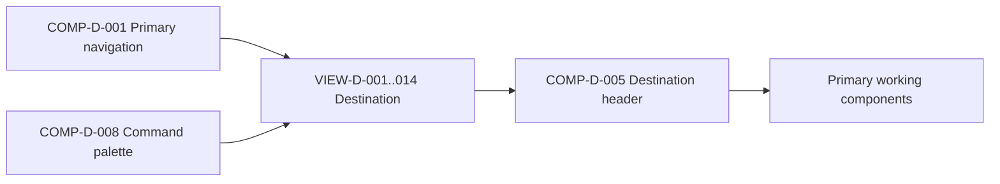

Rules:
- destination changes preserve the current verified/historical context where valid;
- Operate remains unavailable without verified live mutation context;
- keyboard focus moves to the destination heading;
- direct/deep-link navigation must remain possible even if visible navigation becomes grouped.

## FLOW-D-002 · Object selection → inspector → owner

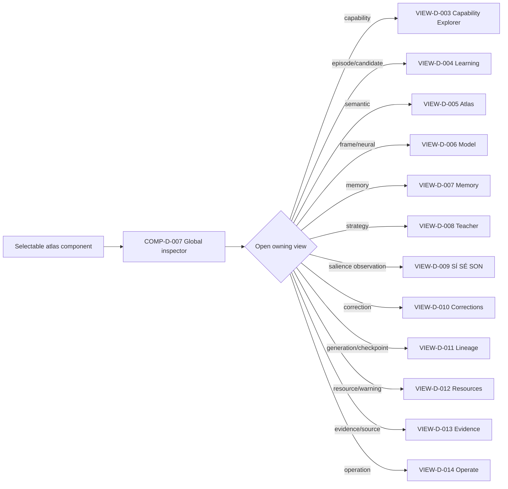

The selected object identity is run + generation + kind + ID. Opening an owner must not silently rebind the object to a different context.

## FLOW-D-003 · Object selection → Evidence → return

Evidence preserves an explicit origin when opened contextually. Return restores the investigation path rather than guessing from object type.

## FLOW-D-004 · Time lens

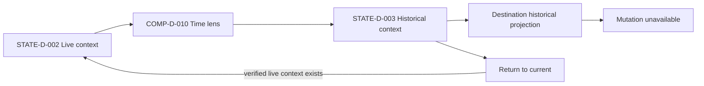

Changing generation makes the context historical and clears/invalidates live-only authority fields until a view obtains exact historical evidence. Returning to current requires a verified live context.

## FLOW-D-005 · Compare

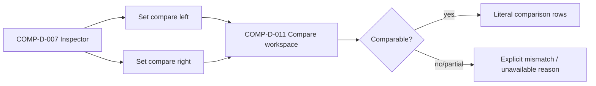

Compare must state differences in run/generation/kind/context. Visual symmetry does not imply semantic equivalence.

## FLOW-D-006 · Pin and reopen exact context

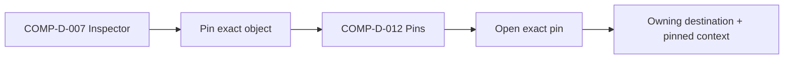

Pins are operator metadata keyed to exact object context. They do not promote evidence or alter learner state.

## FLOW-D-007 · Operator annotation

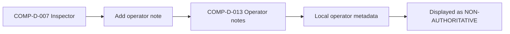

Annotations remain local/non-authoritative and must never acquire source or learned-state styling.

## FLOW-D-008 · School → Capability Explorer

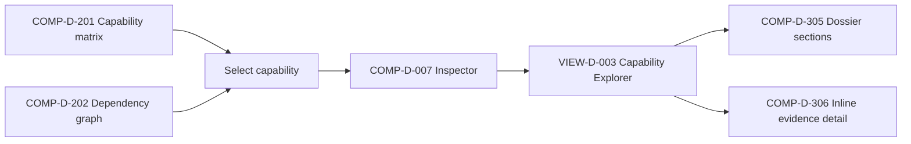

School answers comparative/topological questions. Capability Explorer owns exact longitudinal dossier detail.

## FLOW-D-009 · Learning evidence path

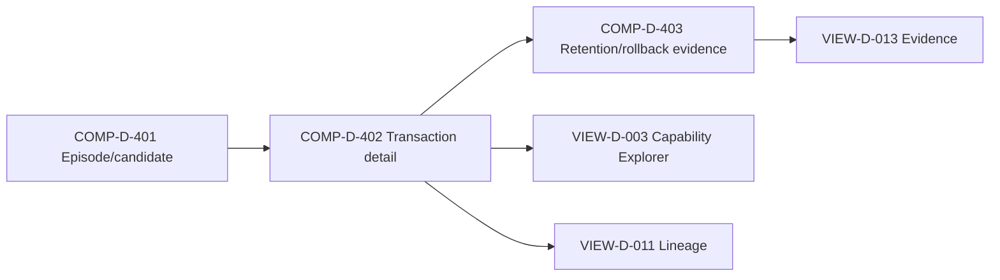

The flow must preserve the difference between an episode, a capability claim, accepted lineage, and raw evidence.

## FLOW-D-010 · Memory relation path

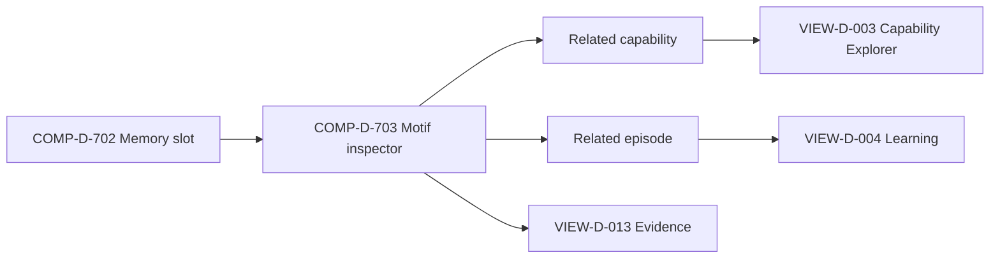

Memory retrieval is operational evidence, not source truth. Navigation may reveal related claims but must not visually collapse the authority boundary.

## FLOW-D-011 · Correction blast-radius investigation

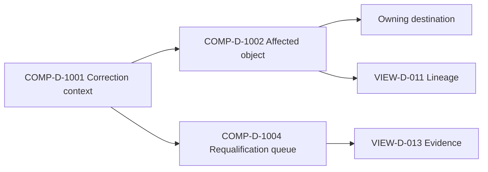

Corrections reveal known exposure and requalification evidence. The UI must not claim perfect neural unlearning.

## FLOW-D-012 · Resource spike investigation

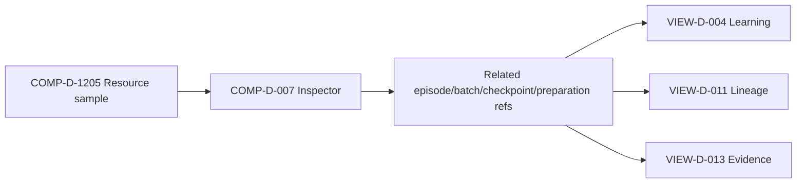

Correlation is literal. The interface must not turn temporal/resource association into a causal explanation.

## FLOW-D-013 · Operate command lifecycle

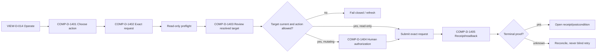

This flow is a safety boundary. Visual simplification may not skip, merge, pre-authorize, or imply completion of any unproven stage.

## FLOW-D-014 · Defensive reconnect

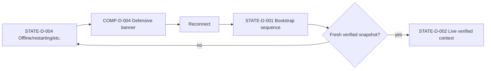

The current view/selection may be retained when safe, but mutation stays unavailable until the fresh snapshot re-establishes command context.

## FLOW-D-015 · Display settings

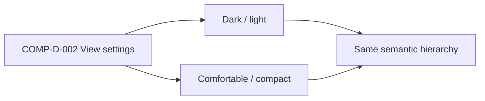

Theme and density may alter visual presentation only. They may not hide a state, change semantic priority, or make a required control inaccessible.

## FLOW-D-016 · Deep link / app URI

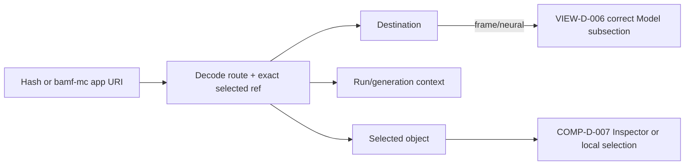

Deep links preserve destination, exact context, and selection. Target UI exposes `Copy deep link` from the global inspector rather than dedicating permanent shell chrome to the URI. The route must not silently discard run/generation identity or route a frame into the wrong Model subsection.

## FLOW-D-017 · Model neural ↔ frame context custody

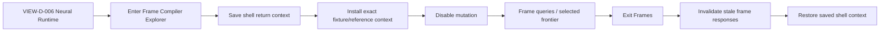

The frame surface is not allowed to borrow the live shell's authority merely because it is visually inside the same destination.

## FLOW-D-018 · Selective live event refresh

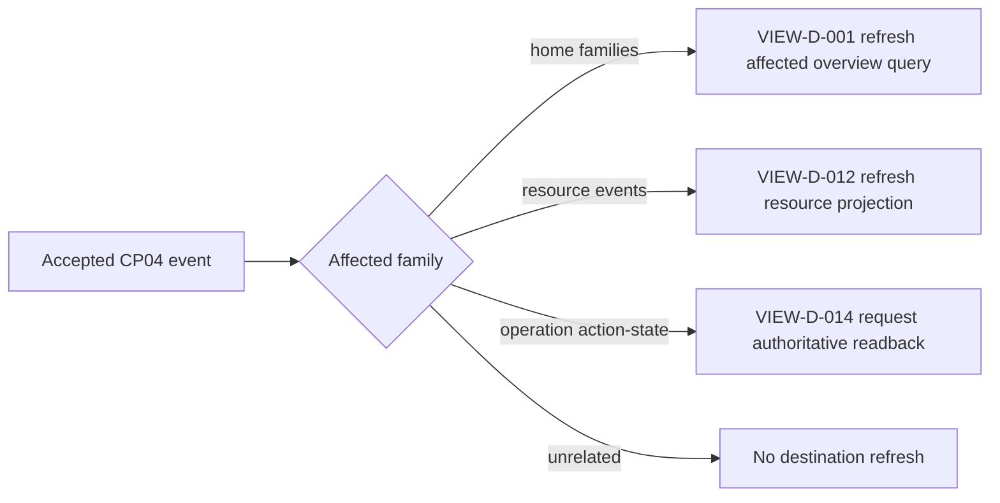

Event delivery is effect plumbing, not a new authority layer. Visual activity indicators must not imply that an event changed semantic truth merely because a view refreshed.
