# Mission Control current-state information atlas

Status: descriptive map of the current implementation, not target-screen approval
Parent authority: GitHub issue #1124
Cross-view relationships: `FLOWS.md`

The atlas deliberately describes composition as a hierarchy. Cross-view navigation, state propagation, selection ownership, evidence return, compare, pinning, and command lifecycles are kept in `FLOWS.md` so this tree does not become spaghetti.

## ID grammar

- `SHELL-D-###`: persistent shell segment
- `VIEW-D-###`: destination
- `COMP-D-###`: component/section inside a shell/view
- `STATE-D-###`: important presentation state

Each component records **information → treatment → interaction → effect**.

The node register is not the visual atlas by itself. The mind map below is the requested composition-first tree. The register that follows supplies exact current-state detail, and the concern matrix at the end supplies the state/authority/accessibility/i18n/test-hook trace for every node.

## Visual mind-map tree

```mermaid
mindmap
  root((Bilqis Mission Control))
    SHELL-D-001 Application shell
      COMP-D-001 Primary navigation
      COMP-D-002 Context bar
      COMP-D-003 Investigation strip
        COMP-D-010 Time lens
        COMP-D-011 Compare workspace
        COMP-D-012 Pins
        COMP-D-013 Annotations
        COMP-D-014 App URI and deep link
      COMP-D-004 Defensive banner
      Workspace
        COMP-D-005 Destination header
        COMP-D-006 Local subnavigation
        VIEW-D-001 Mission Control
          COMP-D-107 Startup state
          COMP-D-101 Learner posture
          COMP-D-102 Learning pulse
          COMP-D-103 Actionable attention
          COMP-D-104 Health strip
          COMP-D-105 Current work
          COMP-D-106 Compact School map
        VIEW-D-002 School
          COMP-D-201 Capability matrix
            COMP-D-207 Matrix controls
          COMP-D-202 Dependency graph
          COMP-D-203 Curriculum semantic atlas
            COMP-D-205 Curriculum controls
            COMP-D-206 Topology and node dossier
            COMP-D-208 Semantic equivalent table
            COMP-D-209 Scale disclosure
          COMP-D-204 Peer subnavigation
        VIEW-D-003 Capability Explorer
          COMP-D-301 Capability identity
          COMP-D-302 Chronology
          COMP-D-303 Source and evidence dossier
          COMP-D-304 Source lens controls
          COMP-D-305 Dossier sections
          COMP-D-306 Inline evidence detail
        VIEW-D-004 Learning
          COMP-D-401 Episode selector
          COMP-D-402 Candidate transaction
          COMP-D-403 Retention rollback evidence
          COMP-D-404 Challenger committed comparison
          COMP-D-405 Lifecycle replay controls
        VIEW-D-005 Atlas
          COMP-D-501 Semantic overview
          COMP-D-502 Semantic selection
          COMP-D-503 Learned similarity
          COMP-D-504 ABI bank map
          COMP-D-505 Exact semantic lookup
        VIEW-D-006 Model
          COMP-D-601 Model local navigation
          COMP-D-602 Neural topology
          COMP-D-603 CCGQA attention AttnRes
          COMP-D-604 Local refinement
          COMP-D-605 Instrumentation coverage
          COMP-D-606 Frame Compiler Explorer
            COMP-D-607 Frame generation and query
            COMP-D-608 Compiled provenance and packing
            COMP-D-609 Prediction frontier
            COMP-D-610 Aggregate packing disclosure
        VIEW-D-007 Memory
          COMP-D-701 Memory summary
          COMP-D-702 Memory atlas pages
          COMP-D-703 Motif inspector
          COMP-D-704 Generation comparison
          COMP-D-705 Rejected candidate boundary
        VIEW-D-008 Teacher
          COMP-D-801 Strategy population
          COMP-D-802 Outcome cost fidelity
          COMP-D-803 Fidelity ladder
          COMP-D-804 Projection boundary
        VIEW-D-009 SI SE SON
          COMP-D-906 As-of snapshot selector
          COMP-D-901 Salience observations
          COMP-D-902 Provenance
          COMP-D-903 Recursive aggregation
          COMP-D-904 Routing rationale
          COMP-D-905 Projection boundary
        VIEW-D-010 Corrections
          COMP-D-1001 Correction history
          COMP-D-1002 Blast-radius graph
          COMP-D-1003 Equivalent impact table
          COMP-D-1004 Requalification state
          COMP-D-1005 Append-only history
        VIEW-D-011 Lineage
          COMP-D-1101 Accepted lineage
          COMP-D-1102 Generation comparison
          COMP-D-1103 Rejected candidate boundary
          COMP-D-1104 Exact generation node
        VIEW-D-012 Resources
          COMP-D-1201 Resource headline
          COMP-D-1202 Metric semantics
          COMP-D-1203 Memory decomposition
          COMP-D-1204 Compute and length
          COMP-D-1205 Timeline and correlation
          COMP-D-1206 Historical comparison
        VIEW-D-013 Evidence
          COMP-D-1301 Query and filter
          COMP-D-1305 Query and degraded state
          COMP-D-1302 Result list
          COMP-D-1306 Traversal and omission status
          COMP-D-1303 Exact record and raw payload
          COMP-D-1304 Return to origin
        VIEW-D-014 Operate
          COMP-D-1401 Action catalog
          COMP-D-1402 Exact request
          COMP-D-1403 Preflight
          COMP-D-1404 Deliberate authorization
          COMP-D-1405 Receipt and reconciliation
      COMP-D-007 Global inspector
      COMP-D-008 Command palette
      COMP-D-009 Fixture provenance boundary
```



## SHELL-D-001 · Application shell

### COMP-D-001 · Primary navigation rail
- Information: Bilqis/Mission Control identity; current destination; fourteen destination actions; command-palette trigger.
- Treatment: persistent left rail with flat destination buttons.
- Interaction: click or roving keyboard navigation; command palette via keyboard shortcut.
- Effect: changes destination while preserving current run/generation context where allowed.
- Concerns: D-003 overload; eventual task/domain grouping; no ambiguous collapsed labels.

### COMP-D-002 · Context bar
- Information: posture, run, generation/manifest, freshness, topology, Factory release, semantic release, optimizer, lease, frontier, resources, coverage, run/time selectors.
- Treatment: persistent top context strip.
- Interaction: run/generation selection where supported; theme and density controls.
- Effect: changes inspected context/display settings.
- Concerns: excessive permanent metadata; operator-significant values must not truncate.

### COMP-D-003 · Global investigation strip
- Information: current/as-of lens plus entry points for compare, pins, annotations, and exact app/deep-link context.
- Treatment: persistent investigation toolbar with deliberately disclosed workspaces.
- Interaction: open one investigation workspace or change the time lens.
- Effect: coordinates the independent investigation subcomponents below.
- Concerns: must not compete visually with primary destination; exact context identity is mandatory.

### COMP-D-010 · Time lens
- Information: current verified context or exact historical generation.
- Treatment: compact generation input/current-context affordance.
- Interaction: choose exact generation; return to verified current when available.
- Effect: changes the global inspected context to historical or current and gates mutation accordingly.

### COMP-D-011 · Compare workspace
- Information: exact left/right stable object refs, comparison state, literal comparison rows and mismatch reasons.
- Treatment: disclosed two-slot comparison workspace plus analytical table.
- Interaction: clear side, populate from inspector, inspect comparison result.
- Effect: compares exact objects without implying equivalence when run/generation/kind differ.

### COMP-D-012 · Pins
- Information: locally stored exact object refs including run, generation, kind, ID and label.
- Treatment: disclosed pin list.
- Interaction: open exact pin; remove pin.
- Effect: returns to the pinned object's exact owning route/context without changing learner state.

### COMP-D-013 · Annotations
- Information: local operator notes attached to exact stable refs and explicitly marked non-authoritative.
- Treatment: note list plus bounded annotation form.
- Interaction: create/read notes for the selected exact object context.
- Effect: persists operator metadata locally without promoting it to evidence/source truth.

### COMP-D-014 · App URI / deep-link affordance
- Information: exact routable object/context identity.
- Treatment: compact exact URI rendered as code subordinate to investigation.
- Interaction: none directly in the current renderer; the URI is exposed for external/manual use.
- Effect: supplies a stable route string that can rehydrate exact destination, context, selection and Model subsection when consumed.

### COMP-D-004 · Defensive-state banner
- Information: current service/telemetry/availability posture and recovery guidance.
- Treatment: conditional status/alert banner with non-color cue.
- Interaction: reconnect where available.
- Effect: communicates boundary-specific failure/recovery and may gate mutation.

### COMP-D-005 · Destination header
- Information: destination eyebrow, title, concise purpose/current interpretation boundary.
- Treatment: top of workspace.
- Interaction: none, except focus target after navigation.
- Effect: establishes task hierarchy and reading context.

### COMP-D-006 · Destination-local subnavigation
- Information: peer modes within a destination, currently Model → Neural Runtime / Frame Compiler Explorer.
- Treatment: tab/segmented-like local controls.
- Interaction: switches peer surface.
- Effect: changes local working surface without changing global destination.

### COMP-D-007 · Global inspector
- Information: selected object kind, identity, posture, generation, exact details, owner/evidence actions.
- Treatment: non-modal side inspection plane.
- Interaction: close, open owner, open evidence, pin, compare left/right, annotate.
- Effect: cross-view navigation and investigation-state changes; focus returns to invoker.

### COMP-D-008 · Command palette
- Information: destination list and availability.
- Treatment: modal dialog.
- Interaction: keyboard open, roving selection, activate/close.
- Effect: fast destination navigation; mutation remains separately gated.

### COMP-D-009 · Fixture provenance boundary
- Information: whether a rich surface is live, historical, reference, or fixture-backed and which context owns it.
- Treatment: local provenance notice/status adjacent to the affected working surface.
- Interaction: usually none; may link to exact evidence where available.
- Effect: prevents checked-in diagnostic richness from being mistaken for live accepted learner telemetry.

### STATE-D-001 · Bootstrap
- Four-stage startup: control plane, learner discovery, Mission Control telemetry, trainer.
- Must not substitute fixtures for missing live telemetry.

### STATE-D-002 · Live verified context
- Fresh snapshot supports ordinary inspection; Operate is available only when mutation context is verified.

### STATE-D-003 · Historical / inspection-only
- Exact prior generation context; mutation disabled.

### STATE-D-004 · Defensive variants
- loading, progressive, empty, stale, partial, offline, denied, revoked, unavailable, incompatible-version, timeout, duplicate-action, session/service restarting, historical unavailable, malformed/unsupported payload, outcome unknown.

### STATE-D-005 · Route / deep-link state
- Destination, exact selected object, run/generation context, and Model subsection where applicable.

### STATE-D-006 · Global selection / inspector state
- Exact selected object plus focus-return origin and inspector-open posture.

### STATE-D-007 · Evidence-return origin state
- The destination/object context from which Evidence was opened, retained for explicit return.

### STATE-D-008 · Investigation state
- Active panel, compare sides, pins, annotations, and exact stable object references.

### STATE-D-009 · Display / focus / fixture-custody state
- Theme, density, focus-return tokens, and temporary fixture/reference context ownership where a surface is not using the live shell context.

## VIEW-D-001 · Mission Control

Purpose: outcome-first learner health, current work, learning pulse, actionable attention.

### COMP-D-107 · Startup state
- Information: accepted generation, optimizer step, trainer running/stopped/unknown, current stage, and whether the first accepted learning event exists.
- Treatment: dedicated startup panel used instead of the normal dashboard when startup projection is present.
- Interaction: no direct action control in the current panel; copy points to Operate or the documented CLI resume path.
- Effect: distinguishes generation-zero-ready, trainer-running/waiting, and accepted-idle/no-events conditions without rendering absent learning telemetry as failure.

### COMP-D-101 · Learner headline / current posture
- Information: accepted learner health and current state.
- Treatment: summary region.
- Interaction: inspect relevant object where exposed.
- Effect: establishes the most important current condition.

### COMP-D-102 · Learning pulse
- Information: recent accepted learning activity and progression signal.
- Treatment: compact trend/summary surface.
- Interaction: inspect/navigate to exact learning evidence.
- Effect: answers whether learning is currently advancing without requiring the operator to enter Learning first.

### COMP-D-103 · Actionable attention
- Information: items requiring operator attention.
- Treatment: prioritized attention list/status.
- Interaction: inspect or navigate.
- Effect: converts overview into next investigation.

### COMP-D-104 · Health strip
- Information: Learning, Curriculum, Runtime, and System health families.
- Treatment: compact status strip using the application-wide status grammar.
- Interaction: none in the current renderer; the four health cards are static summary sections.
- Effect: distinguishes where an issue lives at overview depth.

### COMP-D-105 · Current work
- Information: active candidate/training work and its exact target/context.
- Treatment: concise current-work summary.
- Interaction: none in the current renderer; the current-work details are a static definition list.
- Effect: exposes what the learner is doing now without conflating work-in-progress with retained learning.

### COMP-D-106 · Compact School map
- Information: current curriculum/capability position at overview depth.
- Treatment: reduced School summary rather than a second full matrix.
- Interaction: select/open School or Capability Explorer.
- Effect: provides orientation without duplicating the full School destination.

## VIEW-D-002 · School

Purpose: exact capability comparison and declared prerequisite topology.

### COMP-D-201 · Capability matrix
- Information: capability rows; WAS/TOP/NOW/ALL; debt; retention probability where measured; source/implementation/qualification state.
- Treatment: dense analytical matrix.
- Interaction: select capability; sort/filter where implemented.
- Effect: opens capability in inspector and cross-highlights relationships.

### COMP-D-207 · Matrix controls
- Information: active filters, family grouping, sort key/direction, page position, displayed identity count, and export scope.
- Treatment: filter/group/export control row, sortable column headings, and bounded pagination footer around the matrix.
- Interaction: toggle filters, group by family, sort, page previous/next, export the displayed identities.
- Effect: changes the visible matrix projection or exports that exact projection without changing capability evidence.

### COMP-D-202 · Dependency graph
- Information: prerequisite and dependent relationships.
- Treatment: interactive graph plus accessible equivalent relationship table.
- Interaction: keyboard/pointer selection.
- Effect: changes selected capability and neighborhood.

### COMP-D-203 · Curriculum semantic atlas
- Information: curriculum/semantic relationships supplied by GUI22.
- Treatment: dedicated analytical surface within School.
- Interaction: inspect/select semantic/curriculum objects.
- Effect: bridges curriculum structure and capability context.

### COMP-D-204 · School peer subnavigation
- Information: Capability matrix / Curriculum Semantic Atlas peer modes.
- Treatment: local peer-mode navigation.
- Interaction: switch School mode without leaving the destination.
- Effect: changes the working surface while preserving School context.

### COMP-D-205 · Curriculum search / filter / trace controls
- Information: query/filter controls and trace selection for curriculum-semantic relationships.
- Treatment: compact control cluster local to the curriculum atlas.
- Interaction: search, filter, select trace.
- Effect: narrows the curriculum-semantic working set without mutating learner state.

### COMP-D-206 · Declared topology / node dossier
- Information: selected curriculum/topology node, semantic binding, and declared consequences.
- Treatment: detail/dossier surface adjacent to the atlas.
- Interaction: select node, inspect exact binding/evidence.
- Effect: explains the exact declared relationship behind the visual topology.

### COMP-D-208 · Curriculum semantic equivalent table
- Information: capability, semantic display identity, grade, state, prerequisites, dependents, and evidence for every atlas node.
- Treatment: scrollable tabular equivalent beneath the visual curriculum graph.
- Interaction: select a capability/node from the table.
- Effect: changes the selected curriculum node while providing an equivalent non-graph representation.

### COMP-D-209 · Scale / progressive disclosure
- Information: a 243-row representative School fixture summarized by grade and semantic family, with bounded family and semantic expansion.
- Treatment: collapsed `details` summary with bounded family buttons and selected-node descendant disclosure.
- Interaction: expand the scale section, choose a family, choose a semantic within the bounded expansion.
- Effect: demonstrates how large School scopes are progressively disclosed without rendering all 243 rows as one graph.

## VIEW-D-003 · Capability Explorer

Purpose: measured chronology, source support, literal evidence; no inferred causes.

### COMP-D-301 · Capability identity/header
- Information: exact capability and context.
- Treatment: dossier header/state.
- Interaction: time/context controls where supported.
- Effect: anchors evidence to exact capability.

### COMP-D-302 · Chronology / measurements
- Information: measured progression and events over time.
- Treatment: chronology/table/metric surfaces.
- Interaction: inspect exact evidence.
- Effect: supports temporal comparison without causal synthesis.

### COMP-D-303 · Source/evidence dossier
- Information: source support and literal evidence.
- Treatment: evidence sections/details.
- Interaction: open evidence or related object.
- Effect: moves from capability summary to provenance.

### COMP-D-304 · Source / lens / reload controls
- Information: selected source/lens and reload/query posture.
- Treatment: local control cluster.
- Interaction: change admitted lens or refresh the dossier query.
- Effect: changes what exact capability evidence is being inspected without changing capability identity.

### COMP-D-305 · Dossier sections
- Information: performance, teaching, sources, dependencies, and history sections.
- Treatment: structured dossier sections with progressive disclosure.
- Interaction: navigate/expand section and inspect exact entries.
- Effect: groups evidence by operator question instead of presenting one undifferentiated wall.

### COMP-D-306 · Inline evidence detail / pagination
- Information: selected evidence entry, provenance, related objects, page/cursor state.
- Treatment: bounded inline detail.
- Interaction: paginate and traverse the capability-local evidence records/related objects exposed by the dossier.
- Effect: supports local investigation without losing exact evidence identity.

## VIEW-D-004 · Learning

Purpose: durable candidate transaction replay with retention, rollback, and evidence boundaries.

### COMP-D-401 · Episode/candidate list
- Information: episode/candidate identities and terminal states.
- Treatment: timeline/list/table.
- Interaction: select episode/candidate.
- Effect: updates selection/inspector.

### COMP-D-402 · Candidate transaction narrative
- Information: target capability, parent generation, teaching/assessment/retention phases, terminal outcome.
- Treatment: staged episode detail.
- Interaction: inspect evidence at each stage.
- Effect: explains what happened without converting evidence into unsupported causal claims.

### COMP-D-403 · Retention / rollback evidence
- Information: retention result, reason, rollback boundary, receipts.
- Treatment: state/evidence block.
- Interaction: open exact evidence.
- Effect: traces candidate outcome to durable custody.

### COMP-D-404 · Challenger vs committed comparison
- Information: before/after or challenger/committed state for the candidate transaction.
- Treatment: literal comparison table.
- Interaction: inspect compared values/evidence.
- Effect: shows the measured difference without converting it into a causal story.

### COMP-D-405 · Lifecycle replay stage controls
- Information: the currently inspected candidate stage and available replay stages.
- Treatment: ordered stage navigation.
- Interaction: move between admitted replay stages.
- Effect: repositions the transaction narrative while preserving the same episode/candidate identity.

## VIEW-D-005 · Atlas

Purpose: source-authoritative semantic identity and generation-scoped ABI state; learned similarity is a separate lens.

### COMP-D-501 · Semantic overview
- Information: semantic identities/classes and release-scoped overview.
- Treatment: atlas/table/graph surface.
- Interaction: select semantic object.
- Effect: opens semantic detail and relationships.

### COMP-D-502 · Semantic selection detail
- Information: exact identity, source/ABI relationships, generation context.
- Treatment: detail surface/inspector bridge.
- Interaction: inspect/open related object.
- Effect: preserves source-authoritative semantic navigation.

### COMP-D-503 · Learned-similarity lens
- Information: derived similarity where available.
- Treatment: explicitly separate derived view.
- Interaction: compare/explore.
- Effect: prevents learned geometry from masquerading as semantic identity.

### COMP-D-504 · ABI bank map / row resolver
- Information: bank layout, ABI row identity, and exact row resolution.
- Treatment: structured map/table.
- Interaction: select bank/row and inspect exact identity.
- Effect: connects semantic identity to generation-scoped ABI placement.

### COMP-D-505 · Exact semantic identity lookup
- Information: exact semantic identifier and resolution result.
- Treatment: bounded lookup control plus result.
- Interaction: enter/select identity and resolve.
- Effect: provides direct identity access without requiring graph traversal.

## VIEW-D-006 · Model

Purpose: measured model/runtime mechanisms and exact frame compiler inspection.

### COMP-D-601 · Model local navigation
- Information: Neural Runtime / Frame Compiler Explorer peer surfaces and active subsection.
- Treatment: local peer-mode navigation.
- Interaction: switch between Neural Runtime and Frame Compiler Explorer.
- Effect: changes the Model working surface while preserving/restoring the correct shell or fixture context boundary.

### COMP-D-602 · Neural topology/runtime summary
- Information: topology and measured runtime summary.
- Treatment: diagnostic panels.
- Interaction: inspect evidence.
- Effect: situates mechanism telemetry.

### COMP-D-603 · CCGQA / attention / AttnRes
- Information: routing, attention health, recorded mixture weights where fixture-backed.
- Treatment: diagnostic grids/bars/tables.
- Interaction: inspect recorded evidence.
- Effect: mechanism inspection only; no semantic interpretation upgrade.

### COMP-D-604 · Local refinement
- Information: eligibility, quotas, passes, density, resource cost.
- Treatment: histogram + analytical table.
- Interaction: inspect episode receipt.
- Effect: traces local refinement to evidence.

### COMP-D-605 · Instrumentation coverage
- Information: present/unavailable instrumentation.
- Treatment: coverage list/status.
- Interaction: none/inspect.
- Effect: prevents synthesized absent metrics.

### COMP-D-606 · Frame Compiler Explorer
- Information: exact frame packing/unpacking receipts and causal visibility.
- Treatment: specialized frame surface.
- Interaction: inspect frame/receipt.
- Effect: exposes exact compiler behavior distinct from neural telemetry.

### COMP-D-607 · Frame generation / query status
- Information: frame query context, generation, request status, and selected example/frontier.
- Treatment: query/status header local to the frame surface.
- Interaction: choose fixture generation; after a page loads, choose an exact compiled example and its prediction frontier.
- Effect: establishes exact frame-inspection custody.

### COMP-D-608 · Compiled-example provenance / packing
- Information: exact compiled example, provenance, packing receipts, and constituent visibility.
- Treatment: receipt-oriented analytical detail.
- Interaction: inspect exact packing/provenance entries.
- Effect: explains how the example was compiled without borrowing authority from the live shell.

### COMP-D-609 · Prediction frontier / legality
- Information: frontier positions, constituent legality, and causal visibility.
- Treatment: ordered frontier surface.
- Interaction: select frontier position/constituent.
- Effect: exposes the exact legal prediction context for the selected frame.

### COMP-D-610 · Aggregate packing disclosure
- Information: aggregate packing summary across the selected frame/example.
- Treatment: progressively disclosed summary beneath exact frame evidence.
- Interaction: expand/collapse aggregate detail.
- Effect: provides orientation without replacing receipt-level truth.

## VIEW-D-007 · Memory

Purpose: retained Engram allocation/retrieval/correction state without promoting memory hits to truth/capability authority.

### COMP-D-701 · Memory summary
- Information: capacity/allocation, hits/misses, hit/gate-use rates, footprint, read-site receipts.
- Treatment: metric summary.
- Interaction: none/inspect receipts.
- Effect: establishes operational memory posture.

### COMP-D-702 · Memory atlas pages
- Information: aggregate → page → stable motif allocation.
- Treatment: page controls + slot list.
- Interaction: choose page/slot.
- Effect: changes exact memory selection.

### COMP-D-703 · Motif inspector
- Information: key digest, semantic release, address, eligibility, lifetime use, parameter bank, correction state, source/evidence refs, related capabilities/episodes.
- Treatment: exact detail list.
- Interaction: inspect/open relations through global mechanisms.
- Effect: exposes retained identity and provenance.

### COMP-D-704 · Generation comparison
- Information: created/removed/held/requalified identities and allocation/hit/gate deltas.
- Treatment: comparison controls and delta grid.
- Interaction: choose comparison generation.
- Effect: shows literal memory change.

### COMP-D-705 · Rejected candidate boundary
- Information: proposed identity, parent preservation, lack of committed generation/slot.
- Treatment: proof block.
- Interaction: none.
- Effect: demonstrates that candidate-local allocation is not retained memory.

## VIEW-D-008 · Teacher

Purpose: strategy population, measured outcomes, cost/fidelity observations without unsupported ranking.

### COMP-D-801 · Strategy population
- Information: strategy identity/role/status.
- Treatment: cards/table/list.
- Interaction: select strategy.
- Effect: opens descriptive strategy evidence.

### COMP-D-802 · Outcome/cost/fidelity observations
- Information: attempts, retained/no-gain/interference, resource/fidelity evidence.
- Treatment: comparative analytical surface.
- Interaction: inspect related evidence.
- Effect: supports comparison without policy mutation or winner synthesis.

### COMP-D-803 · Fidelity ladder
- Information: strategy evidence at declared fidelity levels such as 2/4/8/16 where the current Teacher projection provides it.
- Treatment: bounded comparative ladder rather than an implied universal ranking.
- Interaction: select/compare supported strategy evidence.
- Effect: shows measured fidelity evidence at common scope.

### COMP-D-804 · Projection boundary
- Information: what the current Teacher snapshot does and does not establish.
- Treatment: concise local guidance with deeper technical detail behind disclosure.
- Interaction: inspect exact evidence.
- Effect: blocks descriptive strategy telemetry from becoming policy authority.

## VIEW-D-009 · SÍ SÉ SON

Purpose: independent Impact, Exigency, and Osmotic Novelty evidence with reversible aggregation and admitted routing rationale.

### COMP-D-906 · As-of fixture selector
- Information: the available retained salience snapshots and which exact snapshot is selected.
- Treatment: compact toolbar of mutually exclusive as-of fixture buttons.
- Interaction: choose a snapshot.
- Effect: re-renders all SÍ SÉ SON evidence, aggregation, provenance and routing panels against that exact selected snapshot.

### COMP-D-901 · Salience observation set
- Information: exact observations and three independent axes.
- Treatment: salience table/cards/plot.
- Interaction: select observation.
- Effect: opens exact salience detail.

### COMP-D-902 · Provenance
- Information: source/evidence identity for the selected salience observation.
- Treatment: compact provenance affordance with exact detail available.
- Interaction: inspect/open evidence.
- Effect: grounds the three salience axes.

### COMP-D-903 · Recursive aggregation
- Information: observation → cluster → pattern → trend aggregation where present.
- Treatment: progressive hierarchy rather than a single “score.”
- Interaction: expand/select aggregation level.
- Effect: preserves reversibility and scale.

### COMP-D-904 · Routing rationale
- Information: reversible aggregate and admitted rationale.
- Treatment: derived summary separated from source axes.
- Interaction: inspect rationale/evidence.
- Effect: explains routing input without pretending aggregate is source truth.

### COMP-D-905 · Projection boundary
- Information: the limits of the current salience projection.
- Treatment: local helper/disclosure.
- Interaction: inspect evidence.
- Effect: prevents salience telemetry from being read as universal decision authority.

## VIEW-D-010 · Corrections

Purpose: correction blast radius, append-only correction history, receipt-backed requalification without implying perfect neural unlearning.

### COMP-D-1001 · Correction history
- Information: correction records and status.
- Treatment: chronology/list.
- Interaction: select correction.
- Effect: opens correction detail.

### COMP-D-1002 · Blast-radius graph/list
- Information: affected artifact classes and exposure paths.
- Treatment: graph/relationship surface with evidence references.
- Interaction: inspect affected node.
- Effect: traces known exposure.

### COMP-D-1003 · Accessible equivalent impact table
- Information: the same affected relationships required to understand the impact graph.
- Treatment: captioned/tabular equivalent.
- Interaction: select affected artifact.
- Effect: preserves the relationship model without requiring graph perception.

### COMP-D-1004 · Requalification state
- Information: receipts and requalification status.
- Treatment: evidence/status surface.
- Interaction: none in the current renderer; the queue is a static descriptive list.
- Effect: shows what has actually been requalified.

### COMP-D-1005 · Append-only correction history
- Information: correction/source/generation history and prior states.
- Treatment: chronological record.
- Interaction: none in the current renderer; the history is a static ordered record.
- Effect: preserves the record rather than replacing prior assertions in place.

## VIEW-D-011 · Lineage

Purpose: immutable accepted-generation lineage and literal structured generation differences.

### COMP-D-1101 · Accepted-generation lineage
- Information: generation, manifest, parent, transition, checkpoint.
- Treatment: lineage graph/list.
- Interaction: select generation/checkpoint.
- Effect: opens exact custody identity.

### COMP-D-1102 · Generation comparison
- Information: literal structured differences.
- Treatment: diff/comparison surface.
- Interaction: select compared generations.
- Effect: shows change without “winner” synthesis.

### COMP-D-1103 · Rejected-candidate non-lineage boundary
- Information: candidate state that did not become accepted lineage.
- Treatment: explicit non-lineage proof/state.
- Interaction: inspect supporting evidence.
- Effect: prevents rejected candidate activity from appearing as an accepted generation.

### COMP-D-1104 · Exact immutable generation node
- Information: selected accepted generation, manifest, checkpoint, parent and transition identity.
- Treatment: exact node dossier.
- Interaction: inspect evidence or choose as a comparison endpoint.
- Effect: anchors lineage navigation to immutable accepted custody.

## VIEW-D-012 · Resources

Purpose: measured resource budgets, exact historical comparison, and spike correlation.

### COMP-D-1201 · Resource headline
- Information: current budget posture.
- Treatment: primary metrics/status.
- Interaction: none/inspect.
- Effect: establishes current resource condition.

### COMP-D-1202 · Semantics/decomposition
- Information: evidence semantics and resource decomposition where instrumented.
- Treatment: grouped metrics.
- Interaction: inspect.
- Effect: separates measured/estimated/unavailable quantities.

### COMP-D-1203 · Memory decomposition / remainder
- Information: memory quantities that can be decomposed and any explicitly unresolved remainder.
- Treatment: grouped resource decomposition.
- Interaction: inspect supporting sample/evidence.
- Effect: avoids pretending an unexplained total has been causally attributed.

### COMP-D-1204 · Compute/length profile
- Information: CPU/memory/MLX/workers/compile/wall cost plus sequence/frame/batch/length statistics.
- Treatment: metric groups.
- Interaction: inspect.
- Effect: decomposes resource cost.

### COMP-D-1205 · Timeline and spike correlation
- Information: resource samples related to episode/batch/checkpoint/preparation/refinement.
- Treatment: wide analytical table.
- Interaction: select resource sample.
- Effect: opens exact related evidence.

### COMP-D-1206 · Historical comparison
- Information: exact generation metric comparison and deltas.
- Treatment: generation form + comparison table.
- Interaction: load exact generation.
- Effect: read-only historical query; no generation is inferred.

## VIEW-D-013 · Evidence

Purpose: exact Mission Control records, provenance links, bounded pagination, literal raw payloads.

### COMP-D-1301 · Evidence query/filter
- Information: query constraints/context.
- Treatment: bounded search/filter controls.
- Interaction: query/paginate.
- Effect: changes evidence result set.

### COMP-D-1305 · Query / degraded state
- Information: loading, ready, query-unavailable/error, page state, coverage, truncation, returned/total counts, and operator-facing error detail.
- Treatment: live status/alert surface immediately below the search controls.
- Interaction: none directly; state changes as bounded queries start/resolve/fail.
- Effect: exposes query health without converting missing/disconnected evidence into an empty successful result.

### COMP-D-1302 · Evidence result list/table
- Information: record identities/types/provenance.
- Treatment: analytical list/table.
- Interaction: select exact record.
- Effect: opens evidence detail and establishes return origin.

### COMP-D-1306 · Traversal / omission status
- Information: degraded/omission markers from the evidence page plus provenance-link traversal failures.
- Treatment: omission/degraded marker section and explicit traversal alert.
- Interaction: provenance/reference buttons remain available where exact refs are present; failed traversal itself has no synthetic fallback.
- Effect: preserves partial/degraded evidence semantics and keeps unresolved provenance visible instead of silently dropping it.

### COMP-D-1303 · Exact record/raw payload
- Information: literal payload and provenance links.
- Treatment: details/raw view.
- Interaction: follow provenance/related object.
- Effect: forensic inspection; never rewritten into friendlier facts.

### COMP-D-1304 · Return to origin
- Information: originating destination/object where Evidence was opened contextually.
- Treatment: return affordance.
- Interaction: activate return.
- Effect: restores investigation path.

## VIEW-D-014 · Operate

Purpose: command boundary, not another dashboard.

### COMP-D-1401 · Action catalog
- Information: supported actions, mutation/read-only posture.
- Treatment: selectable action set.
- Interaction: choose action.
- Effect: initializes exact request form.

### COMP-D-1402 · Exact request
- Information: parameters and dry-run option.
- Treatment: structured JSON/input panel.
- Interaction: edit parameters; run read-only preflight.
- Effect: asks CP05 to resolve target/consequence without mutation.

### COMP-D-1403 · Preflight
- Information: target ref, run/generation, manifest/topology/factory/semantic/source/admission identities, resource profile, expected postcondition, stale conflicts.
- Treatment: resolved consequence panel.
- Interaction: review only.
- Effect: establishes exact authorization target or blocks stale context.

### COMP-D-1404 · Deliberate authorization
- Information: exact phrase for mutation or read-only execution state.
- Treatment: high-salience human gate.
- Interaction: type exact authorization and submit.
- Effect: dispatches only the reviewed exact target; target drift fails closed.

### COMP-D-1405 · Receipt/readback/reconciliation
- Information: operation ID, receipt state, postcondition/error refs, bounded logs, literal inspection.
- Treatment: lifecycle + receipt actions.
- Interaction: open receipt/postcondition; reconcile unknown outcome.
- Effect: proves outcome or preserves uncertainty without blind retry.

## Concern overlay

Every component above inherits the concern profile for its containing shell/view unless the node text states a stricter rule. This overlay records both **current implementation posture** and **required redesign posture**. It must not be read as claiming that localization/test-hook work already exists: as of the #1124 baseline, human-facing strings remain largely inline and Mission Control has zero implemented `data-test-id` hooks.

| Scope | State concerns | Authority concerns | Accessibility concerns | Required i18n posture | Required test-hook posture |
| --- | --- | --- | --- | --- | --- |
| SHELL-D-001 / COMP-D-001..014 | STATE-D-001..009; route, selection, defensive, investigation, focus/display, fixture custody | Shell may display source/derived/operator-local facts but never upgrades their authority; mutation gating follows verified context | landmarks, skip link, roving navigation, dialog/inert semantics, focus return, live regions, target size, reduced motion/forced colors | all human labels, summaries, help, state explanations and recovery copy tokenized; machine IDs remain data | `shell-*`, `nav-destination-*`, `investigation-*`, `inspector-*`, `palette-*`; exact IDs unique |
| VIEW-D-001 Mission Control / COMP-D-101..107 | live overview query families; startup projection; defensive projection; no historical event refresh | summary only; retained/current work/evidence distinctions remain explicit | heading/focus order, status non-color cues, inspectable summaries keyboard-reachable | all startup/overview questions, labels, health copy, attention guidance | `home-*` |
| VIEW-D-002 School / COMP-D-201..209 | matrix UI, curriculum mode, selected capability/node, filters/sort/page, context-bound async epoch | declared curriculum/topology and measured capability evidence stay distinct | matrix orientation, keyboard graph selection, equivalent relationship table, scale disclosure, scroll discoverability | filters, column labels, explanations, topology/scale guidance | `school-*`, `school-capability-row-*`, `curriculum-*` |
| VIEW-D-003 Capability Explorer / COMP-D-301..306 | selected capability, lens/source, cursor/page, evidence query epoch | measured chronology/source support only; no inferred causes | dossier navigation, bounded pagination, exact-value access, focus on loaded detail | section labels, helper copy, evidence controls | `capability-*`, `capability-evidence-*` |
| VIEW-D-004 Learning / COMP-D-401..405 | selected episode/candidate and replay stage | episode evidence, candidate state, retention/rollback custody remain separate | ordered stage controls, comparison tables, status announcements | stage labels, terminal/retention explanations, comparison labels | `learning-*`, `learning-stage-*` |
| VIEW-D-005 Atlas / COMP-D-501..505 | overview/selection/lens/bank/request epoch | canonical semantic identity is source-authoritative; learned similarity remains derived | graph/table keyboard paths, exact lookup labels, nonvisual relationship access | lens/search/helper text tokenized; semantic IDs remain data | `atlas-*`, `atlas-semantic-*` |
| VIEW-D-006 Model / COMP-D-601..610 | model subsection, neural fixture mode, frame request epoch, saved return context | measured runtime vs fixture-backed diagnostics vs frame receipts remain explicit | peer-mode navigation, tables/progress readable by AT, fixture posture announced | diagnostic labels/help/state copy; raw IDs/receipts remain data | `model-*`, `neural-*`, `frame-*` |
| VIEW-D-007 Memory / COMP-D-701..705 | generation, selected page/slot, compare generation | retrieval telemetry is operational evidence, never semantic/capability authority | page/slot controls, detail lists, comparison semantics, non-color held/rejected cues | labels/help/compare copy tokenized; stable motif IDs remain data | `memory-*`, `memory-slot-*` |
| VIEW-D-008 Teacher / COMP-D-801..804 | strategy selection/comparison scope and fidelity level | descriptive strategy outcomes/cost/fidelity only; no unsupported winner/policy authority | strategy selection, comparison table/ladder reading order, state cues | strategy-role labels, comparison guidance, projection-boundary copy | `teacher-*`, `teacher-strategy-*` |
| VIEW-D-009 SÍ SÉ SON / COMP-D-901..906 | selected as-of snapshot/observation/aggregation level | Impact, Exigency, Osmotic Novelty remain independent; aggregate/routing rationale derived | snapshot selector, axis labels not color-only, aggregation hierarchy navigable, evidence links named | snapshot labels, axis names/explanations/rationale labels tokenized; source IDs remain data | `salience-*`, `salience-observation-*` |
| VIEW-D-010 Corrections / COMP-D-1001..1005 | selected correction/affected artifact/requalification state | known exposure and receipt-backed requalification only; no perfect-unlearning claim | graph has equivalent table, history order explicit, state cues non-color | correction/requalification/history guidance tokenized | `corrections-*`, `correction-artifact-*` |
| VIEW-D-011 Lineage / COMP-D-1101..1104 | selected generation/checkpoint and diff endpoints | accepted immutable lineage only; rejected candidates explicitly excluded | DAG/table equivalence, exact node inspection, diff table orientation | lineage/diff guidance tokenized; hashes/checkpoints remain data | `lineage-*`, `lineage-generation-*` |
| VIEW-D-012 Resources / COMP-D-1201..1206 | current projection, exact comparison generation, resource-only live refresh | measured/derived/estimated/unavailable distinctions preserved; correlation is not causation | metric units/denominators announced, wide tables own overflow, comparison forms labeled | metric labels/units/help/status copy tokenized | `resources-*`, `resource-sample-*` |
| VIEW-D-013 Evidence / COMP-D-1301..1306 | criteria/page/results/selection/raw/traversal/query epoch; degraded/query/traversal failures | literal evidence/provenance is primary; raw payload may stay technical; missing/degraded records remain explicit | search/pagination/detail semantics, live query/traversal status, raw payload readable, explicit return origin | controls, states and explanations tokenized; literal payload/identifiers not translated | `evidence-*`, `evidence-record-*` |
| VIEW-D-014 Operate / COMP-D-1401..1405 | command phase, target conflicts, authorization, operation readback | CP05 exact target/consequence/receipt authority; unknown outcome remains unknown | deliberate gate focus/order, error association, no hidden mutation, receipt/readback announcements | action/help/error/reconciliation copy tokenized; exact target/operation IDs remain data | `operate-*`, `operate-action-*` |

For repeated elements, exact IDs are never duplicated. Repeated rows/nodes use a documented prefix plus a stable identity suffix. Functional `data-*` attributes used by runtime behavior are not substitutes for these test hooks.

## Atlas-derived task groups for later navigation design

These are design hypotheses for decomposition, not authorization to change navigation yet:

1. **Overview & learning**: VIEW-D-001 Mission Control, VIEW-D-002 School, VIEW-D-003 Capability Explorer, VIEW-D-004 Learning.
2. **Representation & mechanisms**: VIEW-D-005 Atlas, VIEW-D-006 Model, VIEW-D-007 Memory.
3. **Decision & correction**: VIEW-D-008 Teacher, VIEW-D-009 SÍ SÉ SON, VIEW-D-010 Corrections.
4. **Provenance & operations**: VIEW-D-011 Lineage, VIEW-D-012 Resources, VIEW-D-013 Evidence, VIEW-D-014 Operate.

Any final grouping must be tested against real operator journeys and must preserve direct command-palette/deep-link access.

## Expanded component treatment / interaction / effect tree

This second visual tree is generated conceptually from the component register above: every mapped component is expanded into its current treatment, interaction, and effect. Long forensic information payloads stay in the register so the visual map remains navigable.

```mermaid
mindmap
  root((Mission Control component treatments))
    Application shell
      COMP-D-001 Primary navigation rail
        Treatment - persistent left rail with flat destination buttons.
        Interaction - click or roving keyboard navigation; command palette via keyboard shortcut.
        Effect - changes destination while preserving current run/generation context where allowed.
      COMP-D-002 Context bar
        Treatment - persistent top context strip.
        Interaction - run/generation selection where supported; theme and density controls.
        Effect - changes inspected context/display settings.
      COMP-D-003 Global investigation strip
        Treatment - persistent investigation toolbar with deliberately disclosed workspaces.
        Interaction - open one investigation workspace or change the time lens.
        Effect - coordinates the independent investigation subcomponents below.
      COMP-D-010 Time lens
        Treatment - compact generation input/current-context affordance.
        Interaction - choose exact generation; return to verified current when available.
        Effect - changes the global inspected context to historical or current and gates mutation accordingly.
      COMP-D-011 Compare workspace
        Treatment - disclosed two-slot comparison workspace plus analytical table.
        Interaction - clear side, populate from inspector, inspect comparison result.
        Effect - compares exact objects without implying equivalence when run/generation/kind differ.
      COMP-D-012 Pins
        Treatment - disclosed pin list.
        Interaction - open exact pin; remove pin.
        Effect - returns to the pinned object's exact owning route/context without changing learner state.
      COMP-D-013 Annotations
        Treatment - note list plus bounded annotation form.
        Interaction - create/read notes for the selected exact object context.
        Effect - persists operator metadata locally without promoting it to evidence/source truth.
      COMP-D-014 App URI / deep-link affordance
        Treatment - compact exact URI rendered as code subordinate to investigation.
        Interaction - none directly in the current renderer; the URI is exposed for external/manual use.
        Effect - supplies a stable route string that can rehydrate exact destination, context, selection and Model subsection when consumed.
      COMP-D-004 Defensive-state banner
        Treatment - conditional status/alert banner with non-color cue.
        Interaction - reconnect where available.
        Effect - communicates boundary-specific failure/recovery and may gate mutation.
      COMP-D-005 Destination header
        Treatment - top of workspace.
        Interaction - none, except focus target after navigation.
        Effect - establishes task hierarchy and reading context.
      COMP-D-006 Destination-local subnavigation
        Treatment - tab/segmented-like local controls.
        Interaction - switches peer surface.
        Effect - changes local working surface without changing global destination.
      COMP-D-007 Global inspector
        Treatment - non-modal side inspection plane.
        Interaction - close, open owner, open evidence, pin, compare left/right, annotate.
        Effect - cross-view navigation and investigation-state changes; focus returns to invoker.
      COMP-D-008 Command palette
        Treatment - modal dialog.
        Interaction - keyboard open, roving selection, activate/close.
        Effect - fast destination navigation; mutation remains separately gated.
      COMP-D-009 Fixture provenance boundary
        Treatment - local provenance notice/status adjacent to the affected working surface.
        Interaction - usually none; may link to exact evidence where available.
        Effect - prevents checked-in diagnostic richness from being mistaken for live accepted learner telemetry.
    VIEW-D-001 Mission Control
      COMP-D-107 Startup state
        Treatment - dedicated startup panel used instead of the normal dashboard when startup projection is present.
        Interaction - no direct action control in the current panel; copy points to Operate or the documented CLI resume path.
        Effect - distinguishes generation-zero-ready, trainer-running/waiting, and accepted-idle/no-events conditions without rendering absent learning telemetry as failure.
      COMP-D-101 Learner headline / current posture
        Treatment - summary region.
        Interaction - inspect relevant object where exposed.
        Effect - establishes the most important current condition.
      COMP-D-102 Learning pulse
        Treatment - compact trend/summary surface.
        Interaction - inspect/navigate to exact learning evidence.
        Effect - answers whether learning is currently advancing without requiring the operator to enter Learning first.
      COMP-D-103 Actionable attention
        Treatment - prioritized attention list/status.
        Interaction - inspect or navigate.
        Effect - converts overview into next investigation.
      COMP-D-104 Health strip
        Treatment - compact status strip using the application-wide status grammar.
        Interaction - none in the current renderer; the four health cards are static summary sections.
        Effect - distinguishes where an issue lives at overview depth.
      COMP-D-105 Current work
        Treatment - concise current-work summary.
        Interaction - none in the current renderer; the current-work details are a static definition list.
        Effect - exposes what the learner is doing now without conflating work-in-progress with retained learning.
      COMP-D-106 Compact School map
        Treatment - reduced School summary rather than a second full matrix.
        Interaction - select/open School or Capability Explorer.
        Effect - provides orientation without duplicating the full School destination.
    VIEW-D-002 School
      COMP-D-201 Capability matrix
        Treatment - dense analytical matrix.
        Interaction - select capability; sort/filter where implemented.
        Effect - opens capability in inspector and cross-highlights relationships.
      COMP-D-207 Matrix controls
        Treatment - filter/group/export control row, sortable column headings, and bounded pagination footer around the matrix.
        Interaction - toggle filters, group by family, sort, page previous/next, export the displayed identities.
        Effect - changes the visible matrix projection or exports that exact projection without changing capability evidence.
      COMP-D-202 Dependency graph
        Treatment - interactive graph plus accessible equivalent relationship table.
        Interaction - keyboard/pointer selection.
        Effect - changes selected capability and neighborhood.
      COMP-D-203 Curriculum semantic atlas
        Treatment - dedicated analytical surface within School.
        Interaction - inspect/select semantic/curriculum objects.
        Effect - bridges curriculum structure and capability context.
      COMP-D-204 School peer subnavigation
        Treatment - local peer-mode navigation.
        Interaction - switch School mode without leaving the destination.
        Effect - changes the working surface while preserving School context.
      COMP-D-205 Curriculum search / filter / trace controls
        Treatment - compact control cluster local to the curriculum atlas.
        Interaction - search, filter, select trace.
        Effect - narrows the curriculum-semantic working set without mutating learner state.
      COMP-D-206 Declared topology / node dossier
        Treatment - detail/dossier surface adjacent to the atlas.
        Interaction - select node, inspect exact binding/evidence.
        Effect - explains the exact declared relationship behind the visual topology.
      COMP-D-208 Curriculum semantic equivalent table
        Treatment - scrollable tabular equivalent beneath the visual curriculum graph.
        Interaction - select a capability/node from the table.
        Effect - changes the selected curriculum node while providing an equivalent non-graph representation.
      COMP-D-209 Scale / progressive disclosure
        Treatment - collapsed details summary with bounded family buttons and selected-node descendant disclosure.
        Interaction - expand the scale section, choose a family, choose a semantic within the bounded expansion.
        Effect - demonstrates how large School scopes are progressively disclosed without rendering all 243 rows as one graph.
    VIEW-D-003 Capability Explorer
      COMP-D-301 Capability identity/header
        Treatment - dossier header/state.
        Interaction - time/context controls where supported.
        Effect - anchors evidence to exact capability.
      COMP-D-302 Chronology / measurements
        Treatment - chronology/table/metric surfaces.
        Interaction - inspect exact evidence.
        Effect - supports temporal comparison without causal synthesis.
      COMP-D-303 Source/evidence dossier
        Treatment - evidence sections/details.
        Interaction - open evidence or related object.
        Effect - moves from capability summary to provenance.
      COMP-D-304 Source / lens / reload controls
        Treatment - local control cluster.
        Interaction - change admitted lens or refresh the dossier query.
        Effect - changes what exact capability evidence is being inspected without changing capability identity.
      COMP-D-305 Dossier sections
        Treatment - structured dossier sections with progressive disclosure.
        Interaction - navigate/expand section and inspect exact entries.
        Effect - groups evidence by operator question instead of presenting one undifferentiated wall.
      COMP-D-306 Inline evidence detail / pagination
        Treatment - bounded inline detail.
        Interaction - paginate and traverse the capability-local evidence records/related objects exposed by the dossier.
        Effect - supports local investigation without losing exact evidence identity.
    VIEW-D-004 Learning
      COMP-D-401 Episode/candidate list
        Treatment - timeline/list/table.
        Interaction - select episode/candidate.
        Effect - updates selection/inspector.
      COMP-D-402 Candidate transaction narrative
        Treatment - staged episode detail.
        Interaction - inspect evidence at each stage.
        Effect - explains what happened without converting evidence into unsupported causal claims.
      COMP-D-403 Retention / rollback evidence
        Treatment - state/evidence block.
        Interaction - open exact evidence.
        Effect - traces candidate outcome to durable custody.
      COMP-D-404 Challenger vs committed comparison
        Treatment - literal comparison table.
        Interaction - inspect compared values/evidence.
        Effect - shows the measured difference without converting it into a causal story.
      COMP-D-405 Lifecycle replay stage controls
        Treatment - ordered stage navigation.
        Interaction - move between admitted replay stages.
        Effect - repositions the transaction narrative while preserving the same episode/candidate identity.
    VIEW-D-005 Atlas
      COMP-D-501 Semantic overview
        Treatment - atlas/table/graph surface.
        Interaction - select semantic object.
        Effect - opens semantic detail and relationships.
      COMP-D-502 Semantic selection detail
        Treatment - detail surface/inspector bridge.
        Interaction - inspect/open related object.
        Effect - preserves source-authoritative semantic navigation.
      COMP-D-503 Learned-similarity lens
        Treatment - explicitly separate derived view.
        Interaction - compare/explore.
        Effect - prevents learned geometry from masquerading as semantic identity.
      COMP-D-504 ABI bank map / row resolver
        Treatment - structured map/table.
        Interaction - select bank/row and inspect exact identity.
        Effect - connects semantic identity to generation-scoped ABI placement.
      COMP-D-505 Exact semantic identity lookup
        Treatment - bounded lookup control plus result.
        Interaction - enter/select identity and resolve.
        Effect - provides direct identity access without requiring graph traversal.
    VIEW-D-006 Model
      COMP-D-601 Model local navigation
        Treatment - local peer-mode navigation.
        Interaction - switch between Neural Runtime and Frame Compiler Explorer.
        Effect - changes the Model working surface while preserving/restoring the correct shell or fixture context boundary.
      COMP-D-602 Neural topology/runtime summary
        Treatment - diagnostic panels.
        Interaction - inspect evidence.
        Effect - situates mechanism telemetry.
      COMP-D-603 CCGQA / attention / AttnRes
        Treatment - diagnostic grids/bars/tables.
        Interaction - inspect recorded evidence.
        Effect - mechanism inspection only; no semantic interpretation upgrade.
      COMP-D-604 Local refinement
        Treatment - histogram + analytical table.
        Interaction - inspect episode receipt.
        Effect - traces local refinement to evidence.
      COMP-D-605 Instrumentation coverage
        Treatment - coverage list/status.
        Interaction - none/inspect.
        Effect - prevents synthesized absent metrics.
      COMP-D-606 Frame Compiler Explorer
        Treatment - specialized frame surface.
        Interaction - inspect frame/receipt.
        Effect - exposes exact compiler behavior distinct from neural telemetry.
      COMP-D-607 Frame generation / query status
        Treatment - query/status header local to the frame surface.
        Interaction - choose fixture generation; after a page loads, choose an exact compiled example and its prediction frontier.
        Effect - establishes exact frame-inspection custody.
      COMP-D-608 Compiled-example provenance / packing
        Treatment - receipt-oriented analytical detail.
        Interaction - inspect exact packing/provenance entries.
        Effect - explains how the example was compiled without borrowing authority from the live shell.
      COMP-D-609 Prediction frontier / legality
        Treatment - ordered frontier surface.
        Interaction - select frontier position/constituent.
        Effect - exposes the exact legal prediction context for the selected frame.
      COMP-D-610 Aggregate packing disclosure
        Treatment - progressively disclosed summary beneath exact frame evidence.
        Interaction - expand/collapse aggregate detail.
        Effect - provides orientation without replacing receipt-level truth.
    VIEW-D-007 Memory
      COMP-D-701 Memory summary
        Treatment - metric summary.
        Interaction - none/inspect receipts.
        Effect - establishes operational memory posture.
      COMP-D-702 Memory atlas pages
        Treatment - page controls + slot list.
        Interaction - choose page/slot.
        Effect - changes exact memory selection.
      COMP-D-703 Motif inspector
        Treatment - exact detail list.
        Interaction - inspect/open relations through global mechanisms.
        Effect - exposes retained identity and provenance.
      COMP-D-704 Generation comparison
        Treatment - comparison controls and delta grid.
        Interaction - choose comparison generation.
        Effect - shows literal memory change.
      COMP-D-705 Rejected candidate boundary
        Treatment - proof block.
        Interaction - none.
        Effect - demonstrates that candidate-local allocation is not retained memory.
    VIEW-D-008 Teacher
      COMP-D-801 Strategy population
        Treatment - cards/table/list.
        Interaction - select strategy.
        Effect - opens descriptive strategy evidence.
      COMP-D-802 Outcome/cost/fidelity observations
        Treatment - comparative analytical surface.
        Interaction - inspect related evidence.
        Effect - supports comparison without policy mutation or winner synthesis.
      COMP-D-803 Fidelity ladder
        Treatment - bounded comparative ladder rather than an implied universal ranking.
        Interaction - select/compare supported strategy evidence.
        Effect - shows measured fidelity evidence at common scope.
      COMP-D-804 Projection boundary
        Treatment - concise local guidance with deeper technical detail behind disclosure.
        Interaction - inspect exact evidence.
        Effect - blocks descriptive strategy telemetry from becoming policy authority.
    VIEW-D-009 SÍ SÉ SON
      COMP-D-906 As-of fixture selector
        Treatment - compact toolbar of mutually exclusive as-of fixture buttons.
        Interaction - choose a snapshot.
        Effect - re-renders all SÍ SÉ SON evidence, aggregation, provenance and routing panels against that exact selected snapshot.
      COMP-D-901 Salience observation set
        Treatment - salience table/cards/plot.
        Interaction - select observation.
        Effect - opens exact salience detail.
      COMP-D-902 Provenance
        Treatment - compact provenance affordance with exact detail available.
        Interaction - inspect/open evidence.
        Effect - grounds the three salience axes.
      COMP-D-903 Recursive aggregation
        Treatment - progressive hierarchy rather than a single “score.”
        Interaction - expand/select aggregation level.
        Effect - preserves reversibility and scale.
      COMP-D-904 Routing rationale
        Treatment - derived summary separated from source axes.
        Interaction - inspect rationale/evidence.
        Effect - explains routing input without pretending aggregate is source truth.
      COMP-D-905 Projection boundary
        Treatment - local helper/disclosure.
        Interaction - inspect evidence.
        Effect - prevents salience telemetry from being read as universal decision authority.
    VIEW-D-010 Corrections
      COMP-D-1001 Correction history
        Treatment - chronology/list.
        Interaction - select correction.
        Effect - opens correction detail.
      COMP-D-1002 Blast-radius graph/list
        Treatment - graph/relationship surface with evidence references.
        Interaction - inspect affected node.
        Effect - traces known exposure.
      COMP-D-1003 Accessible equivalent impact table
        Treatment - captioned/tabular equivalent.
        Interaction - select affected artifact.
        Effect - preserves the relationship model without requiring graph perception.
      COMP-D-1004 Requalification state
        Treatment - evidence/status surface.
        Interaction - none in the current renderer; the queue is a static descriptive list.
        Effect - shows what has actually been requalified.
      COMP-D-1005 Append-only correction history
        Treatment - chronological record.
        Interaction - none in the current renderer; the history is a static ordered record.
        Effect - preserves the record rather than replacing prior assertions in place.
    VIEW-D-011 Lineage
      COMP-D-1101 Accepted-generation lineage
        Treatment - lineage graph/list.
        Interaction - select generation/checkpoint.
        Effect - opens exact custody identity.
      COMP-D-1102 Generation comparison
        Treatment - diff/comparison surface.
        Interaction - select compared generations.
        Effect - shows change without “winner” synthesis.
      COMP-D-1103 Rejected-candidate non-lineage boundary
        Treatment - explicit non-lineage proof/state.
        Interaction - inspect supporting evidence.
        Effect - prevents rejected candidate activity from appearing as an accepted generation.
      COMP-D-1104 Exact immutable generation node
        Treatment - exact node dossier.
        Interaction - inspect evidence or choose as a comparison endpoint.
        Effect - anchors lineage navigation to immutable accepted custody.
    VIEW-D-012 Resources
      COMP-D-1201 Resource headline
        Treatment - primary metrics/status.
        Interaction - none/inspect.
        Effect - establishes current resource condition.
      COMP-D-1202 Semantics/decomposition
        Treatment - grouped metrics.
        Interaction - inspect.
        Effect - separates measured/estimated/unavailable quantities.
      COMP-D-1203 Memory decomposition / remainder
        Treatment - grouped resource decomposition.
        Interaction - inspect supporting sample/evidence.
        Effect - avoids pretending an unexplained total has been causally attributed.
      COMP-D-1204 Compute/length profile
        Treatment - metric groups.
        Interaction - inspect.
        Effect - decomposes resource cost.
      COMP-D-1205 Timeline and spike correlation
        Treatment - wide analytical table.
        Interaction - select resource sample.
        Effect - opens exact related evidence.
      COMP-D-1206 Historical comparison
        Treatment - generation form + comparison table.
        Interaction - load exact generation.
        Effect - read-only historical query; no generation is inferred.
    VIEW-D-013 Evidence
      COMP-D-1301 Evidence query/filter
        Treatment - bounded search/filter controls.
        Interaction - query/paginate.
        Effect - changes evidence result set.
      COMP-D-1305 Query / degraded state
        Treatment - live status/alert surface immediately below the search controls.
        Interaction - none directly; state changes as bounded queries start/resolve/fail.
        Effect - exposes query health without converting missing/disconnected evidence into an empty successful result.
      COMP-D-1302 Evidence result list/table
        Treatment - analytical list/table.
        Interaction - select exact record.
        Effect - opens evidence detail and establishes return origin.
      COMP-D-1306 Traversal / omission status
        Treatment - omission/degraded marker section and explicit traversal alert.
        Interaction - provenance/reference buttons remain available where exact refs are present; failed traversal itself has no synthetic fallback.
        Effect - preserves partial/degraded evidence semantics and keeps unresolved provenance visible instead of silently dropping it.
      COMP-D-1303 Exact record/raw payload
        Treatment - details/raw view.
        Interaction - follow provenance/related object.
        Effect - forensic inspection; never rewritten into friendlier facts.
      COMP-D-1304 Return to origin
        Treatment - return affordance.
        Interaction - activate return.
        Effect - restores investigation path.
    VIEW-D-014 Operate
      COMP-D-1401 Action catalog
        Treatment - selectable action set.
        Interaction - choose action.
        Effect - initializes exact request form.
      COMP-D-1402 Exact request
        Treatment - structured JSON/input panel.
        Interaction - edit parameters; run read-only preflight.
        Effect - asks CP05 to resolve target/consequence without mutation.
      COMP-D-1403 Preflight
        Treatment - resolved consequence panel.
        Interaction - review only.
        Effect - establishes exact authorization target or blocks stale context.
      COMP-D-1404 Deliberate authorization
        Treatment - high-salience human gate.
        Interaction - type exact authorization and submit.
        Effect - dispatches only the reviewed exact target; target drift fails closed.
      COMP-D-1405 Receipt/readback/reconciliation
        Treatment - lifecycle + receipt actions.
        Interaction - open receipt/postcondition; reconcile unknown outcome.
        Effect - proves outcome or preserves uncertainty without blind retry.
```
