# Model Forensics target-state information atlas

Status: proposed target UI anatomy for the Model Forensics redesign
Parent authority: GitHub issue #1124
Current implementation substrate: `CURRENT_STATE_UI_INVENTORY.md`
Cross-view relationships: `FLOWS.md`

## What this atlas is

This atlas specifies **everything we currently intend to show or operate in the redesigned UI**. It is not a DOM inventory and it is not a promise to preserve every current renderer atom. The current implementation is preserved separately as migration evidence in `CURRENT_STATE_UI_INVENTORY.md`.

A target node belongs here only when it earns a place in the redesigned experience: it conveys operator-relevant information, supports an interaction, communicates a meaningful state, provides required accessibility behavior, or creates a necessary transition/effect. Current elements with no target-state purpose are removed rather than memorialized.

Concrete consequence: the current standalone `B` brand mark is **not part of the target UI**. Product identity is conveyed by a quiet textual `Model Forensics` navigation label and the window/application context; the rail does not spend permanent space on an ornamental glyph.

## Diagram convention

- Mermaid diagrams use `flowchart LR`, not `mindmap`, because the atlas must remain readable in ordinary GitHub rendering.
- One diagram covers the shell or one destination. Cross-view relationships stay in `FLOWS.md`.
- Published `COMP-D-*` IDs remain stable where the target retains the concept; dotted IDs identify intended target constituents. There is **no maximum decomposition depth**: a target branch continues for as many levels as the intended UI requires.
- The detailed register beneath each diagram records information, treatment, interaction, effect, and current-substrate disposition. The diagrams themselves are recursively authoritative: if a constituent contains intended child UI, those children appear beneath it rather than being flattened into the parent label.

## Global target states

| ID | Target state | Meaning / UI consequence |
| --- | --- | --- |
| `STATE-D-001` | Bootstrap / no verified context | Services, learner discovery, telemetry or trainer context is not yet verified. The shell shows bounded startup/recovery truth; mutation is unavailable. |
| `STATE-D-002` | Verified live context | Fresh accepted context is available. Normal inspection is live; Operate may become available only if its stricter mutation prerequisites also pass. |
| `STATE-D-003` | Historical inspection | The operator is inspecting an exact prior generation. Historical posture is unmistakable and mutation is unavailable. |
| `STATE-D-004` | Defensive / degraded | Loading, progressive, empty, stale, partial, offline, denied, revoked, unavailable, incompatible-version, timeout, restart, malformed/unsupported payload, historical-unavailable or outcome-unknown conditions use the common defensive grammar without collapsing their meanings. |
| `STATE-D-005` | Selected object / inspector | One exact stable object ref owns the global inspector and related cross-view actions. |
| `STATE-D-006` | Investigation workspace | Compare, pins or notes are open with exact run/generation/kind/ID context. |

## SHELL-D-001 · Application shell

Persistent orientation, navigation, global context, investigation, accessibility and defensive-state infrastructure without stealing attention from the active task.

```mermaid
flowchart LR
  SHELLD001["SHELL-D-001<br/>Application shell"]
  SHELLD001 --> COMPD015["COMP-D-015<br/>Skip-to-main access path"]
  COMPD015 --> COMPD015C1["COMP-D-015.1<br/>Skip link"]
  COMPD015 --> COMPD015C2["COMP-D-015.2<br/>Main-content focus target"]
  SHELLD001 --> COMPD001["COMP-D-001<br/>Primary navigation rail"]
  COMPD001 --> COMPD001C1["COMP-D-001.1<br/>Model Forensics text label"]
  COMPD001 --> COMPD001C2["COMP-D-001.2<br/>Overview & learning group"]
  COMPD001C2 --> NCOMP_D_001_2_1["COMP-D-001.2.1<br/>Model Forensics"]
  COMPD001C2 --> NCOMP_D_001_2_2["COMP-D-001.2.2<br/>School"]
  COMPD001C2 --> NCOMP_D_001_2_3["COMP-D-001.2.3<br/>Capability Explorer"]
  COMPD001C2 --> NCOMP_D_001_2_4["COMP-D-001.2.4<br/>Learning"]
  COMPD001 --> COMPD001C3["COMP-D-001.3<br/>Representation & mechanisms group"]
  COMPD001C3 --> NCOMP_D_001_3_1["COMP-D-001.3.1<br/>Atlas"]
  COMPD001C3 --> NCOMP_D_001_3_2["COMP-D-001.3.2<br/>Model"]
  COMPD001C3 --> NCOMP_D_001_3_3["COMP-D-001.3.3<br/>Memory"]
  COMPD001 --> COMPD001C4["COMP-D-001.4<br/>Decision & correction group"]
  COMPD001C4 --> NCOMP_D_001_4_1["COMP-D-001.4.1<br/>Teacher"]
  COMPD001C4 --> NCOMP_D_001_4_2["COMP-D-001.4.2<br/>SÍ SÉ SON"]
  COMPD001C4 --> NCOMP_D_001_4_3["COMP-D-001.4.3<br/>Corrections"]
  COMPD001 --> COMPD001C5["COMP-D-001.5<br/>Provenance & operations group"]
  COMPD001C5 --> NCOMP_D_001_5_1["COMP-D-001.5.1<br/>Lineage"]
  COMPD001C5 --> NCOMP_D_001_5_2["COMP-D-001.5.2<br/>Resources"]
  COMPD001C5 --> NCOMP_D_001_5_3["COMP-D-001.5.3<br/>Evidence"]
  COMPD001C5 --> NCOMP_D_001_5_4["COMP-D-001.5.4<br/>Operate"]
  COMPD001 --> COMPD001C6["COMP-D-001.6<br/>Command trigger"]
  COMPD001 --> COMPD001C7["COMP-D-001.7<br/>Responsive navigation mode"]
  SHELLD001 --> COMPD002["COMP-D-002<br/>Global context bar"]
  COMPD002 --> COMPD002C1["COMP-D-002.1<br/>Run identity"]
  COMPD002 --> COMPD002C2["COMP-D-002.2<br/>Generation / as-of summary"]
  COMPD002 --> COMPD002C3["COMP-D-002.3<br/>Freshness / connectivity"]
  COMPD002 --> COMPD002C4["COMP-D-002.4<br/>System context disclosure"]
  COMPD002C4 --> NCOMP_D_002_4_1["COMP-D-002.4.1<br/>Topology"]
  COMPD002C4 --> NCOMP_D_002_4_2["COMP-D-002.4.2<br/>Factory release"]
  COMPD002C4 --> NCOMP_D_002_4_3["COMP-D-002.4.3<br/>Semantic release"]
  COMPD002C4 --> NCOMP_D_002_4_4["COMP-D-002.4.4<br/>Optimizer"]
  COMPD002C4 --> NCOMP_D_002_4_5["COMP-D-002.4.5<br/>Admission lease"]
  COMPD002C4 --> NCOMP_D_002_4_6["COMP-D-002.4.6<br/>Correction frontier"]
  COMPD002C4 --> NCOMP_D_002_4_7["COMP-D-002.4.7<br/>Resource health"]
  COMPD002C4 --> NCOMP_D_002_4_8["COMP-D-002.4.8<br/>Coverage"]
  COMPD002 --> COMPD002C5["COMP-D-002.5<br/>View settings"]
  COMPD002C5 --> NCOMP_D_002_5_1["COMP-D-002.5.1<br/>Theme"]
  COMPD002C5 --> NCOMP_D_002_5_2["COMP-D-002.5.2<br/>Density"]
  SHELLD001 --> COMPD003["COMP-D-003<br/>Investigation toolbar"]
  COMPD003 --> COMPD003C1["COMP-D-003.1<br/>Time lens"]
  COMPD003 --> COMPD003C2["COMP-D-003.2<br/>Compare"]
  COMPD003 --> COMPD003C3["COMP-D-003.3<br/>Pins"]
  COMPD003 --> COMPD003C4["COMP-D-003.4<br/>Notes"]
  SHELLD001 --> COMPD010["COMP-D-010<br/>Time lens"]
  COMPD010 --> COMPD010C1["COMP-D-010.1<br/>Current verified context"]
  COMPD010 --> COMPD010C2["COMP-D-010.2<br/>Exact historical generation"]
  COMPD010 --> COMPD010C3["COMP-D-010.3<br/>Return to current"]
  SHELLD001 --> COMPD011["COMP-D-011<br/>Compare workspace"]
  COMPD011 --> COMPD011C1["COMP-D-011.1<br/>Left object"]
  COMPD011 --> COMPD011C2["COMP-D-011.2<br/>Right object"]
  COMPD011 --> COMPD011C3["COMP-D-011.3<br/>Literal comparison"]
  COMPD011C3 --> NCOMP_D_011_3_1["COMP-D-011.3.1<br/>Dimension"]
  COMPD011C3 --> NCOMP_D_011_3_2["COMP-D-011.3.2<br/>Left value"]
  COMPD011C3 --> NCOMP_D_011_3_3["COMP-D-011.3.3<br/>Right value"]
  COMPD011C3 --> NCOMP_D_011_3_4["COMP-D-011.3.4<br/>Comparison state"]
  COMPD011 --> COMPD011C4["COMP-D-011.4<br/>Mismatch / unavailable explanation"]
  SHELLD001 --> COMPD012["COMP-D-012<br/>Pins"]
  COMPD012 --> COMPD012C1["COMP-D-012.1<br/>Pinned exact objects"]
  COMPD012 --> COMPD012C2["COMP-D-012.2<br/>Open"]
  COMPD012 --> COMPD012C3["COMP-D-012.3<br/>Remove"]
  SHELLD001 --> COMPD013["COMP-D-013<br/>Operator notes"]
  COMPD013 --> COMPD013C1["COMP-D-013.1<br/>Exact target"]
  COMPD013 --> COMPD013C2["COMP-D-013.2<br/>Existing notes"]
  COMPD013C2 --> NCOMP_D_013_2_1["COMP-D-013.2.1<br/>Author / timestamp"]
  COMPD013C2 --> NCOMP_D_013_2_2["COMP-D-013.2.2<br/>Exact target identity"]
  COMPD013C2 --> NCOMP_D_013_2_3["COMP-D-013.2.3<br/>Note body"]
  COMPD013 --> COMPD013C3["COMP-D-013.3<br/>New note form"]
  COMPD013C3 --> NCOMP_D_013_3_1["COMP-D-013.3.1<br/>Exact target label"]
  COMPD013C3 --> NCOMP_D_013_3_2["COMP-D-013.3.2<br/>Note body field"]
  COMPD013C3 --> NCOMP_D_013_3_3["COMP-D-013.3.3<br/>Save note action"]
  COMPD013 --> COMPD013C4["COMP-D-013.4<br/>Non-authoritative marker"]
  SHELLD001 --> COMPD004["COMP-D-004<br/>Defensive state banner"]
  COMPD004 --> COMPD004C1["COMP-D-004.1<br/>State label"]
  COMPD004 --> COMPD004C2["COMP-D-004.2<br/>Plain-language explanation"]
  COMPD004 --> COMPD004C3["COMP-D-004.3<br/>Recovery action when possible"]
  SHELLD001 --> COMPD005["COMP-D-005<br/>Destination header"]
  COMPD005 --> COMPD005C1["COMP-D-005.1<br/>Destination title"]
  COMPD005 --> COMPD005C2["COMP-D-005.2<br/>One-line operator purpose"]
  COMPD005 --> COMPD005C3["COMP-D-005.3<br/>Local posture when material"]
  SHELLD001 --> COMPD006["COMP-D-006<br/>Destination-local subnavigation"]
  COMPD006 --> COMPD006C1["COMP-D-006.1<br/>Peer modes only when a destination genuinely has peers"]
  SHELLD001 --> COMPD007["COMP-D-007<br/>Global inspector"]
  COMPD007 --> COMPD007C1["COMP-D-007.1<br/>Exact identity"]
  COMPD007C1 --> NCOMP_D_007_1_1["COMP-D-007.1.1<br/>Run"]
  COMPD007C1 --> NCOMP_D_007_1_2["COMP-D-007.1.2<br/>Generation"]
  COMPD007C1 --> NCOMP_D_007_1_3["COMP-D-007.1.3<br/>Object kind"]
  COMPD007C1 --> NCOMP_D_007_1_4["COMP-D-007.1.4<br/>Exact ID"]
  COMPD007 --> COMPD007C2["COMP-D-007.2<br/>Key facts"]
  COMPD007C2 --> NCOMP_D_007_2_1["COMP-D-007.2.1<br/>Posture"]
  COMPD007C2 --> NCOMP_D_007_2_2["COMP-D-007.2.2<br/>Evidence posture"]
  COMPD007C2 --> NCOMP_D_007_2_3["COMP-D-007.2.3<br/>Owner / source context"]
  COMPD007C2 --> NCOMP_D_007_2_4["COMP-D-007.2.4<br/>Domain-specific facts"]
  COMPD007 --> COMPD007C3["COMP-D-007.3<br/>Owner / Evidence actions"]
  COMPD007C3 --> NCOMP_D_007_3_1["COMP-D-007.3.1<br/>Open owning view"]
  COMPD007C3 --> NCOMP_D_007_3_2["COMP-D-007.3.2<br/>Open Evidence"]
  COMPD007 --> COMPD007C4["COMP-D-007.4<br/>Pin / Compare / Note"]
  COMPD007C4 --> NCOMP_D_007_4_1["COMP-D-007.4.1<br/>Pin / unpin"]
  COMPD007C4 --> NCOMP_D_007_4_2["COMP-D-007.4.2<br/>Set compare left"]
  COMPD007C4 --> NCOMP_D_007_4_3["COMP-D-007.4.3<br/>Set compare right"]
  COMPD007C4 --> NCOMP_D_007_4_4["COMP-D-007.4.4<br/>Add operator note"]
  COMPD007 --> COMPD007C5["COMP-D-007.5<br/>Copy deep link"]
  SHELLD001 --> COMPD008["COMP-D-008<br/>Command palette"]
  COMPD008 --> COMPD008C1["COMP-D-008.1<br/>Grouped destinations"]
  COMPD008C1 --> NCOMP_D_008_1_1["COMP-D-008.1.1<br/>Overview & learning"]
  NCOMP_D_008_1_1 --> NCOMP_D_008_1_1_1["COMP-D-008.1.1.1<br/>Model Forensics"]
  NCOMP_D_008_1_1 --> NCOMP_D_008_1_1_2["COMP-D-008.1.1.2<br/>School"]
  NCOMP_D_008_1_1 --> NCOMP_D_008_1_1_3["COMP-D-008.1.1.3<br/>Capability Explorer"]
  NCOMP_D_008_1_1 --> NCOMP_D_008_1_1_4["COMP-D-008.1.1.4<br/>Learning"]
  COMPD008C1 --> NCOMP_D_008_1_2["COMP-D-008.1.2<br/>Representation & mechanisms"]
  NCOMP_D_008_1_2 --> NCOMP_D_008_1_2_1["COMP-D-008.1.2.1<br/>Atlas"]
  NCOMP_D_008_1_2 --> NCOMP_D_008_1_2_2["COMP-D-008.1.2.2<br/>Model"]
  NCOMP_D_008_1_2 --> NCOMP_D_008_1_2_3["COMP-D-008.1.2.3<br/>Memory"]
  COMPD008C1 --> NCOMP_D_008_1_3["COMP-D-008.1.3<br/>Decision & correction"]
  NCOMP_D_008_1_3 --> NCOMP_D_008_1_3_1["COMP-D-008.1.3.1<br/>Teacher"]
  NCOMP_D_008_1_3 --> NCOMP_D_008_1_3_2["COMP-D-008.1.3.2<br/>SÍ SÉ SON"]
  NCOMP_D_008_1_3 --> NCOMP_D_008_1_3_3["COMP-D-008.1.3.3<br/>Corrections"]
  COMPD008C1 --> NCOMP_D_008_1_4["COMP-D-008.1.4<br/>Provenance & operations"]
  NCOMP_D_008_1_4 --> NCOMP_D_008_1_4_1["COMP-D-008.1.4.1<br/>Lineage"]
  NCOMP_D_008_1_4 --> NCOMP_D_008_1_4_2["COMP-D-008.1.4.2<br/>Resources"]
  NCOMP_D_008_1_4 --> NCOMP_D_008_1_4_3["COMP-D-008.1.4.3<br/>Evidence"]
  NCOMP_D_008_1_4 --> NCOMP_D_008_1_4_4["COMP-D-008.1.4.4<br/>Operate"]
  COMPD008 --> COMPD008C2["COMP-D-008.2<br/>Available global commands"]
  COMPD008 --> COMPD008C3["COMP-D-008.3<br/>Availability state"]
  SHELLD001 --> COMPD016["COMP-D-016<br/>Polite live announcer"]
  COMPD016 --> COMPD016C1["COMP-D-016.1<br/>Navigation changes"]
  COMPD016 --> COMPD016C2["COMP-D-016.2<br/>Selection changes"]
  COMPD016 --> COMPD016C3["COMP-D-016.3<br/>Recovery / validation messages"]
```

### Target component register

#### COMP-D-015 · Skip-to-main access path
- **Target constituents:** `COMP-D-015.1` Skip link; `COMP-D-015.2` Main-content focus target
- **Information shown:** Keyboard bypass route past persistent chrome.
- **Treatment:** Visually hidden until focused.
- **Interaction:** Activate the skip link.
- **Effect:** Moves focus directly to the active destination workspace.
- **Current substrate / disposition:** Retain CUR-COMP-015; simplify naming only.

#### COMP-D-001 · Primary navigation rail
- **Target constituents:** `COMP-D-001.1` Model Forensics text label; `COMP-D-001.2` Overview & learning group; `COMP-D-001.3` Representation & mechanisms group; `COMP-D-001.4` Decision & correction group; `COMP-D-001.5` Provenance & operations group; `COMP-D-001.6` Command trigger; `COMP-D-001.7` Responsive navigation mode
- **Information shown:** Grouped access to all fourteen destinations and the command palette. No standalone logo glyph.
- **Treatment:** Quiet fixed rail; textual identity only; selected destination visible without a giant filled block.
- **Interaction:** Navigate by pointer/keyboard; Command trigger opens palette.
- **Effect:** Changes destination while preserving valid context; moves focus to destination title.
- **Current substrate / disposition:** Transform CUR-COMP-001. Remove current `B` mark; regroup destinations; replace ambiguous initial-only responsive state.

#### COMP-D-002 · Global context bar
- **Target constituents:** `COMP-D-002.1` Run identity; `COMP-D-002.2` Generation / as-of summary; `COMP-D-002.3` Freshness / connectivity; `COMP-D-002.4` System context disclosure; `COMP-D-002.5` View settings
- **Information shown:** Only context useful across destinations by default; secondary topology/Factory/semantic/optimizer/lease/frontier/resource/coverage facts behind disclosure.
- **Treatment:** Single compact horizontal band; secondary facts in an accessible disclosure/popover; no empty phantom columns.
- **Interaction:** Open system-context disclosure; open view settings. Historical generation changes occur through the time lens, not a duplicate selector.
- **Effect:** Orients every destination without consuming the task surface.
- **Current substrate / disposition:** Transform CUR-COMP-002. Remove permanently disabled run selector; move secondary facts behind disclosure.

#### COMP-D-003 · Investigation toolbar
- **Target constituents:** `COMP-D-003.1` Time lens; `COMP-D-003.2` Compare; `COMP-D-003.3` Pins; `COMP-D-003.4` Notes
- **Information shown:** Compact entry points for cross-view investigation state.
- **Treatment:** Subordinate toolbar, collapsed to terse controls/counts until opened.
- **Interaction:** Open one investigation workspace; change exact time lens.
- **Effect:** Changes inspection context or local investigation metadata without changing learner authority.
- **Current substrate / disposition:** Transform CUR-COMP-003; deep-link creation moves to Inspector actions.

#### COMP-D-010 · Time lens
- **Target constituents:** `COMP-D-010.1` Current verified context; `COMP-D-010.2` Exact historical generation; `COMP-D-010.3` Return to current
- **Information shown:** Current versus exact historical generation context.
- **Treatment:** Compact control with unmistakable live/historical posture.
- **Interaction:** Choose exact generation or return to verified current.
- **Effect:** Rehydrates historical projection and disables mutation until current verified context returns.
- **Current substrate / disposition:** Retain CUR-COMP-010; remove duplicate generation control from context bar.

#### COMP-D-011 · Compare workspace
- **Target constituents:** `COMP-D-011.1` Left object; `COMP-D-011.2` Right object; `COMP-D-011.3` Literal comparison; `COMP-D-011.4` Mismatch / unavailable explanation
- **Information shown:** Two exact stable object refs and their comparable dimensions.
- **Treatment:** Disclosed two-column comparison surface.
- **Interaction:** Populate from inspector; clear either side.
- **Effect:** Shows literal differences while explicitly refusing false equivalence.
- **Current substrate / disposition:** Retain CUR-COMP-011; keep result rows static.

#### COMP-D-012 · Pins
- **Target constituents:** `COMP-D-012.1` Pinned exact objects; `COMP-D-012.2` Open; `COMP-D-012.3` Remove
- **Information shown:** Locally saved exact object refs with run/generation/kind/ID identity.
- **Treatment:** Compact disclosed list with strong context labels.
- **Interaction:** Open exact pin; remove pin.
- **Effect:** Returns to exact pinned context without modifying learner state.
- **Current substrate / disposition:** Retain CUR-COMP-012.

#### COMP-D-013 · Operator notes
- **Target constituents:** `COMP-D-013.1` Exact target; `COMP-D-013.2` Existing notes; `COMP-D-013.3` New note form; `COMP-D-013.4` Non-authoritative marker
- **Information shown:** Local operator annotations attached to exact object context.
- **Treatment:** Disclosed note workspace; explicit local/non-authoritative treatment.
- **Interaction:** Create/read notes.
- **Effect:** Persists local metadata without promoting it to evidence.
- **Current substrate / disposition:** Retain CUR-COMP-013; make authority marker visually quiet but unmissable.

#### COMP-D-004 · Defensive state banner
- **Target constituents:** `COMP-D-004.1` State label; `COMP-D-004.2` Plain-language explanation; `COMP-D-004.3` Recovery action when possible
- **Information shown:** Only the active shell/service defensive condition.
- **Treatment:** One application-wide status grammar; no stripes/gradients/wallpaper.
- **Interaction:** Reconnect/retry only where authoritative and safe.
- **Effect:** Explains the failing boundary and blocks unsafe actions without implying learner failure.
- **Current substrate / disposition:** Transform CUR-COMP-004; preserve state distinctions, replace repeating-pattern treatment.

#### COMP-D-005 · Destination header
- **Target constituents:** `COMP-D-005.1` Destination title; `COMP-D-005.2` One-line operator purpose; `COMP-D-005.3` Local posture when material
- **Information shown:** Where the operator is and what this destination is for.
- **Treatment:** Compact title block; no hero typography and no long implementation-forward summary in the primary path.
- **Interaction:** Normally none.
- **Effect:** Establishes immediate reading hierarchy.
- **Current substrate / disposition:** Transform CUR-COMP-005.

#### COMP-D-006 · Destination-local subnavigation
- **Target constituents:** `COMP-D-006.1` Peer modes only when a destination genuinely has peers
- **Information shown:** Peer working surfaces such as Model → Neural Runtime / Frame Compiler Explorer.
- **Treatment:** Compact segmented/tab treatment.
- **Interaction:** Switch peer mode.
- **Effect:** Changes the local working surface without changing global destination.
- **Current substrate / disposition:** Retain CUR-COMP-006; do not create local nav where a destination has only one task.

#### COMP-D-007 · Global inspector
- **Target constituents:** `COMP-D-007.1` Exact identity; `COMP-D-007.2` Key facts; `COMP-D-007.3` Owner / Evidence actions; `COMP-D-007.4` Pin / Compare / Note; `COMP-D-007.5` Copy deep link
- **Information shown:** Selected-object detail and investigation actions.
- **Treatment:** Independent side plane; summary first, forensic fields below; exact values available without making every view forensic.
- **Interaction:** Close; open owner/evidence; pin; compare; annotate; copy deep link.
- **Effect:** Provides a consistent summary→detail→forensics path with focus return.
- **Current substrate / disposition:** Transform CUR-COMP-007; absorb current app-URI/deep-link display from CUR-COMP-014.

#### COMP-D-008 · Command palette
- **Target constituents:** `COMP-D-008.1` Grouped destinations; `COMP-D-008.2` Available global commands; `COMP-D-008.3` Availability state
- **Information shown:** Fast keyboard navigation and global commands.
- **Treatment:** Modal command list grouped by the target IA.
- **Interaction:** Open with Cmd/Ctrl+K; keyboard select; close.
- **Effect:** Navigates without requiring the rail and preserves mutation gating.
- **Current substrate / disposition:** Transform CUR-COMP-008.

#### COMP-D-016 · Polite live announcer
- **Target constituents:** `COMP-D-016.1` Navigation changes; `COMP-D-016.2` Selection changes; `COMP-D-016.3` Recovery / validation messages
- **Information shown:** Screen-reader-only transient updates.
- **Treatment:** Nonvisual `aria-live="polite"` region.
- **Interaction:** No direct user control.
- **Effect:** Announces meaningful state changes without stealing focus.
- **Current substrate / disposition:** Retain CUR-COMP-016.

#### Removed current-state shell substrate
- **CUR-COMP-009 · Fixture provenance boundary:** Remove from the production shell. The redesign leaves carry their own explicit fixture/reference posture where a fixture remains part of a destination. The scientific visual-language catalog remains test/reference material, not a permanent application surface.
- **CUR-COMP-014 · App URI / deep-link affordance:** Merge into `COMP-D-007 · Global inspector`, as specified above. Exact deep-link construction and hydration remain functional behavior, but no separate permanent shell surface survives.

## VIEW-D-001 · Model Forensics

Answer, at a glance: Is it running? Is it learning? Is it regressing, blocked, or invalid? What is it doing now, and what needs my attention?

```mermaid
flowchart LR
  VIEWD001["VIEW-D-001<br/>Model Forensics"]
  VIEWD001 --> COMPD107["COMP-D-107<br/>Startup / no-learning state"]
  COMPD107 --> COMPD107C1["COMP-D-107.1<br/>Accepted generation"]
  COMPD107 --> COMPD107C2["COMP-D-107.2<br/>Optimizer step"]
  COMPD107 --> COMPD107C3["COMP-D-107.3<br/>Trainer posture"]
  COMPD107 --> COMPD107C4["COMP-D-107.4<br/>Current stage"]
  COMPD107 --> COMPD107C5["COMP-D-107.5<br/>Next useful action"]
  VIEWD001 --> COMPD101["COMP-D-101<br/>Learner status summary"]
  COMPD101 --> COMPD101C1["COMP-D-101.1<br/>Running"]
  COMPD101 --> COMPD101C2["COMP-D-101.2<br/>Learning"]
  COMPD101 --> COMPD101C3["COMP-D-101.3<br/>Regression"]
  COMPD101 --> COMPD101C4["COMP-D-101.4<br/>Blocked"]
  COMPD101 --> COMPD101C5["COMP-D-101.5<br/>Invalidity"]
  VIEWD001 --> COMPD102["COMP-D-102<br/>Current work"]
  COMPD102 --> COMPD102C1["COMP-D-102.1<br/>Target capability"]
  COMPD102 --> COMPD102C2["COMP-D-102.2<br/>Strategy"]
  COMPD102 --> COMPD102C3["COMP-D-102.3<br/>Candidate intent"]
  COMPD102 --> COMPD102C4["COMP-D-102.4<br/>Source family"]
  COMPD102 --> COMPD102C5["COMP-D-102.5<br/>Assessment posture"]
  VIEWD001 --> COMPD103["COMP-D-103<br/>Actionable attention"]
  COMPD103 --> COMPD103C1["COMP-D-103.1<br/>Prioritized concerns"]
  COMPD103C1 --> NCOMP_D_103_1_1["COMP-D-103.1.1<br/>Concern item"]
  NCOMP_D_103_1_1 --> NCOMP_D_103_1_1_1["COMP-D-103.1.1.1<br/>Kind"]
  NCOMP_D_103_1_1 --> NCOMP_D_103_1_1_2["COMP-D-103.1.1.2<br/>Reason"]
  NCOMP_D_103_1_1 --> NCOMP_D_103_1_1_3["COMP-D-103.1.1.3<br/>Owning object"]
  NCOMP_D_103_1_1 --> NCOMP_D_103_1_1_4["COMP-D-103.1.1.4<br/>Open action"]
  COMPD103 --> COMPD103C2["COMP-D-103.2<br/>Kind"]
  COMPD103 --> COMPD103C3["COMP-D-103.3<br/>Reason"]
  COMPD103 --> COMPD103C4["COMP-D-103.4<br/>Owning object"]
  VIEWD001 --> COMPD104["COMP-D-104<br/>Learning pulse"]
  COMPD104 --> COMPD104C1["COMP-D-104.1<br/>Recent accepted/rejected events"]
  COMPD104C1 --> NCOMP_D_104_1_1["COMP-D-104.1.1<br/>Learning event"]
  NCOMP_D_104_1_1 --> NCOMP_D_104_1_1_1["COMP-D-104.1.1.1<br/>Accepted / rejected state"]
  NCOMP_D_104_1_1 --> NCOMP_D_104_1_1_2["COMP-D-104.1.1.2<br/>Timestamp"]
  NCOMP_D_104_1_1 --> NCOMP_D_104_1_1_3["COMP-D-104.1.1.3<br/>Short outcome"]
  NCOMP_D_104_1_1 --> NCOMP_D_104_1_1_4["COMP-D-104.1.1.4<br/>Exact object link"]
  COMPD104 --> COMPD104C2["COMP-D-104.2<br/>Timestamp"]
  COMPD104 --> COMPD104C3["COMP-D-104.3<br/>Short outcome"]
  COMPD104 --> COMPD104C4["COMP-D-104.4<br/>Exact object link"]
  COMPD104 --> COMPD104C5["COMP-D-104.5<br/>Learning direction microtrend<br/>(conditional)"]
  VIEWD001 --> COMPD105["COMP-D-105<br/>School snapshot"]
  COMPD105 --> COMPD105C1["COMP-D-105.1<br/>Capability"]
  COMPD105C1 --> NCOMP_D_105_1_1["COMP-D-105.1.1<br/>Capability row"]
  NCOMP_D_105_1_1 --> NCOMP_D_105_1_1_1["COMP-D-105.1.1.1<br/>Capability identity"]
  NCOMP_D_105_1_1 --> NCOMP_D_105_1_1_2["COMP-D-105.1.1.2<br/>Now"]
  NCOMP_D_105_1_1 --> NCOMP_D_105_1_1_3["COMP-D-105.1.1.3<br/>Best"]
  NCOMP_D_105_1_1 --> NCOMP_D_105_1_1_4["COMP-D-105.1.1.4<br/>Delta"]
  NCOMP_D_105_1_1 --> NCOMP_D_105_1_1_5["COMP-D-105.1.1.5<br/>Debt"]
  NCOMP_D_105_1_1 --> NCOMP_D_105_1_1_6["COMP-D-105.1.1.6<br/>Retention"]
  NCOMP_D_105_1_1 --> NCOMP_D_105_1_1_7["COMP-D-105.1.1.7<br/>Status"]
  COMPD105 --> COMPD105C2["COMP-D-105.2<br/>Now"]
  COMPD105 --> COMPD105C3["COMP-D-105.3<br/>Best"]
  COMPD105 --> COMPD105C4["COMP-D-105.4<br/>Delta"]
  COMPD105 --> COMPD105C5["COMP-D-105.5<br/>Debt"]
  COMPD105 --> COMPD105C6["COMP-D-105.6<br/>Retention"]
  COMPD105 --> COMPD105C7["COMP-D-105.7<br/>Status"]
  VIEWD001 --> COMPD106["COMP-D-106<br/>Health details disclosure"]
  COMPD106 --> COMPD106C1["COMP-D-106.1<br/>Learning health"]
  COMPD106C1 --> NCOMP_D_106_1_1["COMP-D-106.1.1<br/>Latest school score"]
  COMPD106C1 --> NCOMP_D_106_1_2["COMP-D-106.1.2<br/>Best school score"]
  COMPD106C1 --> NCOMP_D_106_1_3["COMP-D-106.1.3<br/>Whole-school growth"]
  COMPD106C1 --> NCOMP_D_106_1_4["COMP-D-106.1.4<br/>G-RTN"]
  COMPD106C1 --> NCOMP_D_106_1_5["COMP-D-106.1.5<br/>P-RET"]
  COMPD106C1 --> NCOMP_D_106_1_6["COMP-D-106.1.6<br/>Retained optimizer steps"]
  COMPD106C1 --> NCOMP_D_106_1_7["COMP-D-106.1.7<br/>Capability state"]
  COMPD106 --> COMPD106C2["COMP-D-106.2<br/>Curriculum health"]
  COMPD106C2 --> NCOMP_D_106_2_1["COMP-D-106.2.1<br/>Qualified capabilities"]
  COMPD106C2 --> NCOMP_D_106_2_2["COMP-D-106.2.2<br/>Observed debt"]
  COMPD106C2 --> NCOMP_D_106_2_3["COMP-D-106.2.3<br/>Active concepts"]
  COMPD106C2 --> NCOMP_D_106_2_4["COMP-D-106.2.4<br/>Ready"]
  COMPD106C2 --> NCOMP_D_106_2_5["COMP-D-106.2.5<br/>Held"]
  COMPD106C2 --> NCOMP_D_106_2_6["COMP-D-106.2.6<br/>Implementation uncovered"]
  COMPD106C2 --> NCOMP_D_106_2_7["COMP-D-106.2.7<br/>School state"]
  COMPD106 --> COMPD106C3["COMP-D-106.3<br/>Runtime health"]
  COMPD106C3 --> NCOMP_D_106_3_1["COMP-D-106.3.1<br/>Elapsed"]
  COMPD106C3 --> NCOMP_D_106_3_2["COMP-D-106.3.2<br/>Visits"]
  COMPD106C3 --> NCOMP_D_106_3_3["COMP-D-106.3.3<br/>Visit rate"]
  COMPD106C3 --> NCOMP_D_106_3_4["COMP-D-106.3.4<br/>Retained candidates"]
  COMPD106C3 --> NCOMP_D_106_3_5["COMP-D-106.3.5<br/>Rejected candidates"]
  COMPD106C3 --> NCOMP_D_106_3_6["COMP-D-106.3.6<br/>Accepted steps / hour"]
  COMPD106C3 --> NCOMP_D_106_3_7["COMP-D-106.3.7<br/>Run state"]
  COMPD106 --> COMPD106C4["COMP-D-106.4<br/>System health"]
  COMPD106C4 --> NCOMP_D_106_4_1["COMP-D-106.4.1<br/>Unified memory pressure"]
  COMPD106C4 --> NCOMP_D_106_4_2["COMP-D-106.4.2<br/>Peak memory"]
  COMPD106C4 --> NCOMP_D_106_4_3["COMP-D-106.4.3<br/>Disk reserve"]
  COMPD106C4 --> NCOMP_D_106_4_4["COMP-D-106.4.4<br/>Correction / requalification debt"]
  COMPD106C4 --> NCOMP_D_106_4_5["COMP-D-106.4.5<br/>Hard warnings"]
  COMPD106C4 --> NCOMP_D_106_4_6["COMP-D-106.4.6<br/>Resource state"]
```

### Target component register

#### COMP-D-107 · Startup / no-learning state
- **Target constituents:** `COMP-D-107.1` Accepted generation; `COMP-D-107.2` Optimizer step; `COMP-D-107.3` Trainer posture; `COMP-D-107.4` Current stage; `COMP-D-107.5` Next useful action
- **Information shown:** Startup truth before normal learning telemetry exists.
- **Treatment:** Purpose-built replacement state, not an empty dashboard.
- **Interaction:** No inline mutation; link/navigate to Operate when action is appropriate.
- **Effect:** Prevents absence of learning telemetry from looking like failure.
- **Current substrate / disposition:** Transform CUR-COMP-107.

#### COMP-D-101 · Learner status summary
- **Target constituents:** `COMP-D-101.1` Running; `COMP-D-101.2` Learning; `COMP-D-101.3` Regression; `COMP-D-101.4` Blocked; `COMP-D-101.5` Invalidity
- **Information shown:** Five operator questions expressed as concise current states.
- **Treatment:** Single compact summary band, not five unrelated cards. Semantic emphasis may strengthen for regression/block/invalidity, but the band remains one compositional unit.
- **Interaction:** Inspect only when a state has an exact owning object.
- **Effect:** Gives two-second orientation.
- **Current substrate / disposition:** Transform CUR-COMP-101 and parts of CUR-COMP-104.

#### COMP-D-102 · Current work
- **Target constituents:** `COMP-D-102.1` Target capability; `COMP-D-102.2` Strategy; `COMP-D-102.3` Candidate intent; `COMP-D-102.4` Source family; `COMP-D-102.5` Assessment posture
- **Information shown:** What the learner is doing now.
- **Treatment:** One focused current-work block.
- **Interaction:** Inspect current episode/candidate when exact identity exists.
- **Effect:** Bridges overview to Learning without conflating in-progress work with retained learning.
- **Current substrate / disposition:** Transform CUR-COMP-105.

#### COMP-D-103 · Actionable attention
- **Target constituents:** `COMP-D-103.1` Prioritized concerns; `COMP-D-103.2` Kind; `COMP-D-103.3` Reason; `COMP-D-103.4` Owning object
- **Information shown:** Only conditions that deserve operator attention.
- **Treatment:** Priority-ordered concise list; quiet empty state. When regression, invalidity, or a hard blocker is present, this region becomes visually dominant over Current Work through order, width, tonal separation, or heading emphasis.
- **Interaction:** Open exact owning object/view.
- **Effect:** Turns overview into next investigation.
- **Current substrate / disposition:** Retain/transform CUR-COMP-103.

#### COMP-D-104 · Learning pulse
- **Target constituents:** `COMP-D-104.1` Recent accepted/rejected events; `COMP-D-104.2` Timestamp; `COMP-D-104.3` Short outcome; `COMP-D-104.4` Exact object link; `COMP-D-104.5` conditional learning-direction microtrend
- **Information shown:** Recent learning activity and progress.
- **Treatment:** Compact chronology, not decorative metric cards. A tiny direction sparkline may accompany the chronology only when the samples are genuinely comparable, its scope is explicit, and exact values remain accessible.
- **Interaction:** Inspect exact event/episode/capability.
- **Effect:** Shows whether learning is advancing and what changed recently.
- **Current substrate / disposition:** Transform CUR-COMP-102.

#### COMP-D-105 · School snapshot
- **Target constituents:** `COMP-D-105.1` Capability; `COMP-D-105.2` Now; `COMP-D-105.3` Best; `COMP-D-105.4` Delta; `COMP-D-105.5` Debt; `COMP-D-105.6` Retention; `COMP-D-105.7` Status
- **Information shown:** Small current capability sample for orientation.
- **Treatment:** Compact analytical table with direct capability drill-through.
- **Interaction:** Open Capability Explorer for selected row.
- **Effect:** Provides curriculum orientation without duplicating School.
- **Current substrate / disposition:** Retain CUR-COMP-106.

#### COMP-D-106 · Health details disclosure
- **Target constituents:** `COMP-D-106.1` Learning health; `COMP-D-106.2` Curriculum health; `COMP-D-106.3` Runtime health; `COMP-D-106.4` System health
- **Information shown:** Supporting health metrics that do not deserve permanent top-level cards.
- **Treatment:** Collapsed by default; four grouped metric families inside disclosure.
- **Interaction:** Expand/collapse; inspect exact owning evidence only where available.
- **Effect:** Keeps useful diagnostics available without overwhelming the overview.
- **Current substrate / disposition:** Transform current CUR-COMP-104 card wall into progressive detail.

## VIEW-D-002 · School

Compare capability state, understand declared dependencies, and inspect curriculum-semantic structure without losing orientation.

```mermaid
flowchart LR
  VIEWD002["VIEW-D-002<br/>School"]
  VIEWD002 --> COMPD204["COMP-D-204<br/>School mode switch"]
  COMPD204 --> COMPD204C1["COMP-D-204.1<br/>Capability matrix"]
  COMPD204 --> COMPD204C2["COMP-D-204.2<br/>Curriculum semantic atlas"]
  VIEWD002 --> COMPD207["COMP-D-207<br/>Matrix controls"]
  COMPD207 --> COMPD207C1["COMP-D-207.1<br/>Filters"]
  COMPD207C1 --> NCOMP_D_207_1_1["COMP-D-207.1.1<br/>Lifecycle / state filters"]
  COMPD207C1 --> NCOMP_D_207_1_2["COMP-D-207.1.2<br/>Family filter"]
  COMPD207C1 --> NCOMP_D_207_1_3["COMP-D-207.1.3<br/>Source / implementation filter"]
  COMPD207C1 --> NCOMP_D_207_1_4["COMP-D-207.1.4<br/>Qualification filter"]
  COMPD207 --> COMPD207C2["COMP-D-207.2<br/>Group by family"]
  COMPD207 --> COMPD207C3["COMP-D-207.3<br/>Column disclosure"]
  COMPD207 --> COMPD207C4["COMP-D-207.4<br/>Export displayed scope"]
  VIEWD002 --> COMPD201["COMP-D-201<br/>Capability matrix"]
  COMPD201 --> COMPD201C1["COMP-D-201.1<br/>Sticky capability identity"]
  COMPD201 --> COMPD201C2["COMP-D-201.2<br/>WAS / TOP / NOW / ALL"]
  COMPD201 --> COMPD201C3["COMP-D-201.3<br/>Growth / debt / retention"]
  COMPD201 --> COMPD201C4["COMP-D-201.4<br/>Source / implementation / qualification"]
  COMPD201 --> COMPD201C5["COMP-D-201.5<br/>Pagination"]
  VIEWD002 --> COMPD202["COMP-D-202<br/>Declared dependency view"]
  COMPD202 --> COMPD202C1["COMP-D-202.1<br/>Graph"]
  COMPD202C1 --> NCOMP_D_202_1_1["COMP-D-202.1.1<br/>Capability nodes"]
  NCOMP_D_202_1_1 --> NCOMP_D_202_1_1_1["COMP-D-202.1.1.1<br/>Capability identity"]
  NCOMP_D_202_1_1 --> NCOMP_D_202_1_1_2["COMP-D-202.1.1.2<br/>Lifecycle / eligibility"]
  NCOMP_D_202_1_1 --> NCOMP_D_202_1_1_3["COMP-D-202.1.1.3<br/>Mastery / debt"]
  COMPD202C1 --> NCOMP_D_202_1_2["COMP-D-202.1.2<br/>Prerequisite / dependent edges"]
  COMPD202 --> COMPD202C2["COMP-D-202.2<br/>Equivalent relationship table"]
  COMPD202C2 --> NCOMP_D_202_2_1["COMP-D-202.2.1<br/>Relationship row"]
  NCOMP_D_202_2_1 --> NCOMP_D_202_2_1_1["COMP-D-202.2.1.1<br/>From capability"]
  NCOMP_D_202_2_1 --> NCOMP_D_202_2_1_2["COMP-D-202.2.1.2<br/>Relation"]
  NCOMP_D_202_2_1 --> NCOMP_D_202_2_1_3["COMP-D-202.2.1.3<br/>To capability"]
  COMPD202 --> COMPD202C3["COMP-D-202.3<br/>Legend / keyboard guidance"]
  VIEWD002 --> COMPD205["COMP-D-205<br/>Curriculum atlas controls"]
  COMPD205 --> COMPD205C1["COMP-D-205.1<br/>Search"]
  COMPD205 --> COMPD205C2["COMP-D-205.2<br/>Jump to active"]
  COMPD205 --> COMPD205C3["COMP-D-205.3<br/>Trace mode"]
  COMPD205 --> COMPD205C4["COMP-D-205.4<br/>Grade / state / family filters"]
  COMPD205C4 --> NCOMP_D_205_4_1["COMP-D-205.4.1<br/>Grade"]
  COMPD205C4 --> NCOMP_D_205_4_2["COMP-D-205.4.2<br/>State"]
  COMPD205C4 --> NCOMP_D_205_4_3["COMP-D-205.4.3<br/>Family"]
  COMPD205C4 --> NCOMP_D_205_4_4["COMP-D-205.4.4<br/>Attention"]
  COMPD205C4 --> NCOMP_D_205_4_5["COMP-D-205.4.5<br/>New only"]
  COMPD205 --> COMPD205C5["COMP-D-205.5<br/>Reset"]
  VIEWD002 --> COMPD203["COMP-D-203<br/>Curriculum semantic atlas"]
  COMPD203 --> COMPD203C1["COMP-D-203.1<br/>Grade strata"]
  COMPD203 --> COMPD203C2["COMP-D-203.2<br/>Declared prerequisite edges"]
  COMPD203 --> COMPD203C3["COMP-D-203.3<br/>Capability nodes"]
  COMPD203C3 --> NCOMP_D_203_3_1["COMP-D-203.3.1<br/>Capability node"]
  NCOMP_D_203_3_1 --> NCOMP_D_203_3_1_1["COMP-D-203.3.1.1<br/>Capability identity"]
  NCOMP_D_203_3_1 --> NCOMP_D_203_3_1_2["COMP-D-203.3.1.2<br/>Semantic identity"]
  NCOMP_D_203_3_1 --> NCOMP_D_203_3_1_3["COMP-D-203.3.1.3<br/>Grade"]
  NCOMP_D_203_3_1 --> NCOMP_D_203_3_1_4["COMP-D-203.3.1.4<br/>Lifecycle / qualification"]
  NCOMP_D_203_3_1 --> NCOMP_D_203_3_1_5["COMP-D-203.3.1.5<br/>Now / top / debt"]
  NCOMP_D_203_3_1 --> NCOMP_D_203_3_1_6["COMP-D-203.3.1.6<br/>Blocker state"]
  COMPD203 --> COMPD203C4["COMP-D-203.4<br/>Semantic identity / state / debt"]
  VIEWD002 --> COMPD208["COMP-D-208<br/>Curriculum semantic equivalent table"]
  COMPD208 --> COMPD208C1["COMP-D-208.1<br/>Capability / semantic identity"]
  COMPD208C1 --> NCOMP_D_208_1_1["COMP-D-208.1.1<br/>Relationship row"]
  NCOMP_D_208_1_1 --> NCOMP_D_208_1_1_1["COMP-D-208.1.1.1<br/>Capability"]
  NCOMP_D_208_1_1 --> NCOMP_D_208_1_1_2["COMP-D-208.1.1.2<br/>Semantic identity"]
  NCOMP_D_208_1_1 --> NCOMP_D_208_1_1_3["COMP-D-208.1.1.3<br/>Grade / state"]
  NCOMP_D_208_1_1 --> NCOMP_D_208_1_1_4["COMP-D-208.1.1.4<br/>Prerequisites"]
  NCOMP_D_208_1_1 --> NCOMP_D_208_1_1_5["COMP-D-208.1.1.5<br/>Dependents"]
  NCOMP_D_208_1_1 --> NCOMP_D_208_1_1_6["COMP-D-208.1.1.6<br/>Evidence"]
  COMPD208 --> COMPD208C2["COMP-D-208.2<br/>Grade / state"]
  COMPD208 --> COMPD208C3["COMP-D-208.3<br/>Prerequisites / dependents"]
  COMPD208 --> COMPD208C4["COMP-D-208.4<br/>Evidence"]
  VIEWD002 --> COMPD206["COMP-D-206<br/>Selected curriculum node dossier"]
  COMPD206 --> COMPD206C1["COMP-D-206.1<br/>Identity"]
  COMPD206 --> COMPD206C2["COMP-D-206.2<br/>Semantic binding"]
  COMPD206 --> COMPD206C3["COMP-D-206.3<br/>Grade / lifecycle / qualification"]
  COMPD206 --> COMPD206C4["COMP-D-206.4<br/>Now / top / debt"]
  COMPD206 --> COMPD206C5["COMP-D-206.5<br/>Blocker reason"]
  COMPD206 --> COMPD206C6["COMP-D-206.6<br/>Recent evidence"]
  COMPD206C6 --> NCOMP_D_206_6_1["COMP-D-206.6.1<br/>Recent event"]
  NCOMP_D_206_6_1 --> NCOMP_D_206_6_1_1["COMP-D-206.6.1.1<br/>Generation / time"]
  NCOMP_D_206_6_1 --> NCOMP_D_206_6_1_2["COMP-D-206.6.1.2<br/>State / outcome"]
  NCOMP_D_206_6_1 --> NCOMP_D_206_6_1_3["COMP-D-206.6.1.3<br/>Evidence ref"]
  COMPD206 --> COMPD206C7["COMP-D-206.7<br/>Cross-view actions"]
  COMPD206C7 --> NCOMP_D_206_7_1["COMP-D-206.7.1<br/>Open Capability Explorer"]
  COMPD206C7 --> NCOMP_D_206_7_2["COMP-D-206.7.2<br/>Open Atlas"]
  COMPD206C7 --> NCOMP_D_206_7_3["COMP-D-206.7.3<br/>Open Evidence"]
  COMPD206C7 --> NCOMP_D_206_7_4["COMP-D-206.7.4<br/>Open Lineage"]
  VIEWD002 --> COMPD209["COMP-D-209<br/>Scale disclosure"]
  COMPD209 --> COMPD209C1["COMP-D-209.1<br/>Grade/family summary"]
  COMPD209C1 --> NCOMP_D_209_1_1["COMP-D-209.1.1<br/>Grade summary"]
  COMPD209C1 --> NCOMP_D_209_1_2["COMP-D-209.1.2<br/>Family summary"]
  COMPD209 --> COMPD209C2["COMP-D-209.2<br/>Bounded family expansion"]
  COMPD209 --> COMPD209C3["COMP-D-209.3<br/>Selected semantic prerequisites/dependents"]
```

### Target component register

#### COMP-D-204 · School mode switch
- **Target constituents:** `COMP-D-204.1` Capability matrix; `COMP-D-204.2` Curriculum semantic atlas
- **Information shown:** Two peer analytical tasks.
- **Treatment:** Compact local subnavigation.
- **Interaction:** Switch mode.
- **Effect:** Preserves School context while changing working surface.
- **Current substrate / disposition:** Retain CUR-COMP-204.

#### COMP-D-207 · Matrix controls
- **Target constituents:** `COMP-D-207.1` Filters; `COMP-D-207.2` Group by family; `COMP-D-207.3` Column disclosure; `COMP-D-207.4` Export displayed scope
- **Information shown:** Controls that shape the capability matrix. Sort remains in column headers; pagination remains adjacent to the table.
- **Treatment:** One compact toolbar; secondary columns opt-in where useful.
- **Interaction:** Filter/group/disclose/export.
- **Effect:** Changes displayed projection without changing evidence.
- **Current substrate / disposition:** Transform CUR-COMP-207; reduce simultaneous-column overload.

#### COMP-D-201 · Capability matrix
- **Target constituents:** `COMP-D-201.1` Sticky capability identity; `COMP-D-201.2` WAS / TOP / NOW / ALL; `COMP-D-201.3` Growth / debt / retention; `COMP-D-201.4` Source / implementation / qualification; `COMP-D-201.5` Pagination
- **Information shown:** Exact comparative capability state.
- **Treatment:** Wide analytical table with sticky identity column/header and obvious local horizontal overflow.
- **Interaction:** Select capability; sort; page.
- **Effect:** Opens exact capability context while preserving comparison orientation.
- **Current substrate / disposition:** Transform CUR-COMP-201.

#### COMP-D-202 · Declared dependency view
- **Target constituents:** `COMP-D-202.1` Graph; `COMP-D-202.2` Equivalent relationship table; `COMP-D-202.3` Legend / keyboard guidance
- **Information shown:** Prerequisite/dependent topology.
- **Treatment:** Graph and accessible equivalent table as peer representations, not graph-plus-afterthought.
- **Interaction:** Select capability via pointer/keyboard/table.
- **Effect:** Changes selected capability and neighborhood.
- **Current substrate / disposition:** Transform CUR-COMP-202.

#### COMP-D-205 · Curriculum atlas controls
- **Target constituents:** `COMP-D-205.1` Search; `COMP-D-205.2` Jump to active; `COMP-D-205.3` Trace mode; `COMP-D-205.4` Grade / state / family filters; `COMP-D-205.5` Reset
- **Information shown:** Controls for the semantic curriculum surface.
- **Treatment:** Compact toolbar above curriculum visualization.
- **Interaction:** Search/filter/change trace/reset.
- **Effect:** Narrows/focuses the curriculum working set.
- **Current substrate / disposition:** Retain CUR-COMP-205.

#### COMP-D-203 · Curriculum semantic atlas
- **Target constituents:** `COMP-D-203.1` Grade strata; `COMP-D-203.2` Declared prerequisite edges; `COMP-D-203.3` Capability nodes; `COMP-D-203.4` Semantic identity / state / debt
- **Information shown:** Curriculum topology and semantic binding.
- **Treatment:** Structured graph with bounded visible scope and strong orientation.
- **Interaction:** Select node.
- **Effect:** Updates selected-node dossier and trace.
- **Current substrate / disposition:** Transform CUR-COMP-203.

#### COMP-D-208 · Curriculum semantic equivalent table
- **Target constituents:** `COMP-D-208.1` Capability / semantic identity; `COMP-D-208.2` Grade / state; `COMP-D-208.3` Prerequisites / dependents; `COMP-D-208.4` Evidence
- **Information shown:** Capability / semantic identity, grade / lifecycle state, prerequisites, dependents, and exact evidence posture for the same curriculum relationships represented visually.
- **Treatment:** Captioned analytical table adjacent to or directly below the graph, with the same current filters/selection.
- **Interaction:** Select the same curriculum node through a non-graph path.
- **Effect:** Provides an equivalent accessible representation and keeps graph comprehension nonessential.
- **Current substrate / disposition:** Retain and simplify CUR-COMP-208.

#### COMP-D-206 · Selected curriculum node dossier
- **Target constituents:** `COMP-D-206.1` Identity; `COMP-D-206.2` Semantic binding; `COMP-D-206.3` Grade / lifecycle / qualification; `COMP-D-206.4` Now / top / debt; `COMP-D-206.5` Blocker reason; `COMP-D-206.6` Recent evidence; `COMP-D-206.7` Cross-view actions
- **Information shown:** Exact selected-node detail.
- **Treatment:** Adjacent dossier; progressive detail for history/downstream consequences.
- **Interaction:** Open Capability / Atlas / Evidence / Lineage where exact links exist.
- **Effect:** Explains the selected node without cluttering every graph node.
- **Current substrate / disposition:** Transform CUR-COMP-206.

#### COMP-D-209 · Scale disclosure
- **Target constituents:** `COMP-D-209.1` Grade/family summary; `COMP-D-209.2` Bounded family expansion; `COMP-D-209.3` Selected semantic prerequisites/dependents
- **Information shown:** Large-scope curriculum summary beyond the currently visible graph.
- **Treatment:** Collapsed summary with bounded expansion.
- **Interaction:** Expand family/semantic scope.
- **Effect:** Makes large curriculum scale inspectable without rendering hundreds of nodes at once.
- **Current substrate / disposition:** Retain CUR-COMP-209.

## VIEW-D-003 · Capability Explorer

Give one capability an exact longitudinal dossier: identity, current state, measured history, source support, dependencies and literal evidence, without inferred causality.

```mermaid
flowchart LR
  VIEWD003["VIEW-D-003<br/>Capability Explorer"]
  VIEWD003 --> COMPD304["COMP-D-304<br/>Dossier lens controls"]
  COMPD304 --> COMPD304C1["COMP-D-304.1<br/>Exact capability"]
  COMPD304 --> COMPD304C2["COMP-D-304.2<br/>Run / generation as-of"]
  COMPD304 --> COMPD304C3["COMP-D-304.3<br/>Admitted source lens"]
  COMPD304 --> COMPD304C4["COMP-D-304.4<br/>Reload"]
  VIEWD003 --> COMPD301["COMP-D-301<br/>Capability identity header"]
  COMPD301 --> COMPD301C1["COMP-D-301.1<br/>Capability name / ID"]
  COMPD301 --> COMPD301C2["COMP-D-301.2<br/>Current posture"]
  COMPD301 --> COMPD301C3["COMP-D-301.3<br/>Qualification / source posture"]
  COMPD301 --> COMPD301C4["COMP-D-301.4<br/>Provenance context"]
  VIEWD003 --> COMPD302["COMP-D-302<br/>Capability metric summary"]
  COMPD302 --> COMPD302C1["COMP-D-302.1<br/>NOW"]
  COMPD302 --> COMPD302C2["COMP-D-302.2<br/>TOP"]
  COMPD302 --> COMPD302C3["COMP-D-302.3<br/>Total"]
  COMPD302 --> COMPD302C4["COMP-D-302.4<br/>Debt"]
  COMPD302 --> COMPD302C5["COMP-D-302.5<br/>Retention"]
  COMPD302 --> COMPD302C6["COMP-D-302.6<br/>Eligibility"]
  COMPD302 --> COMPD302C7["COMP-D-302.7<br/>Qualification"]
  COMPD302 --> COMPD302C8["COMP-D-302.8<br/>Source"]
  VIEWD003 --> COMPD305["COMP-D-305<br/>Dossier sections"]
  COMPD305 --> COMPD305C1["COMP-D-305.1<br/>Performance"]
  COMPD305C1 --> NCOMP_D_305_1_1["COMP-D-305.1.1<br/>Measured performance entries"]
  NCOMP_D_305_1_1 --> NCOMP_D_305_1_1_1["COMP-D-305.1.1.1<br/>Kind / label"]
  NCOMP_D_305_1_1 --> NCOMP_D_305_1_1_2["COMP-D-305.1.1.2<br/>Generation / time"]
  NCOMP_D_305_1_1 --> NCOMP_D_305_1_1_3["COMP-D-305.1.1.3<br/>Facts"]
  NCOMP_D_305_1_1 --> NCOMP_D_305_1_1_4["COMP-D-305.1.1.4<br/>Evidence / related object actions"]
  COMPD305 --> COMPD305C2["COMP-D-305.2<br/>Teaching"]
  COMPD305C2 --> NCOMP_D_305_2_1["COMP-D-305.2.1<br/>Teaching entries"]
  NCOMP_D_305_2_1 --> NCOMP_D_305_2_1_1["COMP-D-305.2.1.1<br/>Strategy / source"]
  NCOMP_D_305_2_1 --> NCOMP_D_305_2_1_2["COMP-D-305.2.1.2<br/>Outcome facts"]
  NCOMP_D_305_2_1 --> NCOMP_D_305_2_1_3["COMP-D-305.2.1.3<br/>Evidence / related object actions"]
  COMPD305 --> COMPD305C3["COMP-D-305.3<br/>Sources"]
  COMPD305C3 --> NCOMP_D_305_3_1["COMP-D-305.3.1<br/>Source entries"]
  NCOMP_D_305_3_1 --> NCOMP_D_305_3_1_1["COMP-D-305.3.1.1<br/>Source identity"]
  NCOMP_D_305_3_1 --> NCOMP_D_305_3_1_2["COMP-D-305.3.1.2<br/>Authority / admission posture"]
  NCOMP_D_305_3_1 --> NCOMP_D_305_3_1_3["COMP-D-305.3.1.3<br/>Evidence actions"]
  COMPD305 --> COMPD305C4["COMP-D-305.4<br/>Dependencies"]
  COMPD305C4 --> NCOMP_D_305_4_1["COMP-D-305.4.1<br/>Dependency entries"]
  NCOMP_D_305_4_1 --> NCOMP_D_305_4_1_1["COMP-D-305.4.1.1<br/>Relation"]
  NCOMP_D_305_4_1 --> NCOMP_D_305_4_1_2["COMP-D-305.4.1.2<br/>Related capability"]
  NCOMP_D_305_4_1 --> NCOMP_D_305_4_1_3["COMP-D-305.4.1.3<br/>Evidence actions"]
  COMPD305 --> COMPD305C5["COMP-D-305.5<br/>History"]
  COMPD305C5 --> NCOMP_D_305_5_1["COMP-D-305.5.1<br/>History entries"]
  NCOMP_D_305_5_1 --> NCOMP_D_305_5_1_1["COMP-D-305.5.1.1<br/>Generation / time"]
  NCOMP_D_305_5_1 --> NCOMP_D_305_5_1_2["COMP-D-305.5.1.2<br/>Event / state"]
  NCOMP_D_305_5_1 --> NCOMP_D_305_5_1_3["COMP-D-305.5.1.3<br/>Evidence actions"]
  VIEWD003 --> COMPD306["COMP-D-306<br/>Inline evidence detail"]
  COMPD306 --> COMPD306C1["COMP-D-306.1<br/>Selected evidence identity"]
  COMPD306C1 --> NCOMP_D_306_1_1["COMP-D-306.1.1<br/>Record ID"]
  COMPD306C1 --> NCOMP_D_306_1_2["COMP-D-306.1.2<br/>Record type"]
  COMPD306C1 --> NCOMP_D_306_1_3["COMP-D-306.1.3<br/>Query / coverage state"]
  COMPD306 --> COMPD306C2["COMP-D-306.2<br/>Literal detail"]
  COMPD306 --> COMPD306C3["COMP-D-306.3<br/>Related objects"]
  COMPD306C3 --> NCOMP_D_306_3_1["COMP-D-306.3.1<br/>Related record"]
  NCOMP_D_306_3_1 --> NCOMP_D_306_3_1_1["COMP-D-306.3.1.1<br/>Record identity"]
  NCOMP_D_306_3_1 --> NCOMP_D_306_3_1_2["COMP-D-306.3.1.2<br/>Relation"]
  NCOMP_D_306_3_1 --> NCOMP_D_306_3_1_3["COMP-D-306.3.1.3<br/>Open action"]
  COMPD306 --> COMPD306C4["COMP-D-306.4<br/>Pagination / bounded continuation"]
```

### Target component register

#### COMP-D-304 · Dossier lens controls
- **Target constituents:** `COMP-D-304.1` Exact capability; `COMP-D-304.2` Run / generation as-of; `COMP-D-304.3` Admitted source lens; `COMP-D-304.4` Reload
- **Information shown:** Exact dossier query/context.
- **Treatment:** Compact query row.
- **Interaction:** Change admitted context/lens; reload.
- **Effect:** Changes the evidence projection without changing capability identity.
- **Current substrate / disposition:** Transform CUR-COMP-304.

#### COMP-D-301 · Capability identity header
- **Target constituents:** `COMP-D-301.1` Capability name / ID; `COMP-D-301.2` Current posture; `COMP-D-301.3` Qualification / source posture; `COMP-D-301.4` Provenance context
- **Information shown:** Exact capability identity and current claim posture.
- **Treatment:** Compact dossier header.
- **Interaction:** Normally none; deep link lives in inspector.
- **Effect:** Anchors all subsequent measurements/evidence.
- **Current substrate / disposition:** Transform CUR-COMP-301.

#### COMP-D-302 · Capability metric summary
- **Target constituents:** `COMP-D-302.1` NOW; `COMP-D-302.2` TOP; `COMP-D-302.3` Total; `COMP-D-302.4` Debt; `COMP-D-302.5` Retention; `COMP-D-302.6` Eligibility; `COMP-D-302.7` Qualification; `COMP-D-302.8` Source
- **Information shown:** Primary measured values with origin/denominator context.
- **Treatment:** Single analytical metric strip.
- **Interaction:** None directly.
- **Effect:** Makes current capability state scannable before chronology/detail.
- **Current substrate / disposition:** Transform CUR-COMP-302.

#### COMP-D-305 · Dossier sections
- **Target constituents:** `COMP-D-305.1` Performance; `COMP-D-305.2` Teaching; `COMP-D-305.3` Sources; `COMP-D-305.4` Dependencies; `COMP-D-305.5` History
- **Information shown:** Operator-question-oriented evidence groups.
- **Treatment:** Document-like sections, not nested cards.
- **Interaction:** Expand evidence/related-object details within entries.
- **Effect:** Organizes the longitudinal dossier by question.
- **Current substrate / disposition:** Transform CUR-COMP-305; merge CUR-COMP-303 source/evidence dossier material into the Sources section and COMP-D-306 inline evidence detail.

#### COMP-D-306 · Inline evidence detail
- **Target constituents:** `COMP-D-306.1` Selected evidence identity; `COMP-D-306.2` Literal detail; `COMP-D-306.3` Related objects; `COMP-D-306.4` Pagination / bounded continuation
- **Information shown:** Local evidence drill-down.
- **Treatment:** Bounded disclosure beneath relevant dossier entry.
- **Interaction:** Page/traverse related records; open full Evidence when exact forensic work is needed.
- **Effect:** Preserves investigation context while avoiding a permanent raw-evidence wall.
- **Current substrate / disposition:** Transform CUR-COMP-306.

## VIEW-D-004 · Learning

Replay one candidate transaction from intent through teaching, assessment, retention or rejection, with explicit custody and rollback boundaries.

```mermaid
flowchart LR
  VIEWD004["VIEW-D-004<br/>Learning"]
  VIEWD004 --> COMPD401["COMP-D-401<br/>Episode selector"]
  COMPD401 --> COMPD401C1["COMP-D-401.1<br/>Episode / candidate identity"]
  COMPD401C1 --> NCOMP_D_401_1_1["COMP-D-401.1.1<br/>Episode option"]
  NCOMP_D_401_1_1 --> NCOMP_D_401_1_1_1["COMP-D-401.1.1.1<br/>Episode / candidate ID"]
  NCOMP_D_401_1_1 --> NCOMP_D_401_1_1_2["COMP-D-401.1.1.2<br/>Capability"]
  NCOMP_D_401_1_1 --> NCOMP_D_401_1_1_3["COMP-D-401.1.1.3<br/>Terminal state"]
  NCOMP_D_401_1_1 --> NCOMP_D_401_1_1_4["COMP-D-401.1.1.4<br/>Retention reason"]
  COMPD401 --> COMPD401C2["COMP-D-401.2<br/>Capability"]
  COMPD401 --> COMPD401C3["COMP-D-401.3<br/>Terminal state"]
  COMPD401 --> COMPD401C4["COMP-D-401.4<br/>Retention reason"]
  VIEWD004 --> COMPD402["COMP-D-402<br/>Transaction summary"]
  COMPD402 --> COMPD402C1["COMP-D-402.1<br/>Target capability"]
  COMPD402C1 --> NCOMP_D_402_1_1["COMP-D-402.1.1<br/>Custody facts"]
  NCOMP_D_402_1_1 --> NCOMP_D_402_1_1_1["COMP-D-402.1.1.1<br/>Candidate ID"]
  NCOMP_D_402_1_1 --> NCOMP_D_402_1_1_2["COMP-D-402.1.1.2<br/>CP03 record ID"]
  NCOMP_D_402_1_1 --> NCOMP_D_402_1_1_3["COMP-D-402.1.1.3<br/>Target capability"]
  NCOMP_D_402_1_1 --> NCOMP_D_402_1_1_4["COMP-D-402.1.1.4<br/>Parent generation"]
  COMPD402 --> COMPD402C2["COMP-D-402.2<br/>Parent generation"]
  COMPD402C2 --> NCOMP_D_402_2_1["COMP-D-402.2.1<br/>Teaching / work facts"]
  NCOMP_D_402_2_1 --> NCOMP_D_402_2_1_1["COMP-D-402.2.1.1<br/>Strategy"]
  NCOMP_D_402_2_1 --> NCOMP_D_402_2_1_2["COMP-D-402.2.1.2<br/>Source family"]
  NCOMP_D_402_2_1 --> NCOMP_D_402_2_1_3["COMP-D-402.2.1.3<br/>Lesson family"]
  NCOMP_D_402_2_1 --> NCOMP_D_402_2_1_4["COMP-D-402.2.1.4<br/>Intended / attempted / retained steps"]
  COMPD402 --> COMPD402C3["COMP-D-402.3<br/>Strategy / source"]
  COMPD402 --> COMPD402C4["COMP-D-402.4<br/>Attempted / retained work"]
  COMPD402 --> COMPD402C5["COMP-D-402.5<br/>Resource posture"]
  COMPD402C5 --> NCOMP_D_402_5_1["COMP-D-402.5.1<br/>Resource facts"]
  NCOMP_D_402_5_1 --> NCOMP_D_402_5_1_1["COMP-D-402.5.1.1<br/>Duration"]
  NCOMP_D_402_5_1 --> NCOMP_D_402_5_1_2["COMP-D-402.5.1.2<br/>Peak memory"]
  NCOMP_D_402_5_1 --> NCOMP_D_402_5_1_3["COMP-D-402.5.1.3<br/>Step rate"]
  NCOMP_D_402_5_1 --> NCOMP_D_402_5_1_4["COMP-D-402.5.1.4<br/>Resource coverage"]
  COMPD402 --> COMPD402C6["COMP-D-402.6<br/>Terminal state"]
  VIEWD004 --> COMPD405["COMP-D-405<br/>Lifecycle replay"]
  COMPD405 --> COMPD405C1["COMP-D-405.1<br/>Ordered stages"]
  COMPD405C1 --> NCOMP_D_405_1_1["COMP-D-405.1.1<br/>Lifecycle stage"]
  NCOMP_D_405_1_1 --> NCOMP_D_405_1_1_1["COMP-D-405.1.1.1<br/>Stage label"]
  NCOMP_D_405_1_1 --> NCOMP_D_405_1_1_2["COMP-D-405.1.1.2<br/>Stage state"]
  NCOMP_D_405_1_1 --> NCOMP_D_405_1_1_3["COMP-D-405.1.1.3<br/>Stage detail"]
  NCOMP_D_405_1_1 --> NCOMP_D_405_1_1_4["COMP-D-405.1.1.4<br/>Evidence actions"]
  COMPD405 --> COMPD405C2["COMP-D-405.2<br/>Current stage"]
  COMPD405 --> COMPD405C3["COMP-D-405.3<br/>Stage evidence"]
  VIEWD004 --> COMPD404["COMP-D-404<br/>Challenger vs committed comparison"]
  COMPD404 --> COMPD404C1["COMP-D-404.1<br/>Before"]
  COMPD404 --> COMPD404C2["COMP-D-404.2<br/>Challenger"]
  COMPD404 --> COMPD404C3["COMP-D-404.3<br/>Committed"]
  COMPD404 --> COMPD404C4["COMP-D-404.4<br/>Coverage"]
  VIEWD004 --> COMPD403["COMP-D-403<br/>Retention / rollback proof"]
  COMPD403 --> COMPD403C1["COMP-D-403.1<br/>Retained transition"]
  COMPD403 --> COMPD403C2["COMP-D-403.2<br/>Pending / unknown outcome"]
  COMPD403 --> COMPD403C3["COMP-D-403.3<br/>Rejection class / reason"]
  COMPD403 --> COMPD403C4["COMP-D-403.4<br/>Rollback invariants"]
  COMPD403C4 --> NCOMP_D_403_4_1["COMP-D-403.4.1<br/>Parent neural identity unchanged"]
  COMPD403C4 --> NCOMP_D_403_4_2["COMP-D-403.4.2<br/>Parent optimizer identity unchanged"]
  COMPD403C4 --> NCOMP_D_403_4_3["COMP-D-403.4.3<br/>Parent allocation identity unchanged"]
  COMPD403C4 --> NCOMP_D_403_4_4["COMP-D-403.4.4<br/>Retained optimizer steps = 0"]
  COMPD403C4 --> NCOMP_D_403_4_5["COMP-D-403.4.5<br/>Child generation = none"]
```

### Target component register

#### COMP-D-401 · Episode selector
- **Target constituents:** `COMP-D-401.1` Episode / candidate identity; `COMP-D-401.2` Capability; `COMP-D-401.3` Terminal state; `COMP-D-401.4` Retention reason
- **Information shown:** Choose exact learning transaction.
- **Treatment:** Searchable/bounded selector, not a long button wall.
- **Interaction:** Select episode/candidate.
- **Effect:** Loads one transaction narrative.
- **Current substrate / disposition:** Transform CUR-COMP-401.

#### COMP-D-402 · Transaction summary
- **Target constituents:** `COMP-D-402.1` Target capability; `COMP-D-402.2` Parent generation; `COMP-D-402.3` Strategy / source; `COMP-D-402.4` Attempted / retained work; `COMP-D-402.5` Resource posture; `COMP-D-402.6` Terminal state
- **Information shown:** One-page summary of the transaction.
- **Treatment:** Structured summary with custody facts separated from work/outcome facts.
- **Interaction:** Inspect candidate through global inspector.
- **Effect:** Establishes what happened before replay detail.
- **Current substrate / disposition:** Transform CUR-COMP-402.

#### COMP-D-405 · Lifecycle replay
- **Target constituents:** `COMP-D-405.1` Ordered stages; `COMP-D-405.2` Current stage; `COMP-D-405.3` Stage evidence
- **Information shown:** Teaching/assessment/commit lifecycle.
- **Treatment:** Ordered stepper/timeline with one selected stage detail.
- **Interaction:** Move between stages; open exact stage evidence.
- **Effect:** Replays the transaction without implying stages that did not occur.
- **Current substrate / disposition:** Transform CUR-COMP-405.

#### COMP-D-404 · Challenger vs committed comparison
- **Target constituents:** `COMP-D-404.1` Before; `COMP-D-404.2` Challenger; `COMP-D-404.3` Committed; `COMP-D-404.4` Coverage
- **Information shown:** Literal measured differences around the candidate transaction.
- **Treatment:** Compact comparison table.
- **Interaction:** Static comparison; evidence links only where exact refs exist.
- **Effect:** Separates measurement from causal interpretation.
- **Current substrate / disposition:** Transform CUR-COMP-404.

#### COMP-D-403 · Retention / rollback proof
- **Target constituents:** `COMP-D-403.1` Retained transition; `COMP-D-403.2` Pending / unknown outcome; `COMP-D-403.3` Rejection class / reason; `COMP-D-403.4` Rollback invariants
- **Information shown:** Durable outcome/custody proof.
- **Treatment:** Outcome-specific proof panel.
- **Interaction:** Open receipt/evidence where exact refs exist.
- **Effect:** Shows what became durable, what did not, and what remains unknown.
- **Current substrate / disposition:** Transform CUR-COMP-403.

## VIEW-D-005 · Atlas

Inspect canonical semantic identity and generation-scoped ABI placement while keeping learned similarity visibly separate and derived.

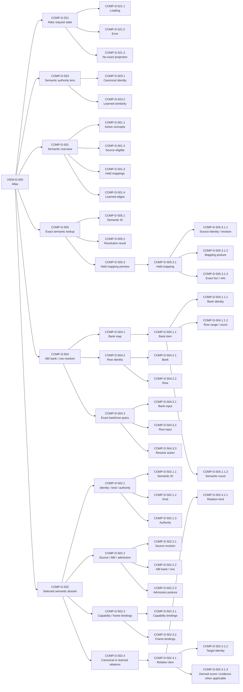

### Target component register

#### COMP-D-521 · Atlas request state
- **Target constituents:** `COMP-D-521.1` Loading; `COMP-D-521.2` Error; `COMP-D-521.3` No exact projection
- **Information shown:** Whole-view request posture.
- **Treatment:** Clean replacement state.
- **Interaction:** Retry only if supported.
- **Effect:** Prevents stale semantic detail from masquerading as current.
- **Current substrate / disposition:** Retain CUR-COMP-521.

#### COMP-D-503 · Semantic authority lens
- **Target constituents:** `COMP-D-503.1` Canonical identity; `COMP-D-503.2` Learned similarity
- **Information shown:** Explicitly separate source-authoritative semantics from learned relations.
- **Treatment:** Two-state lens with strong authority labeling.
- **Interaction:** Switch lens.
- **Effect:** Changes relation projection without changing canonical identity.
- **Current substrate / disposition:** Transform CUR-COMP-503.

#### COMP-D-501 · Semantic overview
- **Target constituents:** `COMP-D-501.1` Active concepts; `COMP-D-501.2` Source eligible; `COMP-D-501.3` Held mappings; `COMP-D-501.4` Learned edges
- **Information shown:** Atlas-scale summary.
- **Treatment:** Compact aggregate strip.
- **Interaction:** None directly.
- **Effect:** Orients the operator before exact lookup.
- **Current substrate / disposition:** Retain CUR-COMP-501.

#### COMP-D-505 · Exact semantic lookup
- **Target constituents:** `COMP-D-505.1` Semantic ID; `COMP-D-505.2` Resolution result; `COMP-D-505.3` Held mapping preview
- **Information shown:** Direct access to exact semantic identity.
- **Treatment:** Search/resolve control with bounded result.
- **Interaction:** Resolve exact ID.
- **Effect:** Loads the selected identity dossier.
- **Current substrate / disposition:** Transform CUR-COMP-505.

#### COMP-D-504 · ABI bank / row resolver
- **Target constituents:** `COMP-D-504.1` Bank map; `COMP-D-504.2` Row identity; `COMP-D-504.3` Exact bank/row query
- **Information shown:** Generation-scoped ABI placement.
- **Treatment:** Structured bank list and exact resolver.
- **Interaction:** Select bank/row; resolve exact placement.
- **Effect:** Connects canonical semantic identity to ABI location.
- **Current substrate / disposition:** Transform CUR-COMP-504.

#### COMP-D-502 · Selected semantic dossier
- **Target constituents:** `COMP-D-502.1` Identity / kind / authority; `COMP-D-502.2` Source / ABI / admission; `COMP-D-502.3` Capability / frame bindings; `COMP-D-502.4` Canonical or learned relations
- **Information shown:** Exact semantic detail.
- **Treatment:** Dossier with authority-separated relation sections.
- **Interaction:** Open related capability/frame/evidence through explicit actions.
- **Effect:** Preserves canonical identity while exposing derived relations at the right depth.
- **Current substrate / disposition:** Transform CUR-COMP-502.

## VIEW-D-006 · Model

Inspect measured neural/runtime mechanisms and exact frame compiler behavior without turning instrumentation into semantic authority.

```mermaid
flowchart LR
  VIEWD006["VIEW-D-006<br/>Model"]
  VIEWD006 --> COMPD601["COMP-D-601<br/>Model mode switch"]
  COMPD601 --> COMPD601C1["COMP-D-601.1<br/>Neural Runtime"]
  COMPD601 --> COMPD601C2["COMP-D-601.2<br/>Frame Compiler Explorer"]
  VIEWD006 --> COMPD611["COMP-D-611<br/>Neural Runtime summary"]
  COMPD611 --> COMPD611C1["COMP-D-611.1<br/>Current / historical fixture posture"]
  COMPD611C1 --> NCOMP_D_611_1_1["COMP-D-611.1.1<br/>Diagnostic mode"]
  COMPD611C1 --> NCOMP_D_611_1_2["COMP-D-611.1.2<br/>Exact generation / fixture identity"]
  COMPD611C1 --> NCOMP_D_611_1_3["COMP-D-611.1.3<br/>Mutation-disabled fixture posture"]
  COMPD611 --> COMPD611C2["COMP-D-611.2<br/>Topology / runtime overview"]
  VIEWD006 --> COMPD602["COMP-D-602<br/>Topology / runtime"]
  COMPD602 --> COMPD602C1["COMP-D-602.1<br/>Topology path / facts"]
  COMPD602C1 --> NCOMP_D_602_1_1["COMP-D-602.1.1<br/>Topology path"]
  COMPD602C1 --> NCOMP_D_602_1_2["COMP-D-602.1.2<br/>Manifest identity"]
  COMPD602C1 --> NCOMP_D_602_1_3["COMP-D-602.1.3<br/>Topology facts"]
  COMPD602 --> COMPD602C2["COMP-D-602.2<br/>Runtime summary metrics"]
  COMPD602C2 --> NCOMP_D_602_2_1["COMP-D-602.2.1<br/>Runtime metric"]
  NCOMP_D_602_2_1 --> NCOMP_D_602_2_1_1["COMP-D-602.2.1.1<br/>Label"]
  NCOMP_D_602_2_1 --> NCOMP_D_602_2_1_2["COMP-D-602.2.1.2<br/>Value"]
  NCOMP_D_602_2_1 --> NCOMP_D_602_2_1_3["COMP-D-602.2.1.3<br/>Source / coverage"]
  VIEWD006 --> COMPD603["COMP-D-603<br/>CCGQA / AttnRes diagnostics"]
  COMPD603 --> COMPD603C1["COMP-D-603.1<br/>CCGQA layer evidence"]
  COMPD603C1 --> NCOMP_D_603_1_1["COMP-D-603.1.1<br/>CCGQA layer card"]
  NCOMP_D_603_1_1 --> NCOMP_D_603_1_1_1["COMP-D-603.1.1.1<br/>Evidence validity"]
  NCOMP_D_603_1_1 --> NCOMP_D_603_1_1_2["COMP-D-603.1.1.2<br/>Q / K / V"]
  NCOMP_D_603_1_1 --> NCOMP_D_603_1_1_3["COMP-D-603.1.1.3<br/>Channel convolution"]
  NCOMP_D_603_1_1 --> NCOMP_D_603_1_1_4["COMP-D-603.1.1.4<br/>Entropy"]
  NCOMP_D_603_1_1 --> NCOMP_D_603_1_1_5["COMP-D-603.1.1.5<br/>Sequence / cache / finite"]
  NCOMP_D_603_1_1 --> NCOMP_D_603_1_1_6["COMP-D-603.1.1.6<br/>Inspect evidence action"]
  COMPD603 --> COMPD603C2["COMP-D-603.2<br/>Attention residual routing weights"]
  COMPD603C2 --> NCOMP_D_603_2_1["COMP-D-603.2.1<br/>AttnRes boundary / layer card"]
  NCOMP_D_603_2_1 --> NCOMP_D_603_2_1_1["COMP-D-603.2.1.1<br/>Routing weights"]
  NCOMP_D_603_2_1 --> NCOMP_D_603_2_1_2["COMP-D-603.2.1.2<br/>Gate sum"]
  NCOMP_D_603_2_1 --> NCOMP_D_603_2_1_3["COMP-D-603.2.1.3<br/>Inspect recorded weights action"]
  COMPD603 --> COMPD603C3["COMP-D-603.3<br/>Unavailable / invalid evidence states"]
  COMPD603C3 --> NCOMP_D_603_3_1["COMP-D-603.3.1<br/>Historical unavailable"]
  COMPD603C3 --> NCOMP_D_603_3_2["COMP-D-603.3.2<br/>Evidence invalid"]
  VIEWD006 --> COMPD604["COMP-D-604<br/>Local refinement"]
  COMPD604 --> COMPD604C1["COMP-D-604.1<br/>Expansion histogram"]
  COMPD604 --> COMPD604C2["COMP-D-604.2<br/>Reconciliation cost"]
  COMPD604 --> COMPD604C3["COMP-D-604.3<br/>Receipt table"]
  COMPD604C3 --> NCOMP_D_604_3_1["COMP-D-604.3.1<br/>Refinement receipt row"]
  NCOMP_D_604_3_1 --> NCOMP_D_604_3_1_1["COMP-D-604.3.1.1<br/>Frame / receipt identity"]
  NCOMP_D_604_3_1 --> NCOMP_D_604_3_1_2["COMP-D-604.3.1.2<br/>Eligibility / quota"]
  NCOMP_D_604_3_1 --> NCOMP_D_604_3_1_3["COMP-D-604.3.1.3<br/>Passes / density"]
  NCOMP_D_604_3_1 --> NCOMP_D_604_3_1_4["COMP-D-604.3.1.4<br/>Cost"]
  NCOMP_D_604_3_1 --> NCOMP_D_604_3_1_5["COMP-D-604.3.1.5<br/>Open receipt action"]
  VIEWD006 --> COMPD605["COMP-D-605<br/>Instrumentation coverage"]
  COMPD605 --> COMPD605C1["COMP-D-605.1<br/>Instrument"]
  COMPD605 --> COMPD605C2["COMP-D-605.2<br/>Source"]
  COMPD605 --> COMPD605C3["COMP-D-605.3<br/>Present / unavailable"]
  VIEWD006 --> COMPD606["COMP-D-606<br/>Frame Compiler Explorer"]
  COMPD606 --> COMPD606C1["COMP-D-606.1<br/>Generation / example selection"]
  COMPD606C1 --> NCOMP_D_606_1_1["COMP-D-606.1.1<br/>Generation selector"]
  COMPD606C1 --> NCOMP_D_606_1_2["COMP-D-606.1.2<br/>Request state"]
  COMPD606C1 --> NCOMP_D_606_1_3["COMP-D-606.1.3<br/>Coverage / returned count"]
  COMPD606C1 --> NCOMP_D_606_1_4["COMP-D-606.1.4<br/>Compiled example selector"]
  COMPD606 --> COMPD606C2["COMP-D-606.2<br/>Packing / provenance"]
  COMPD606C2 --> NCOMP_D_606_2_1["COMP-D-606.2.1<br/>Selected-example packing summary"]
  COMPD606C2 --> NCOMP_D_606_2_2["COMP-D-606.2.2<br/>Receipt provenance"]
  COMPD606C2 --> NCOMP_D_606_2_3["COMP-D-606.2.3<br/>Position disclosure"]
  NCOMP_D_606_2_3 --> NCOMP_D_606_2_3_1["COMP-D-606.2.3.1<br/>Position metadata"]
  NCOMP_D_606_2_3 --> NCOMP_D_606_2_3_2["COMP-D-606.2.3.2<br/>Constituent legality table"]
  NCOMP_D_606_2_3 --> NCOMP_D_606_2_3_3["COMP-D-606.2.3.3<br/>Codec-field visibility"]
  COMPD606 --> COMPD606C3["COMP-D-606.3<br/>Prediction frontier"]
  COMPD606C3 --> NCOMP_D_606_3_1["COMP-D-606.3.1<br/>Frontier selector"]
  COMPD606C3 --> NCOMP_D_606_3_2["COMP-D-606.3.2<br/>Position / legality projection"]
  COMPD606 --> COMPD606C4["COMP-D-606.4<br/>Aggregate packing"]
  COMPD606C4 --> NCOMP_D_606_4_1["COMP-D-606.4.1<br/>Aggregate disclosure"]
  COMPD606C4 --> NCOMP_D_606_4_2["COMP-D-606.4.2<br/>Aggregate packing metrics"]
```

### Target component register

#### COMP-D-601 · Model mode switch
- **Target constituents:** `COMP-D-601.1` Neural Runtime; `COMP-D-601.2` Frame Compiler Explorer
- **Information shown:** Two peer mechanism-inspection tasks.
- **Treatment:** Compact local subnavigation.
- **Interaction:** Switch mode.
- **Effect:** Changes mechanism workspace while preserving correct context custody.
- **Current substrate / disposition:** Retain CUR-COMP-601.

#### COMP-D-611 · Neural Runtime summary
- **Target constituents:** `COMP-D-611.1` Current / historical fixture posture; `COMP-D-611.2` Topology / runtime overview
- **Information shown:** Neural diagnostic context.
- **Treatment:** Compact mode header plus primary runtime summary.
- **Interaction:** Change supported current/historical diagnostic fixture.
- **Effect:** Scopes all neural diagnostic sections.
- **Current substrate / disposition:** Transform CUR-COMP-611.

#### COMP-D-602 · Topology / runtime
- **Target constituents:** `COMP-D-602.1` Topology path / facts; `COMP-D-602.2` Runtime summary metrics
- **Information shown:** Measured topology/runtime posture.
- **Treatment:** Static diagnostic sections.
- **Interaction:** None directly.
- **Effect:** Situates mechanism telemetry.
- **Current substrate / disposition:** Transform CUR-COMP-602.

#### COMP-D-603 · CCGQA / AttnRes diagnostics
- **Target constituents:** `COMP-D-603.1` CCGQA layer evidence; `COMP-D-603.2` Attention residual routing weights; `COMP-D-603.3` Unavailable / invalid evidence states
- **Information shown:** Recorded attention/routing diagnostics.
- **Treatment:** Separate CCGQA and AttnRes sections; no conflation.
- **Interaction:** Inspect exact recorded evidence where refs exist.
- **Effect:** Shows measured mechanism behavior without semantic interpretation upgrade.
- **Current substrate / disposition:** Transform CUR-COMP-603.

#### COMP-D-604 · Local refinement
- **Target constituents:** `COMP-D-604.1` Expansion histogram; `COMP-D-604.2` Reconciliation cost; `COMP-D-604.3` Receipt table
- **Information shown:** Measured local refinement behavior.
- **Treatment:** Histogram plus analytical receipt table.
- **Interaction:** Open exact receipt/evidence.
- **Effect:** Connects refinement cost/eligibility to recorded episodes.
- **Current substrate / disposition:** Transform CUR-COMP-604.

#### COMP-D-605 · Instrumentation coverage
- **Target constituents:** `COMP-D-605.1` Instrument; `COMP-D-605.2` Source; `COMP-D-605.3` Present / unavailable
- **Information shown:** What is and is not measured.
- **Treatment:** Compact coverage table.
- **Interaction:** None directly.
- **Effect:** Prevents missing instrumentation from becoming synthesized zeros.
- **Current substrate / disposition:** Transform CUR-COMP-605.

#### COMP-D-606 · Frame Compiler Explorer
- **Target constituents:** `COMP-D-606.1` Generation / example selection; `COMP-D-606.2` Packing / provenance; `COMP-D-606.3` Prediction frontier; `COMP-D-606.4` Aggregate packing
- **Information shown:** Exact frame compilation/visibility inspection.
- **Treatment:** Dedicated peer workspace with progressive forensic disclosure.
- **Interaction:** Select exact generation/example/frontier; expand aggregate detail.
- **Effect:** Explains compiler behavior and causal visibility under fixture/reference custody.
- **Current substrate / disposition:** Transform CUR-COMP-606, CUR-COMP-607, CUR-COMP-608, CUR-COMP-609, and CUR-COMP-610 into one coherent target workspace with internal sections.

## VIEW-D-007 · Memory

Inspect retained Engram allocation, retrieval and correction state without promoting memory hits to semantic or capability authority.

```mermaid
flowchart LR
  VIEWD007["VIEW-D-007<br/>Memory"]
  VIEWD007 --> COMPD733["COMP-D-733<br/>Historical memory unavailable"]
  COMPD733 --> COMPD733C1["COMP-D-733.1<br/>Requested generation"]
  COMPD733 --> COMPD733C2["COMP-D-733.2<br/>Exact fixture absent"]
  VIEWD007 --> COMPD701["COMP-D-701<br/>Memory summary"]
  COMPD701 --> COMPD701C1["COMP-D-701.1<br/>Allocation / capacity"]
  COMPD701C1 --> NCOMP_D_701_1_1["COMP-D-701.1.1<br/>Allocated"]
  COMPD701C1 --> NCOMP_D_701_1_2["COMP-D-701.1.2<br/>Capacity"]
  COMPD701 --> COMPD701C2["COMP-D-701.2<br/>Hit / miss / gate use"]
  COMPD701C2 --> NCOMP_D_701_2_1["COMP-D-701.2.1<br/>Eligible"]
  COMPD701C2 --> NCOMP_D_701_2_2["COMP-D-701.2.2<br/>Hits"]
  COMPD701C2 --> NCOMP_D_701_2_3["COMP-D-701.2.3<br/>Exact structural misses"]
  COMPD701C2 --> NCOMP_D_701_2_4["COMP-D-701.2.4<br/>Hit rate"]
  COMPD701C2 --> NCOMP_D_701_2_5["COMP-D-701.2.5<br/>Gate-use rate"]
  COMPD701 --> COMPD701C3["COMP-D-701.3<br/>Footprint"]
  COMPD701C3 --> NCOMP_D_701_3_1["COMP-D-701.3.1<br/>State footprint"]
  COMPD701C3 --> NCOMP_D_701_3_2["COMP-D-701.3.2<br/>Parameter footprint"]
  COMPD701C3 --> NCOMP_D_701_3_3["COMP-D-701.3.3<br/>Optimizer footprint"]
  COMPD701 --> COMPD701C4["COMP-D-701.4<br/>Read-site receipts"]
  COMPD701C4 --> NCOMP_D_701_4_1["COMP-D-701.4.1<br/>Read-site receipt"]
  NCOMP_D_701_4_1 --> NCOMP_D_701_4_1_1["COMP-D-701.4.1.1<br/>Site identity"]
  NCOMP_D_701_4_1 --> NCOMP_D_701_4_1_2["COMP-D-701.4.1.2<br/>Receipt identity"]
  NCOMP_D_701_4_1 --> NCOMP_D_701_4_1_3["COMP-D-701.4.1.3<br/>Observed posture"]
  COMPD701 --> COMPD701C5["COMP-D-701.5<br/>Authority reminder"]
  VIEWD007 --> COMPD702["COMP-D-702<br/>Memory atlas"]
  COMPD702 --> COMPD702C1["COMP-D-702.1<br/>Page selector"]
  COMPD702C1 --> NCOMP_D_702_1_1["COMP-D-702.1.1<br/>Current page"]
  COMPD702C1 --> NCOMP_D_702_1_2["COMP-D-702.1.2<br/>Total pages"]
  COMPD702C1 --> NCOMP_D_702_1_3["COMP-D-702.1.3<br/>Previous"]
  COMPD702C1 --> NCOMP_D_702_1_4["COMP-D-702.1.4<br/>Next"]
  COMPD702 --> COMPD702C2["COMP-D-702.2<br/>Slot list"]
  COMPD702C2 --> NCOMP_D_702_2_1["COMP-D-702.2.1<br/>Memory slot"]
  NCOMP_D_702_2_1 --> NCOMP_D_702_2_1_1["COMP-D-702.2.1.1<br/>Address"]
  NCOMP_D_702_2_1 --> NCOMP_D_702_2_1_2["COMP-D-702.2.1.2<br/>Stable identity"]
  NCOMP_D_702_2_1 --> NCOMP_D_702_2_1_3["COMP-D-702.2.1.3<br/>Frame schema"]
  NCOMP_D_702_2_1 --> NCOMP_D_702_2_1_4["COMP-D-702.2.1.4<br/>Allocation state"]
  NCOMP_D_702_2_1 --> NCOMP_D_702_2_1_5["COMP-D-702.2.1.5<br/>Capability / episode relations"]
  COMPD702 --> COMPD702C3["COMP-D-702.3<br/>Allocation state"]
  VIEWD007 --> COMPD703["COMP-D-703<br/>Motif dossier"]
  COMPD703 --> COMPD703C1["COMP-D-703.1<br/>Identity / address / key"]
  COMPD703C1 --> NCOMP_D_703_1_1["COMP-D-703.1.1<br/>Stable identity"]
  COMPD703C1 --> NCOMP_D_703_1_2["COMP-D-703.1.2<br/>Address"]
  COMPD703C1 --> NCOMP_D_703_1_3["COMP-D-703.1.3<br/>Key / semantic identity"]
  COMPD703 --> COMPD703C2["COMP-D-703.2<br/>Eligibility / lifetime use"]
  COMPD703C2 --> NCOMP_D_703_2_1["COMP-D-703.2.1<br/>Eligibility"]
  COMPD703C2 --> NCOMP_D_703_2_2["COMP-D-703.2.2<br/>Created"]
  COMPD703C2 --> NCOMP_D_703_2_3["COMP-D-703.2.3<br/>Last used"]
  COMPD703C2 --> NCOMP_D_703_2_4["COMP-D-703.2.4<br/>Hits"]
  COMPD703C2 --> NCOMP_D_703_2_5["COMP-D-703.2.5<br/>Gate use"]
  COMPD703 --> COMPD703C3["COMP-D-703.3<br/>Parameters / correction state"]
  COMPD703C3 --> NCOMP_D_703_3_1["COMP-D-703.3.1<br/>Parameter state"]
  COMPD703C3 --> NCOMP_D_703_3_2["COMP-D-703.3.2<br/>Optimizer state"]
  COMPD703C3 --> NCOMP_D_703_3_3["COMP-D-703.3.3<br/>Correction state"]
  COMPD703 --> COMPD703C4["COMP-D-703.4<br/>Source / evidence refs"]
  COMPD703C4 --> NCOMP_D_703_4_1["COMP-D-703.4.1<br/>Source refs"]
  COMPD703C4 --> NCOMP_D_703_4_2["COMP-D-703.4.2<br/>Evidence refs"]
  COMPD703 --> COMPD703C5["COMP-D-703.5<br/>Related capabilities / episodes"]
  COMPD703C5 --> NCOMP_D_703_5_1["COMP-D-703.5.1<br/>Capability refs"]
  COMPD703C5 --> NCOMP_D_703_5_2["COMP-D-703.5.2<br/>Episode refs"]
  VIEWD007 --> COMPD704["COMP-D-704<br/>Generation comparison"]
  COMPD704 --> COMPD704C1["COMP-D-704.1<br/>Created"]
  COMPD704C1 --> NCOMP_D_704_1_1["COMP-D-704.1.1<br/>Created identity list"]
  COMPD704 --> COMPD704C2["COMP-D-704.2<br/>Removed"]
  COMPD704C2 --> NCOMP_D_704_2_1["COMP-D-704.2.1<br/>Removed identity list"]
  COMPD704 --> COMPD704C3["COMP-D-704.3<br/>Held"]
  COMPD704C3 --> NCOMP_D_704_3_1["COMP-D-704.3.1<br/>Held identity list"]
  COMPD704 --> COMPD704C4["COMP-D-704.4<br/>Requalified"]
  COMPD704C4 --> NCOMP_D_704_4_1["COMP-D-704.4.1<br/>Requalified identity list"]
  COMPD704 --> COMPD704C5["COMP-D-704.5<br/>Allocation / hit / gate deltas"]
  COMPD704C5 --> NCOMP_D_704_5_1["COMP-D-704.5.1<br/>Allocation delta"]
  COMPD704C5 --> NCOMP_D_704_5_2["COMP-D-704.5.2<br/>Capacity delta"]
  COMPD704C5 --> NCOMP_D_704_5_3["COMP-D-704.5.3<br/>Hit delta"]
  COMPD704C5 --> NCOMP_D_704_5_4["COMP-D-704.5.4<br/>Miss delta"]
  COMPD704C5 --> NCOMP_D_704_5_5["COMP-D-704.5.5<br/>Gate delta"]
  VIEWD007 --> COMPD705["COMP-D-705<br/>Rejected candidate boundary"]
  COMPD705 --> COMPD705C1["COMP-D-705.1<br/>Candidate identity"]
  COMPD705 --> COMPD705C2["COMP-D-705.2<br/>Parent preservation"]
  COMPD705 --> COMPD705C3["COMP-D-705.3<br/>No committed generation / slot"]
  COMPD705 --> COMPD705C4["COMP-D-705.4<br/>Reason"]
```

### Target component register

#### COMP-D-733 · Historical memory unavailable
- **Target constituents:** `COMP-D-733.1` Requested generation; `COMP-D-733.2` Exact fixture absent
- **Information shown:** Historical missing state.
- **Treatment:** Whole-view replacement state.
- **Interaction:** None locally.
- **Effect:** Refuses to substitute current memory for unavailable historical memory.
- **Current substrate / disposition:** Retain CUR-COMP-733.

#### COMP-D-701 · Memory summary
- **Target constituents:** `COMP-D-701.1` Allocation / capacity; `COMP-D-701.2` Hit / miss / gate use; `COMP-D-701.3` Footprint; `COMP-D-701.4` Read-site receipts; `COMP-D-701.5` Authority reminder
- **Information shown:** Operational memory posture.
- **Treatment:** Compact metric summary with receipts progressively disclosed.
- **Interaction:** Open exact receipt only where refs exist.
- **Effect:** Establishes memory posture without claiming truth authority.
- **Current substrate / disposition:** Transform CUR-COMP-701.

#### COMP-D-702 · Memory atlas
- **Target constituents:** `COMP-D-702.1` Page selector; `COMP-D-702.2` Slot list; `COMP-D-702.3` Allocation state
- **Information shown:** Browse retained motif placement.
- **Treatment:** Page controls plus slot table/list.
- **Interaction:** Select page/slot.
- **Effect:** Loads exact motif dossier.
- **Current substrate / disposition:** Transform CUR-COMP-702.

#### COMP-D-703 · Motif dossier
- **Target constituents:** `COMP-D-703.1` Identity / address / key; `COMP-D-703.2` Eligibility / lifetime use; `COMP-D-703.3` Parameters / correction state; `COMP-D-703.4` Source / evidence refs; `COMP-D-703.5` Related capabilities / episodes
- **Information shown:** Exact retained motif state.
- **Treatment:** Structured dossier, not a card stack.
- **Interaction:** Open exact related capability/episode/evidence through explicit actions.
- **Effect:** Exposes retained identity/provenance.
- **Current substrate / disposition:** Transform CUR-COMP-703.

#### COMP-D-704 · Generation comparison
- **Target constituents:** `COMP-D-704.1` Created; `COMP-D-704.2` Removed; `COMP-D-704.3` Held; `COMP-D-704.4` Requalified; `COMP-D-704.5` Allocation / hit / gate deltas
- **Information shown:** Literal memory change between exact generations.
- **Treatment:** Generation selector plus grouped deltas.
- **Interaction:** Choose exact comparison generation.
- **Effect:** Shows change without implying winner/causality.
- **Current substrate / disposition:** Transform CUR-COMP-704.

#### COMP-D-705 · Rejected candidate boundary
- **Target constituents:** `COMP-D-705.1` Candidate identity; `COMP-D-705.2` Parent preservation; `COMP-D-705.3` No committed generation / slot; `COMP-D-705.4` Reason
- **Information shown:** Proof that rejected candidate-local allocation did not become retained memory.
- **Treatment:** Small proof panel.
- **Interaction:** None directly.
- **Effect:** Protects the retention boundary.
- **Current substrate / disposition:** Retain CUR-COMP-705.

## VIEW-D-008 · Teacher

Compare strategy population and measured outcomes/cost/fidelity without creating unsupported ranking or policy authority.

```mermaid
flowchart LR
  VIEWD008["VIEW-D-008<br/>Teacher"]
  VIEWD008 --> COMPD801["COMP-D-801<br/>Strategy roster"]
  COMPD801 --> COMPD801C1["COMP-D-801.1<br/>Identity / role / status"]
  COMPD801C1 --> NCOMP_D_801_1_1["COMP-D-801.1.1<br/>Strategy ID"]
  COMPD801C1 --> NCOMP_D_801_1_2["COMP-D-801.1.2<br/>Role"]
  COMPD801C1 --> NCOMP_D_801_1_3["COMP-D-801.1.3<br/>Status"]
  COMPD801 --> COMPD801C2["COMP-D-801.2<br/>Attempts / outcomes"]
  COMPD801C2 --> NCOMP_D_801_2_1["COMP-D-801.2.1<br/>Attempts"]
  COMPD801C2 --> NCOMP_D_801_2_2["COMP-D-801.2.2<br/>Retained"]
  COMPD801C2 --> NCOMP_D_801_2_3["COMP-D-801.2.3<br/>Gain"]
  COMPD801C2 --> NCOMP_D_801_2_4["COMP-D-801.2.4<br/>No-gain"]
  COMPD801C2 --> NCOMP_D_801_2_5["COMP-D-801.2.5<br/>Interference"]
  COMPD801C2 --> NCOMP_D_801_2_6["COMP-D-801.2.6<br/>Wall time"]
  COMPD801 --> COMPD801C3["COMP-D-801.3<br/>Scope"]
  COMPD801C3 --> NCOMP_D_801_3_1["COMP-D-801.3.1<br/>Capability scope"]
  COMPD801C3 --> NCOMP_D_801_3_2["COMP-D-801.3.2<br/>Source-family scope"]
  COMPD801C3 --> NCOMP_D_801_3_3["COMP-D-801.3.3<br/>Lifecycle scope"]
  COMPD801C3 --> NCOMP_D_801_3_4["COMP-D-801.3.4<br/>Canary posture"]
  COMPD801C3 --> NCOMP_D_801_3_5["COMP-D-801.3.5<br/>Resource scope"]
  COMPD801 --> COMPD801C4["COMP-D-801.4<br/>Episode links"]
  COMPD801C4 --> NCOMP_D_801_4_1["COMP-D-801.4.1<br/>Episode link"]
  NCOMP_D_801_4_1 --> NCOMP_D_801_4_1_1["COMP-D-801.4.1.1<br/>Episode identity"]
  NCOMP_D_801_4_1 --> NCOMP_D_801_4_1_2["COMP-D-801.4.1.2<br/>Outcome"]
  COMPD801 --> COMPD801C5["COMP-D-801.5<br/>Role history"]
  COMPD801C5 --> NCOMP_D_801_5_1["COMP-D-801.5.1<br/>Checkpoint-role entry"]
  NCOMP_D_801_5_1 --> NCOMP_D_801_5_1_1["COMP-D-801.5.1.1<br/>Checkpoint"]
  NCOMP_D_801_5_1 --> NCOMP_D_801_5_1_2["COMP-D-801.5.1.2<br/>Role"]
  VIEWD008 --> COMPD802["COMP-D-802<br/>Outcome / cost comparison"]
  COMPD802 --> COMPD802C1["COMP-D-802.1<br/>Selected strategies"]
  COMPD802C1 --> NCOMP_D_802_1_1["COMP-D-802.1.1<br/>Strategy option"]
  NCOMP_D_802_1_1 --> NCOMP_D_802_1_1_1["COMP-D-802.1.1.1<br/>Strategy identity"]
  NCOMP_D_802_1_1 --> NCOMP_D_802_1_1_2["COMP-D-802.1.1.2<br/>Selected state"]
  COMPD802 --> COMPD802C2["COMP-D-802.2<br/>Scope"]
  COMPD802C2 --> NCOMP_D_802_2_1["COMP-D-802.2.1<br/>Whole school"]
  COMPD802C2 --> NCOMP_D_802_2_2["COMP-D-802.2.2<br/>Capability"]
  COMPD802C2 --> NCOMP_D_802_2_3["COMP-D-802.2.3<br/>Source family"]
  COMPD802 --> COMPD802C3["COMP-D-802.3<br/>Attempts / retained / gain"]
  COMPD802 --> COMPD802C4["COMP-D-802.4<br/>No-gain / interference"]
  COMPD802 --> COMPD802C5["COMP-D-802.5<br/>Wall time / steps"]
  COMPD802 --> COMPD802C6["COMP-D-802.6<br/>Coverage"]
  VIEWD008 --> COMPD803["COMP-D-803<br/>Fidelity ladder"]
  COMPD803 --> COMPD803C1["COMP-D-803.1<br/>Rungs"]
  COMPD803C1 --> NCOMP_D_803_1_1["COMP-D-803.1.1<br/>Fidelity rung"]
  NCOMP_D_803_1_1 --> NCOMP_D_803_1_1_1["COMP-D-803.1.1.1<br/>Mode / rung identity"]
  NCOMP_D_803_1_1 --> NCOMP_D_803_1_1_2["COMP-D-803.1.1.2<br/>Delta"]
  NCOMP_D_803_1_1 --> NCOMP_D_803_1_1_3["COMP-D-803.1.1.3<br/>Outcome metrics"]
  COMPD803 --> COMPD803C2["COMP-D-803.2<br/>Observed deltas"]
  COMPD803 --> COMPD803C3["COMP-D-803.3<br/>Stop / retained / savings / false-kill outcomes"]
  COMPD803C3 --> NCOMP_D_803_3_1["COMP-D-803.3.1<br/>Stop state"]
  COMPD803C3 --> NCOMP_D_803_3_2["COMP-D-803.3.2<br/>Retained steps"]
  COMPD803C3 --> NCOMP_D_803_3_3["COMP-D-803.3.3<br/>Savings"]
  COMPD803C3 --> NCOMP_D_803_3_4["COMP-D-803.3.4<br/>False-kill outcome"]
  VIEWD008 --> COMPD804["COMP-D-804<br/>Projection boundary"]
  COMPD804 --> COMPD804C1["COMP-D-804.1<br/>Schema / coverage"]
  COMPD804 --> COMPD804C2["COMP-D-804.2<br/>Exposed fields"]
  COMPD804 --> COMPD804C3["COMP-D-804.3<br/>Fixture limitations"]
```

### Target component register

#### COMP-D-801 · Strategy roster
- **Target constituents:** `COMP-D-801.1` Identity / role / status; `COMP-D-801.2` Attempts / outcomes; `COMP-D-801.3` Scope; `COMP-D-801.4` Episode links; `COMP-D-801.5` Role history
- **Information shown:** Population of known strategies.
- **Treatment:** Compact roster/table with selected strategy detail, not oversized cards.
- **Interaction:** Inspect strategy identity; open related episode where exact.
- **Effect:** Provides descriptive strategy evidence.
- **Current substrate / disposition:** Transform CUR-COMP-801.

#### COMP-D-802 · Outcome / cost comparison
- **Target constituents:** `COMP-D-802.1` Selected strategies; `COMP-D-802.2` Scope; `COMP-D-802.3` Attempts / retained / gain; `COMP-D-802.4` No-gain / interference; `COMP-D-802.5` Wall time / steps; `COMP-D-802.6` Coverage
- **Information shown:** Measured comparison at common scope.
- **Treatment:** Comparison controls plus analytical table.
- **Interaction:** Choose strategies and scope.
- **Effect:** Recomputes descriptive comparison only.
- **Current substrate / disposition:** Transform CUR-COMP-802.

#### COMP-D-803 · Fidelity ladder
- **Target constituents:** `COMP-D-803.1` Rungs; `COMP-D-803.2` Observed deltas; `COMP-D-803.3` Stop / retained / savings / false-kill outcomes
- **Information shown:** Observed fidelity evidence.
- **Treatment:** Static ladder/table with clear observational label.
- **Interaction:** None directly.
- **Effect:** Shows fidelity observations without implying a recommended winner.
- **Current substrate / disposition:** Transform CUR-COMP-803.

#### COMP-D-804 · Projection boundary
- **Target constituents:** `COMP-D-804.1` Schema / coverage; `COMP-D-804.2` Exposed fields; `COMP-D-804.3` Fixture limitations
- **Information shown:** What this Teacher projection can and cannot establish.
- **Treatment:** Concise disclosure, not permanent wall text.
- **Interaction:** Expand/collapse.
- **Effect:** Keeps descriptive telemetry from becoming policy authority.
- **Current substrate / disposition:** Transform CUR-COMP-804.

## VIEW-D-009 · SÍ SÉ SON

Inspect Impact, Exigency and Osmotic Novelty as independent evidence, plus reversible aggregation and admitted routing rationale.

```mermaid
flowchart LR
  VIEWD009["VIEW-D-009<br/>SÍ SÉ SON"]
  VIEWD009 --> COMPD906["COMP-D-906<br/>As-of selector"]
  COMPD906 --> COMPD906C1["COMP-D-906.1<br/>Exact retained snapshot"]
  VIEWD009 --> COMPD901["COMP-D-901<br/>Observation table"]
  COMPD901 --> COMPD901C1["COMP-D-901.1<br/>Event / capability identity"]
  COMPD901C1 --> NCOMP_D_901_1_1["COMP-D-901.1.1<br/>Observation row"]
  NCOMP_D_901_1_1 --> NCOMP_D_901_1_1_1["COMP-D-901.1.1.1<br/>Event identity"]
  NCOMP_D_901_1_1 --> NCOMP_D_901_1_1_2["COMP-D-901.1.1.2<br/>Capability identity"]
  NCOMP_D_901_1_1 --> NCOMP_D_901_1_1_3["COMP-D-901.1.1.3<br/>Impact"]
  NCOMP_D_901_1_1 --> NCOMP_D_901_1_1_4["COMP-D-901.1.1.4<br/>Exigency"]
  NCOMP_D_901_1_1 --> NCOMP_D_901_1_1_5["COMP-D-901.1.1.5<br/>Osmotic Novelty"]
  NCOMP_D_901_1_1 --> NCOMP_D_901_1_1_6["COMP-D-901.1.1.6<br/>Scope / source"]
  NCOMP_D_901_1_1 --> NCOMP_D_901_1_1_7["COMP-D-901.1.1.7<br/>Inspect action"]
  COMPD901 --> COMPD901C2["COMP-D-901.2<br/>Impact"]
  COMPD901 --> COMPD901C3["COMP-D-901.3<br/>Exigency"]
  COMPD901 --> COMPD901C4["COMP-D-901.4<br/>Osmotic Novelty"]
  COMPD901 --> COMPD901C5["COMP-D-901.5<br/>Scope / source"]
  VIEWD009 --> COMPD902["COMP-D-902<br/>Observation provenance"]
  COMPD902 --> COMPD902C1["COMP-D-902.1<br/>Policy owner / version / digest"]
  COMPD902C1 --> NCOMP_D_902_1_1["COMP-D-902.1.1<br/>Policy owner"]
  COMPD902C1 --> NCOMP_D_902_1_2["COMP-D-902.1.2<br/>Version"]
  COMPD902C1 --> NCOMP_D_902_1_3["COMP-D-902.1.3<br/>Digest"]
  COMPD902 --> COMPD902C2["COMP-D-902.2<br/>Window policy"]
  COMPD902C2 --> NCOMP_D_902_2_1["COMP-D-902.2.1<br/>Window policy identity"]
  COMPD902C2 --> NCOMP_D_902_2_2["COMP-D-902.2.2<br/>Version"]
  COMPD902C2 --> NCOMP_D_902_2_3["COMP-D-902.2.3<br/>Window size"]
  COMPD902 --> COMPD902C3["COMP-D-902.3<br/>Per-axis source / rule / basis"]
  COMPD902C3 --> NCOMP_D_902_3_1["COMP-D-902.3.1<br/>Impact provenance"]
  NCOMP_D_902_3_1 --> NCOMP_D_902_3_1_1["COMP-D-902.3.1.1<br/>Source ref"]
  NCOMP_D_902_3_1 --> NCOMP_D_902_3_1_2["COMP-D-902.3.1.2<br/>Rule ID"]
  NCOMP_D_902_3_1 --> NCOMP_D_902_3_1_3["COMP-D-902.3.1.3<br/>Basis refs"]
  COMPD902C3 --> NCOMP_D_902_3_2["COMP-D-902.3.2<br/>Exigency provenance"]
  NCOMP_D_902_3_2 --> NCOMP_D_902_3_2_1["COMP-D-902.3.2.1<br/>Source ref"]
  NCOMP_D_902_3_2 --> NCOMP_D_902_3_2_2["COMP-D-902.3.2.2<br/>Rule ID"]
  NCOMP_D_902_3_2 --> NCOMP_D_902_3_2_3["COMP-D-902.3.2.3<br/>Basis refs"]
  COMPD902C3 --> NCOMP_D_902_3_3["COMP-D-902.3.3<br/>Osmotic Novelty provenance"]
  NCOMP_D_902_3_3 --> NCOMP_D_902_3_3_1["COMP-D-902.3.3.1<br/>Source ref"]
  NCOMP_D_902_3_3 --> NCOMP_D_902_3_3_2["COMP-D-902.3.3.2<br/>Rule ID"]
  NCOMP_D_902_3_3 --> NCOMP_D_902_3_3_3["COMP-D-902.3.3.3<br/>Basis refs"]
  VIEWD009 --> COMPD903["COMP-D-903<br/>Recursive aggregation"]
  COMPD903 --> COMPD903C1["COMP-D-903.1<br/>Window"]
  COMPD903 --> COMPD903C2["COMP-D-903.2<br/>Cluster"]
  COMPD903C2 --> NCOMP_D_903_2_1["COMP-D-903.2.1<br/>Cluster item"]
  NCOMP_D_903_2_1 --> NCOMP_D_903_2_1_1["COMP-D-903.2.1.1<br/>Identity / partition"]
  NCOMP_D_903_2_1 --> NCOMP_D_903_2_1_2["COMP-D-903.2.1.2<br/>Rule / posture"]
  NCOMP_D_903_2_1 --> NCOMP_D_903_2_1_3["COMP-D-903.2.1.3<br/>Lineage / count"]
  NCOMP_D_903_2_1 --> NCOMP_D_903_2_1_4["COMP-D-903.2.1.4<br/>Constituent observations"]
  COMPD903 --> COMPD903C3["COMP-D-903.3<br/>Pattern"]
  COMPD903C3 --> NCOMP_D_903_3_1["COMP-D-903.3.1<br/>Pattern identity"]
  COMPD903C3 --> NCOMP_D_903_3_2["COMP-D-903.3.2<br/>Status / nomination"]
  COMPD903C3 --> NCOMP_D_903_3_3["COMP-D-903.3.3<br/>Source-gold / qualification"]
  COMPD903 --> COMPD903C4["COMP-D-903.4<br/>Trend"]
  COMPD903C4 --> NCOMP_D_903_4_1["COMP-D-903.4.1<br/>Trend rule"]
  COMPD903C4 --> NCOMP_D_903_4_2["COMP-D-903.4.2<br/>Window points"]
  COMPD903 --> COMPD903C5["COMP-D-903.5<br/>Constituent observations"]
  COMPD903C5 --> NCOMP_D_903_5_1["COMP-D-903.5.1<br/>Observation ref"]
  NCOMP_D_903_5_1 --> NCOMP_D_903_5_1_1["COMP-D-903.5.1.1<br/>Exact identity"]
  NCOMP_D_903_5_1 --> NCOMP_D_903_5_1_2["COMP-D-903.5.1.2<br/>Available / outside-as-of state"]
  NCOMP_D_903_5_1 --> NCOMP_D_903_5_1_3["COMP-D-903.5.1.3<br/>Inspect action when available"]
  VIEWD009 --> COMPD904["COMP-D-904<br/>Routing rationale"]
  COMPD904 --> COMPD904C1["COMP-D-904.1<br/>Route / tier / rule"]
  COMPD904 --> COMPD904C2["COMP-D-904.2<br/>Ordering keys"]
  COMPD904 --> COMPD904C3["COMP-D-904.3<br/>Hidden-weighting posture"]
  COMPD904 --> COMPD904C4["COMP-D-904.4<br/>Cited observations"]
  COMPD904C4 --> NCOMP_D_904_4_1["COMP-D-904.4.1<br/>Cited observation"]
  NCOMP_D_904_4_1 --> NCOMP_D_904_4_1_1["COMP-D-904.4.1.1<br/>Observation identity"]
  NCOMP_D_904_4_1 --> NCOMP_D_904_4_1_2["COMP-D-904.4.1.2<br/>Availability state"]
  NCOMP_D_904_4_1 --> NCOMP_D_904_4_1_3["COMP-D-904.4.1.3<br/>Inspect action"]
  VIEWD009 --> COMPD905["COMP-D-905<br/>Projection boundary"]
  COMPD905 --> COMPD905C1["COMP-D-905.1<br/>Schema / coverage"]
  COMPD905 --> COMPD905C2["COMP-D-905.2<br/>Projected fields"]
  COMPD905 --> COMPD905C3["COMP-D-905.3<br/>Fixture limitations"]
```

### Target component register

#### COMP-D-906 · As-of selector
- **Target constituents:** `COMP-D-906.1` Exact retained snapshot
- **Information shown:** Choose exact salience snapshot.
- **Treatment:** Compact selector in view controls.
- **Interaction:** Select snapshot.
- **Effect:** Re-renders all salience evidence against exact as-of state.
- **Current substrate / disposition:** Retain CUR-COMP-906.

#### COMP-D-901 · Observation table
- **Target constituents:** `COMP-D-901.1` Event / capability identity; `COMP-D-901.2` Impact; `COMP-D-901.3` Exigency; `COMP-D-901.4` Osmotic Novelty; `COMP-D-901.5` Scope / source
- **Information shown:** Three independent axes per observation.
- **Treatment:** Analytical table; axes never collapsed into one default scalar.
- **Interaction:** Inspect exact observation.
- **Effect:** Loads provenance/related detail.
- **Current substrate / disposition:** Transform CUR-COMP-901.

#### COMP-D-902 · Observation provenance
- **Target constituents:** `COMP-D-902.1` Policy owner / version / digest; `COMP-D-902.2` Window policy; `COMP-D-902.3` Per-axis source / rule / basis
- **Information shown:** Why each axis value exists.
- **Treatment:** Progressively disclosed provenance.
- **Interaction:** Open exact evidence only where refs exist.
- **Effect:** Grounds salience claims.
- **Current substrate / disposition:** Transform CUR-COMP-902.

#### COMP-D-903 · Recursive aggregation
- **Target constituents:** `COMP-D-903.1` Window; `COMP-D-903.2` Cluster; `COMP-D-903.3` Pattern; `COMP-D-903.4` Trend; `COMP-D-903.5` Constituent observations
- **Information shown:** Reversible aggregation hierarchy.
- **Treatment:** Nested disclosure.
- **Interaction:** Expand levels; inspect constituent observations.
- **Effect:** Shows scale without upgrading aggregate authority.
- **Current substrate / disposition:** Transform CUR-COMP-903.

#### COMP-D-904 · Routing rationale
- **Target constituents:** `COMP-D-904.1` Route / tier / rule; `COMP-D-904.2` Ordering keys; `COMP-D-904.3` Hidden-weighting posture; `COMP-D-904.4` Cited observations
- **Information shown:** Recorded admitted routing rationale.
- **Treatment:** Derived rationale section separated from source axes.
- **Interaction:** Inspect cited observations.
- **Effect:** Explains routing without inferring private weights.
- **Current substrate / disposition:** Transform CUR-COMP-904.

#### COMP-D-905 · Projection boundary
- **Target constituents:** `COMP-D-905.1` Schema / coverage; `COMP-D-905.2` Projected fields; `COMP-D-905.3` Fixture limitations
- **Information shown:** Limits of current salience projection.
- **Treatment:** Concise disclosure.
- **Interaction:** Expand/collapse.
- **Effect:** Prevents universal-decision-authority interpretation.
- **Current substrate / disposition:** Transform CUR-COMP-905.

## VIEW-D-010 · Corrections

Show correction context, known blast radius, requalification work and append-only history without claiming perfect unlearning.

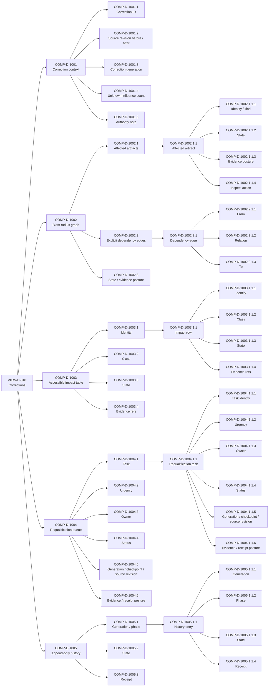

### Target component register

#### COMP-D-1001 · Correction context
- **Target constituents:** `COMP-D-1001.1` Correction ID; `COMP-D-1001.2` Source revision before / after; `COMP-D-1001.3` Correction generation; `COMP-D-1001.4` Unknown-influence count; `COMP-D-1001.5` Authority note
- **Information shown:** Exact correction being inspected.
- **Treatment:** Compact summary header.
- **Interaction:** None directly.
- **Effect:** Anchors all impact/requalification detail.
- **Current substrate / disposition:** Transform CUR-COMP-1001.

#### COMP-D-1002 · Blast-radius graph
- **Target constituents:** `COMP-D-1002.1` Affected artifacts; `COMP-D-1002.2` Explicit dependency edges; `COMP-D-1002.3` State / evidence posture
- **Information shown:** Known exposure relationships.
- **Treatment:** Graph with bounded scope.
- **Interaction:** Select affected artifact.
- **Effect:** Loads exact artifact detail and related evidence.
- **Current substrate / disposition:** Transform CUR-COMP-1002.

#### COMP-D-1003 · Accessible impact table
- **Target constituents:** `COMP-D-1003.1` Identity; `COMP-D-1003.2` Class; `COMP-D-1003.3` State; `COMP-D-1003.4` Evidence refs
- **Information shown:** Equivalent representation of blast radius.
- **Treatment:** Table paired with graph.
- **Interaction:** Select affected artifact.
- **Effect:** Provides equivalent non-graph access.
- **Current substrate / disposition:** Retain CUR-COMP-1003.

#### COMP-D-1004 · Requalification queue
- **Target constituents:** `COMP-D-1004.1` Task; `COMP-D-1004.2` Urgency; `COMP-D-1004.3` Owner; `COMP-D-1004.4` Status; `COMP-D-1004.5` Generation / checkpoint / source revision; `COMP-D-1004.6` Evidence / receipt posture
- **Information shown:** Known requalification work.
- **Treatment:** Analytical queue/table.
- **Interaction:** Open exact owning evidence/task when available.
- **Effect:** Shows what still needs proof.
- **Current substrate / disposition:** Transform CUR-COMP-1004.

#### COMP-D-1005 · Append-only history
- **Target constituents:** `COMP-D-1005.1` Generation / phase; `COMP-D-1005.2` State; `COMP-D-1005.3` Receipt
- **Information shown:** Correction history for affected artifact/context.
- **Treatment:** Chronological table/list.
- **Interaction:** Open exact receipt when available.
- **Effect:** Preserves prior states rather than rewriting history.
- **Current substrate / disposition:** Transform CUR-COMP-1005.

## VIEW-D-011 · Lineage

Inspect immutable accepted-generation custody, exact generation detail and literal differences; rejected candidates remain explicitly outside accepted lineage.

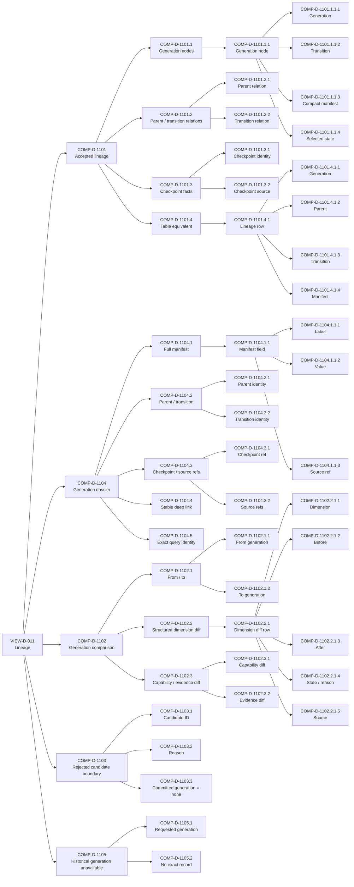

### Target component register

#### COMP-D-1101 · Accepted lineage
- **Target constituents:** `COMP-D-1101.1` Generation nodes; `COMP-D-1101.2` Parent / transition relations; `COMP-D-1101.3` Checkpoint facts; `COMP-D-1101.4` Table equivalent
- **Information shown:** Accepted generation graph/list.
- **Treatment:** Graph plus accessible tabular equivalent.
- **Interaction:** Select accepted generation.
- **Effect:** Loads exact generation dossier.
- **Current substrate / disposition:** Transform CUR-COMP-1101.

#### COMP-D-1104 · Generation dossier
- **Target constituents:** `COMP-D-1104.1` Full manifest; `COMP-D-1104.2` Parent / transition; `COMP-D-1104.3` Checkpoint / source refs; `COMP-D-1104.4` Stable deep link; `COMP-D-1104.5` Exact query identity
- **Information shown:** Immutable selected-generation detail.
- **Treatment:** Structured dossier with machine IDs at forensic depth.
- **Interaction:** Open exact evidence where refs exist.
- **Effect:** Anchors custody to exact accepted generation.
- **Current substrate / disposition:** Transform CUR-COMP-1104.

#### COMP-D-1102 · Generation comparison
- **Target constituents:** `COMP-D-1102.1` From / to; `COMP-D-1102.2` Structured dimension diff; `COMP-D-1102.3` Capability / evidence diff
- **Information shown:** Literal exact differences.
- **Treatment:** Endpoint selectors plus diff table.
- **Interaction:** Choose exact endpoints.
- **Effect:** Shows change without winner synthesis.
- **Current substrate / disposition:** Transform CUR-COMP-1102.

#### COMP-D-1103 · Rejected candidate boundary
- **Target constituents:** `COMP-D-1103.1` Candidate ID; `COMP-D-1103.2` Reason; `COMP-D-1103.3` Committed generation = none
- **Information shown:** Proof that rejected candidate is not lineage.
- **Treatment:** Small explicit boundary state.
- **Interaction:** None directly.
- **Effect:** Prevents rejected work from appearing accepted.
- **Current substrate / disposition:** Retain CUR-COMP-1103.

#### COMP-D-1105 · Historical generation unavailable
- **Target constituents:** `COMP-D-1105.1` Requested generation; `COMP-D-1105.2` No exact record
- **Information shown:** Missing historical state.
- **Treatment:** Whole-view/local replacement depending scope.
- **Interaction:** None locally.
- **Effect:** Refuses current-generation substitution.
- **Current substrate / disposition:** New explicit target component derived from current defensive branch.

## VIEW-D-012 · Resources

Inspect measured resource posture, decomposition, time correlation and exact historical comparison without confusing absence with zero or correlation with causation.

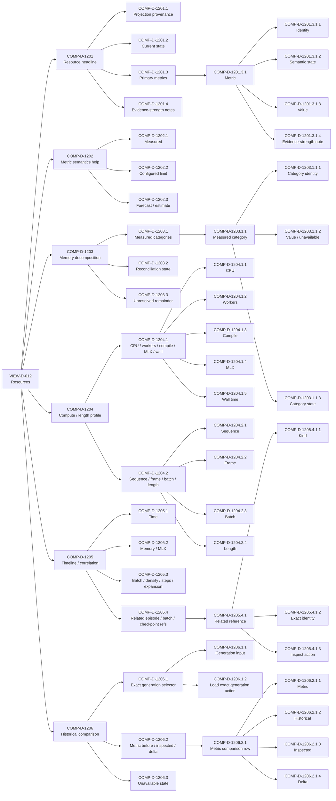

### Target component register

#### COMP-D-1201 · Resource headline
- **Target constituents:** `COMP-D-1201.1` Projection provenance; `COMP-D-1201.2` Current state; `COMP-D-1201.3` Primary metrics; `COMP-D-1201.4` Evidence-strength notes
- **Information shown:** Current resource posture.
- **Treatment:** Compact metric summary; no metric-card wallpaper.
- **Interaction:** None directly.
- **Effect:** Establishes current resource condition.
- **Current substrate / disposition:** Transform CUR-COMP-1201.

#### COMP-D-1202 · Metric semantics help
- **Target constituents:** `COMP-D-1202.1` Measured; `COMP-D-1202.2` Configured limit; `COMP-D-1202.3` Forecast / estimate
- **Information shown:** How to interpret value classes.
- **Treatment:** Small local disclosure/help.
- **Interaction:** Expand/collapse.
- **Effect:** Prevents unlike quantities from reading as equivalent.
- **Current substrate / disposition:** Transform CUR-COMP-1202.

#### COMP-D-1203 · Memory decomposition
- **Target constituents:** `COMP-D-1203.1` Measured categories; `COMP-D-1203.2` Reconciliation state; `COMP-D-1203.3` Unresolved remainder
- **Information shown:** Memory composition without false attribution.
- **Treatment:** Grouped analytical breakdown.
- **Interaction:** None directly.
- **Effect:** Makes unresolved remainder explicit.
- **Current substrate / disposition:** Transform CUR-COMP-1203.

#### COMP-D-1204 · Compute / length profile
- **Target constituents:** `COMP-D-1204.1` CPU / workers / compile / MLX / wall; `COMP-D-1204.2` Sequence / frame / batch / length
- **Information shown:** Compute and workload profile.
- **Treatment:** Grouped metric table/sections.
- **Interaction:** None directly.
- **Effect:** Decomposes measured resource cost.
- **Current substrate / disposition:** Transform CUR-COMP-1204.

#### COMP-D-1205 · Timeline / correlation
- **Target constituents:** `COMP-D-1205.1` Time; `COMP-D-1205.2` Memory / MLX; `COMP-D-1205.3` Batch / density / steps / expansion; `COMP-D-1205.4` Related episode / batch / checkpoint refs
- **Information shown:** Resource samples over time.
- **Treatment:** Wide analytical table with local overflow.
- **Interaction:** Select exact sample.
- **Effect:** Opens exact related evidence without claiming causation.
- **Current substrate / disposition:** Transform CUR-COMP-1205.

#### COMP-D-1206 · Historical comparison
- **Target constituents:** `COMP-D-1206.1` Exact generation selector; `COMP-D-1206.2` Metric before / inspected / delta; `COMP-D-1206.3` Unavailable state
- **Information shown:** Exact generation comparison.
- **Treatment:** Compact form plus comparison table.
- **Interaction:** Load exact generation.
- **Effect:** Queries read-only historical projection; never infers a generation.
- **Current substrate / disposition:** Transform CUR-COMP-1206.

## VIEW-D-013 · Evidence

Find and inspect exact Model Forensics records, literal payloads and provenance while preserving degraded/partial states and investigation origin.

```mermaid
flowchart LR
  VIEWD013["VIEW-D-013<br/>Evidence"]
  VIEWD013 --> COMPD1301["COMP-D-1301<br/>Evidence query"]
  COMPD1301 --> COMPD1301C1["COMP-D-1301.1<br/>Kind"]
  COMPD1301 --> COMPD1301C2["COMP-D-1301.2<br/>Exact identity"]
  COMPD1301C2 --> NCOMP_D_1301_2_1["COMP-D-1301.2.1<br/>Exact identity input"]
  COMPD1301C2 --> NCOMP_D_1301_2_2["COMP-D-1301.2.2<br/>Validation state"]
  COMPD1301 --> COMPD1301C3["COMP-D-1301.3<br/>Fresh search"]
  COMPD1301 --> COMPD1301C4["COMP-D-1301.4<br/>Load next"]
  VIEWD013 --> COMPD1305["COMP-D-1305<br/>Query status"]
  COMPD1305 --> COMPD1305C1["COMP-D-1305.1<br/>Loading / ready / error"]
  COMPD1305 --> COMPD1305C2["COMP-D-1305.2<br/>Coverage"]
  COMPD1305 --> COMPD1305C3["COMP-D-1305.3<br/>Truncation"]
  COMPD1305 --> COMPD1305C4["COMP-D-1305.4<br/>Returned / total"]
  VIEWD013 --> COMPD1302["COMP-D-1302<br/>Evidence results"]
  COMPD1302 --> COMPD1302C1["COMP-D-1302.1<br/>Exact record results"]
  COMPD1302C1 --> NCOMP_D_1302_1_1["COMP-D-1302.1.1<br/>Record result"]
  NCOMP_D_1302_1_1 --> NCOMP_D_1302_1_1_1["COMP-D-1302.1.1.1<br/>Record ID"]
  NCOMP_D_1302_1_1 --> NCOMP_D_1302_1_1_2["COMP-D-1302.1.1.2<br/>Schema"]
  NCOMP_D_1302_1_1 --> NCOMP_D_1302_1_1_3["COMP-D-1302.1.1.3<br/>Authority"]
  NCOMP_D_1302_1_1 --> NCOMP_D_1302_1_1_4["COMP-D-1302.1.1.4<br/>Coverage"]
  NCOMP_D_1302_1_1 --> NCOMP_D_1302_1_1_5["COMP-D-1302.1.1.5<br/>Generation"]
  NCOMP_D_1302_1_1 --> NCOMP_D_1302_1_1_6["COMP-D-1302.1.1.6<br/>Open action"]
  COMPD1302 --> COMPD1302C2["COMP-D-1302.2<br/>Relationship results"]
  COMPD1302C2 --> NCOMP_D_1302_2_1["COMP-D-1302.2.1<br/>Relationship result"]
  NCOMP_D_1302_2_1 --> NCOMP_D_1302_2_1_1["COMP-D-1302.2.1.1<br/>Relation"]
  NCOMP_D_1302_2_1 --> NCOMP_D_1302_2_1_2["COMP-D-1302.2.1.2<br/>Source ref"]
  NCOMP_D_1302_2_1 --> NCOMP_D_1302_2_1_3["COMP-D-1302.2.1.3<br/>Target ref"]
  NCOMP_D_1302_2_1 --> NCOMP_D_1302_2_1_4["COMP-D-1302.2.1.4<br/>Hydrate target action"]
  COMPD1302 --> COMPD1302C3["COMP-D-1302.3<br/>Hydration posture"]
  VIEWD013 --> COMPD1303["COMP-D-1303<br/>Exact record inspector"]
  COMPD1303 --> COMPD1303C1["COMP-D-1303.1<br/>Identity / schema / authority / coverage"]
  COMPD1303C1 --> NCOMP_D_1303_1_1["COMP-D-1303.1.1<br/>Record ID"]
  COMPD1303C1 --> NCOMP_D_1303_1_2["COMP-D-1303.1.2<br/>Schema"]
  COMPD1303C1 --> NCOMP_D_1303_1_3["COMP-D-1303.1.3<br/>Authority"]
  COMPD1303C1 --> NCOMP_D_1303_1_4["COMP-D-1303.1.4<br/>Coverage"]
  COMPD1303C1 --> NCOMP_D_1303_1_5["COMP-D-1303.1.5<br/>Verification / as-of"]
  COMPD1303 --> COMPD1303C2["COMP-D-1303.2<br/>Readable fields"]
  COMPD1303C2 --> NCOMP_D_1303_2_1["COMP-D-1303.2.1<br/>Readable metadata"]
  COMPD1303C2 --> NCOMP_D_1303_2_2["COMP-D-1303.2.2<br/>Readable body fields"]
  COMPD1303 --> COMPD1303C3["COMP-D-1303.3<br/>Raw payload"]
  COMPD1303C3 --> NCOMP_D_1303_3_1["COMP-D-1303.3.1<br/>Raw structured payload"]
  COMPD1303 --> COMPD1303C4["COMP-D-1303.4<br/>Source / Evidence / Receipt refs"]
  COMPD1303C4 --> NCOMP_D_1303_4_1["COMP-D-1303.4.1<br/>Source refs"]
  NCOMP_D_1303_4_1 --> NCOMP_D_1303_4_1_1["COMP-D-1303.4.1.1<br/>Exact ref"]
  NCOMP_D_1303_4_1 --> NCOMP_D_1303_4_1_2["COMP-D-1303.4.1.2<br/>Search / open action"]
  COMPD1303C4 --> NCOMP_D_1303_4_2["COMP-D-1303.4.2<br/>Evidence refs"]
  NCOMP_D_1303_4_2 --> NCOMP_D_1303_4_2_1["COMP-D-1303.4.2.1<br/>Exact ref"]
  NCOMP_D_1303_4_2 --> NCOMP_D_1303_4_2_2["COMP-D-1303.4.2.2<br/>Search / open action"]
  COMPD1303C4 --> NCOMP_D_1303_4_3["COMP-D-1303.4.3<br/>Receipt refs"]
  NCOMP_D_1303_4_3 --> NCOMP_D_1303_4_3_1["COMP-D-1303.4.3.1<br/>Exact ref"]
  NCOMP_D_1303_4_3 --> NCOMP_D_1303_4_3_2["COMP-D-1303.4.3.2<br/>Search / open action"]
  COMPD1303 --> COMPD1303C5["COMP-D-1303.5<br/>Related exact records"]
  COMPD1303C5 --> NCOMP_D_1303_5_1["COMP-D-1303.5.1<br/>Related record"]
  NCOMP_D_1303_5_1 --> NCOMP_D_1303_5_1_1["COMP-D-1303.5.1.1<br/>Relation"]
  NCOMP_D_1303_5_1 --> NCOMP_D_1303_5_1_2["COMP-D-1303.5.1.2<br/>Source ref"]
  NCOMP_D_1303_5_1 --> NCOMP_D_1303_5_1_3["COMP-D-1303.5.1.3<br/>Target ref"]
  NCOMP_D_1303_5_1 --> NCOMP_D_1303_5_1_4["COMP-D-1303.5.1.4<br/>Open exact record action"]
  VIEWD013 --> COMPD1306["COMP-D-1306<br/>Degraded / traversal status"]
  COMPD1306 --> COMPD1306C1["COMP-D-1306.1<br/>Omission markers"]
  COMPD1306 --> COMPD1306C2["COMP-D-1306.2<br/>Traversal failure"]
  COMPD1306 --> COMPD1306C3["COMP-D-1306.3<br/>External / unresolved links"]
  VIEWD013 --> COMPD1304["COMP-D-1304<br/>Return to origin"]
  COMPD1304 --> COMPD1304C1["COMP-D-1304.1<br/>Origin destination / object"]
```

### Target component register

#### COMP-D-1301 · Evidence query
- **Target constituents:** `COMP-D-1301.1` Kind; `COMP-D-1301.2` Exact identity; `COMP-D-1301.3` Fresh search; `COMP-D-1301.4` Load next
- **Information shown:** Bounded forensic query controls.
- **Treatment:** Compact search row with pagination adjacent to results.
- **Interaction:** Search/reset; load next page.
- **Effect:** Changes bounded evidence result set.
- **Current substrate / disposition:** Transform CUR-COMP-1301.

#### COMP-D-1305 · Query status
- **Target constituents:** `COMP-D-1305.1` Loading / ready / error; `COMP-D-1305.2` Coverage; `COMP-D-1305.3` Truncation; `COMP-D-1305.4` Returned / total
- **Information shown:** Evidence query health.
- **Treatment:** Live status surface directly below controls.
- **Interaction:** None directly.
- **Effect:** Prevents missing/disconnected evidence from reading as an empty successful result.
- **Current substrate / disposition:** Retain CUR-COMP-1305.

#### COMP-D-1302 · Evidence results
- **Target constituents:** `COMP-D-1302.1` Exact record results; `COMP-D-1302.2` Relationship results; `COMP-D-1302.3` Hydration posture
- **Information shown:** Bounded result set.
- **Treatment:** Record list plus relationship list, not a fake table when structures differ.
- **Interaction:** Select exact record; hydrate exact relationship target.
- **Effect:** Loads exact record detail and preserves origin.
- **Current substrate / disposition:** Transform CUR-COMP-1302.

#### COMP-D-1303 · Exact record inspector
- **Target constituents:** `COMP-D-1303.1` Identity / schema / authority / coverage; `COMP-D-1303.2` Readable fields; `COMP-D-1303.3` Raw payload; `COMP-D-1303.4` Source / Evidence / Receipt refs; `COMP-D-1303.5` Related exact records
- **Information shown:** Literal record detail.
- **Treatment:** Readable mode first; raw payload behind explicit switch; provenance grouped separately.
- **Interaction:** Toggle readable/raw; search/open exact refs.
- **Effect:** Provides forensic truth without pushing raw JSON into default path.
- **Current substrate / disposition:** Transform CUR-COMP-1303.

#### COMP-D-1306 · Degraded / traversal status
- **Target constituents:** `COMP-D-1306.1` Omission markers; `COMP-D-1306.2` Traversal failure; `COMP-D-1306.3` External / unresolved links
- **Information shown:** Partial/degraded evidence semantics.
- **Treatment:** Passive status/alert surfaces.
- **Interaction:** None directly.
- **Effect:** Keeps unresolved evidence visible instead of silently dropping it.
- **Current substrate / disposition:** Retain CUR-COMP-1306.

#### COMP-D-1304 · Return to origin
- **Target constituents:** `COMP-D-1304.1` Origin destination / object
- **Information shown:** Contextual investigation return.
- **Treatment:** Small explicit return action.
- **Interaction:** Return to inspected object.
- **Effect:** Restores investigation path exactly.
- **Current substrate / disposition:** Retain CUR-COMP-1304.

## VIEW-D-014 · Operate

Cross a deliberate command boundary: exact request → read-only preflight → reviewed consequence → human authorization when mutating → receipt/readback/reconciliation.

```mermaid
flowchart LR
  VIEWD014["VIEW-D-014<br/>Operate"]
  VIEWD014 --> COMPD1400["COMP-D-1400<br/>Command boundary posture"]
  COMPD1400 --> COMPD1400C1["COMP-D-1400.1<br/>Mutation zone identity"]
  COMPD1400 --> COMPD1400C2["COMP-D-1400.2<br/>Verified-live requirement"]
  COMPD1400 --> COMPD1400C3["COMP-D-1400.3<br/>Global command error"]
  VIEWD014 --> COMPD1401["COMP-D-1401<br/>Action catalog"]
  COMPD1401 --> COMPD1401C1["COMP-D-1401.1<br/>Action"]
  COMPD1401C1 --> NCOMP_D_1401_1_1["COMP-D-1401.1.1<br/>Action row"]
  NCOMP_D_1401_1_1 --> NCOMP_D_1401_1_1_1["COMP-D-1401.1.1.1<br/>Action identity"]
  NCOMP_D_1401_1_1 --> NCOMP_D_1401_1_1_2["COMP-D-1401.1.1.2<br/>Description"]
  NCOMP_D_1401_1_1 --> NCOMP_D_1401_1_1_3["COMP-D-1401.1.1.3<br/>Supported / unavailable"]
  NCOMP_D_1401_1_1 --> NCOMP_D_1401_1_1_4["COMP-D-1401.1.1.4<br/>Read-only / authorization-required posture"]
  NCOMP_D_1401_1_1 --> NCOMP_D_1401_1_1_5["COMP-D-1401.1.1.5<br/>Select action"]
  COMPD1401 --> COMPD1401C2["COMP-D-1401.2<br/>Description"]
  COMPD1401 --> COMPD1401C3["COMP-D-1401.3<br/>Supported / unavailable"]
  COMPD1401 --> COMPD1401C4["COMP-D-1401.4<br/>Read-only / authorization-required"]
  VIEWD014 --> COMPD1402["COMP-D-1402<br/>Exact request"]
  COMPD1402 --> COMPD1402C1["COMP-D-1402.1<br/>Parameters"]
  COMPD1402C1 --> NCOMP_D_1402_1_1["COMP-D-1402.1.1<br/>JSON parameters editor"]
  COMPD1402 --> COMPD1402C2["COMP-D-1402.2<br/>Conditional dry run"]
  COMPD1402 --> COMPD1402C3["COMP-D-1402.3<br/>Validation"]
  COMPD1402C3 --> NCOMP_D_1402_3_1["COMP-D-1402.3.1<br/>Invalid JSON"]
  COMPD1402C3 --> NCOMP_D_1402_3_2["COMP-D-1402.3.2<br/>Non-object root"]
  COMPD1402C3 --> NCOMP_D_1402_3_3["COMP-D-1402.3.3<br/>Invalid key / scalar"]
  VIEWD014 --> COMPD1403["COMP-D-1403<br/>Preflight review"]
  COMPD1403 --> COMPD1403C1["COMP-D-1403.1<br/>Exact target"]
  COMPD1403C1 --> NCOMP_D_1403_1_1["COMP-D-1403.1.1<br/>Target ref"]
  COMPD1403C1 --> NCOMP_D_1403_1_2["COMP-D-1403.1.2<br/>Run"]
  COMPD1403C1 --> NCOMP_D_1403_1_3["COMP-D-1403.1.3<br/>Generation"]
  COMPD1403C1 --> NCOMP_D_1403_1_4["COMP-D-1403.1.4<br/>Generation manifest"]
  COMPD1403C1 --> NCOMP_D_1403_1_5["COMP-D-1403.1.5<br/>Topology"]
  COMPD1403C1 --> NCOMP_D_1403_1_6["COMP-D-1403.1.6<br/>Factory"]
  COMPD1403C1 --> NCOMP_D_1403_1_7["COMP-D-1403.1.7<br/>Semantic"]
  COMPD1403C1 --> NCOMP_D_1403_1_8["COMP-D-1403.1.8<br/>Source identity"]
  COMPD1403C1 --> NCOMP_D_1403_1_9["COMP-D-1403.1.9<br/>Admission policy"]
  COMPD1403 --> COMPD1403C2["COMP-D-1403.2<br/>Run / generation / manifest"]
  COMPD1403 --> COMPD1403C3["COMP-D-1403.3<br/>Topology / Factory / semantic / source / admission"]
  COMPD1403 --> COMPD1403C4["COMP-D-1403.4<br/>Resource profile"]
  COMPD1403C4 --> NCOMP_D_1403_4_1["COMP-D-1403.4.1<br/>Resource metric"]
  NCOMP_D_1403_4_1 --> NCOMP_D_1403_4_1_1["COMP-D-1403.4.1.1<br/>Label"]
  NCOMP_D_1403_4_1 --> NCOMP_D_1403_4_1_2["COMP-D-1403.4.1.2<br/>Value"]
  NCOMP_D_1403_4_1 --> NCOMP_D_1403_4_1_3["COMP-D-1403.4.1.3<br/>Source / coverage"]
  COMPD1403 --> COMPD1403C5["COMP-D-1403.5<br/>Expected postcondition"]
  COMPD1403 --> COMPD1403C6["COMP-D-1403.6<br/>Stale conflicts"]
  COMPD1403C6 --> NCOMP_D_1403_6_1["COMP-D-1403.6.1<br/>Conflicting identity"]
  COMPD1403C6 --> NCOMP_D_1403_6_2["COMP-D-1403.6.2<br/>Shell expected"]
  COMPD1403C6 --> NCOMP_D_1403_6_3["COMP-D-1403.6.3<br/>Target actual"]
  COMPD1403C6 --> NCOMP_D_1403_6_4["COMP-D-1403.6.4<br/>Refresh / re-preflight guidance"]
  VIEWD014 --> COMPD1404["COMP-D-1404<br/>Authorization gate"]
  COMPD1404 --> COMPD1404C1["COMP-D-1404.1<br/>Human gate / read-only posture"]
  COMPD1404C1 --> NCOMP_D_1404_1_1["COMP-D-1404.1.1<br/>Human gate state"]
  COMPD1404C1 --> NCOMP_D_1404_1_2["COMP-D-1404.1.2<br/>Read-only state"]
  COMPD1404 --> COMPD1404C2["COMP-D-1404.2<br/>Reviewed target binding"]
  COMPD1404C2 --> NCOMP_D_1404_2_1["COMP-D-1404.2.1<br/>Reviewed target ref"]
  COMPD1404C2 --> NCOMP_D_1404_2_2["COMP-D-1404.2.2<br/>Expected target ref"]
  COMPD1404 --> COMPD1404C3["COMP-D-1404.3<br/>Exact phrase when mutating"]
  COMPD1404 --> COMPD1404C4["COMP-D-1404.4<br/>Submit state"]
  COMPD1404C4 --> NCOMP_D_1404_4_1["COMP-D-1404.4.1<br/>Submit control"]
  COMPD1404C4 --> NCOMP_D_1404_4_2["COMP-D-1404.4.2<br/>Enabled / disabled state"]
  COMPD1404C4 --> NCOMP_D_1404_4_3["COMP-D-1404.4.3<br/>Disabled reason"]
  VIEWD014 --> COMPD1405["COMP-D-1405<br/>Receipt / readback / reconciliation"]
  COMPD1405 --> COMPD1405C1["COMP-D-1405.1<br/>Operation ID"]
  COMPD1405 --> COMPD1405C2["COMP-D-1405.2<br/>Lifecycle stage"]
  COMPD1405 --> COMPD1405C3["COMP-D-1405.3<br/>Receipt / postcondition / error refs"]
  COMPD1405C3 --> NCOMP_D_1405_3_1["COMP-D-1405.3.1<br/>Receipt record"]
  COMPD1405C3 --> NCOMP_D_1405_3_2["COMP-D-1405.3.2<br/>Target ref"]
  COMPD1405C3 --> NCOMP_D_1405_3_3["COMP-D-1405.3.3<br/>Postcondition ref"]
  COMPD1405C3 --> NCOMP_D_1405_3_4["COMP-D-1405.3.4<br/>Error ref"]
  COMPD1405 --> COMPD1405C4["COMP-D-1405.4<br/>Logs"]
  COMPD1405C4 --> NCOMP_D_1405_4_1["COMP-D-1405.4.1<br/>stdout"]
  COMPD1405C4 --> NCOMP_D_1405_4_2["COMP-D-1405.4.2<br/>stderr"]
  COMPD1405 --> COMPD1405C5["COMP-D-1405.5<br/>Literal inspection"]
  COMPD1405C5 --> NCOMP_D_1405_5_1["COMP-D-1405.5.1<br/>Bounded literal JSON"]
  COMPD1405 --> COMPD1405C6["COMP-D-1405.6<br/>Outcome-unknown reconciliation"]
  COMPD1405C6 --> NCOMP_D_1405_6_1["COMP-D-1405.6.1<br/>Operation identity"]
  COMPD1405C6 --> NCOMP_D_1405_6_2["COMP-D-1405.6.2<br/>No-blind-retry doctrine"]
  COMPD1405C6 --> NCOMP_D_1405_6_3["COMP-D-1405.6.3<br/>Reconcile action"]
```

### Target component register

#### COMP-D-1400 · Command boundary posture
- **Target constituents:** `COMP-D-1400.1` Mutation zone identity; `COMP-D-1400.2` Verified-live requirement; `COMP-D-1400.3` Global command error
- **Information shown:** Safety/authority posture before action selection.
- **Treatment:** Strong but calm boundary header; blocker alert only when needed.
- **Interaction:** None directly.
- **Effect:** Makes command authority explicit before controls are used.
- **Current substrate / disposition:** Retain CUR-COMP-1400.

#### COMP-D-1401 · Action catalog
- **Target constituents:** `COMP-D-1401.1` Action; `COMP-D-1401.2` Description; `COMP-D-1401.3` Supported / unavailable; `COMP-D-1401.4` Read-only / authorization-required
- **Information shown:** Available CP05 actions.
- **Treatment:** Compact action list with clear posture.
- **Interaction:** Select action.
- **Effect:** Initializes exact request form.
- **Current substrate / disposition:** Transform CUR-COMP-1401.

#### COMP-D-1402 · Exact request
- **Target constituents:** `COMP-D-1402.1` Parameters; `COMP-D-1402.2` Conditional dry run; `COMP-D-1402.3` Validation
- **Information shown:** Exact command request.
- **Treatment:** Structured form/JSON editor with plain validation.
- **Interaction:** Edit parameters; run read-only preflight.
- **Effect:** Produces a preflight request only.
- **Current substrate / disposition:** Transform CUR-COMP-1402.

#### COMP-D-1403 · Preflight review
- **Target constituents:** `COMP-D-1403.1` Exact target; `COMP-D-1403.2` Run / generation / manifest; `COMP-D-1403.3` Topology / Factory / semantic / source / admission; `COMP-D-1403.4` Resource profile; `COMP-D-1403.5` Expected postcondition; `COMP-D-1403.6` Stale conflicts
- **Information shown:** Resolved target and consequence.
- **Treatment:** Review-first consequence panel; stale conflicts adjacent to conflicting facts.
- **Interaction:** Refresh/re-preflight when stale.
- **Effect:** Binds the human decision to an exact reviewed target.
- **Current substrate / disposition:** Transform CUR-COMP-1403.

#### COMP-D-1404 · Authorization gate
- **Target constituents:** `COMP-D-1404.1` Human gate / read-only posture; `COMP-D-1404.2` Reviewed target binding; `COMP-D-1404.3` Exact phrase when mutating; `COMP-D-1404.4` Submit state
- **Information shown:** Explicit authorization only where mutation requires it.
- **Treatment:** High-salience gate for mutation; simpler read-only execute posture otherwise.
- **Interaction:** Enter exact phrase for mutation; submit.
- **Effect:** Dispatches only the reviewed exact target; mismatch fails closed.
- **Current substrate / disposition:** Transform CUR-COMP-1404.

#### COMP-D-1405 · Receipt / readback / reconciliation
- **Target constituents:** `COMP-D-1405.1` Operation ID; `COMP-D-1405.2` Lifecycle stage; `COMP-D-1405.3` Receipt / postcondition / error refs; `COMP-D-1405.4` Logs; `COMP-D-1405.5` Literal inspection; `COMP-D-1405.6` Outcome-unknown reconciliation
- **Information shown:** Authoritative command result handling.
- **Treatment:** Lifecycle summary with forensic details progressively disclosed.
- **Interaction:** Open receipt/postcondition; reconcile unknown outcome; never blind retry.
- **Effect:** Proves terminal outcome or preserves uncertainty.
- **Current substrate / disposition:** Transform CUR-COMP-1405.

## Target concern overlay

The component register owns composition and behavior. The concern profiles below are inherited by every target component in the scope unless that component states a stricter rule. This keeps accessibility, authority, state, i18n and testability in the target design without turning each flowchart into a compliance thicket.

| Scope | State / authority posture | Accessibility posture | i18n posture | Test-hook posture |
| --- | --- | --- | --- | --- |
| SHELL-D-001 | Live/historical/defensive/investigation context remains explicit; shell never upgrades source, derived or operator-local authority; Operate gating follows verified live context. | Skip path, landmarks, keyboard navigation, focus return, live announcements, non-color defensive cues, reduced-motion/forced-colors behavior. | Every visible shell label/status/help string tokenized; machine identities remain data; grouped nav tolerates expansion. | `shell-*`, `nav-*`, `investigation-*`, `inspector-*`, `palette-*`; one exact ID per rendered element. |
| VIEW-D-001 Model Forensics | Summary only; current work, retained learning, attention and health remain distinct. | Heading/focus order, state cues, quiet empty/startup states, drill-through controls keyboard reachable. | Startup/status/attention/pulse/health copy tokenized. | `home-*` families. |
| VIEW-D-002 School | Measured capability evidence stays distinct from declared curriculum/topology and semantic binding. | Sticky table orientation; local overflow discoverable; graph keyboard operation; equivalent tables for both dependency and curriculum graphs. | Filters, columns, topology/semantic guidance tokenized. | `school-*`, `curriculum-*`, stable row/node suffixes. |
| VIEW-D-003 Capability Explorer | Measured chronology/source support only; no inferred causes. | Dossier section order, evidence disclosures, bounded pagination and exact-value access. | Section labels, helper copy, source/evidence controls tokenized. | `capability-*`, `capability-evidence-*`. |
| VIEW-D-004 Learning | Episode, candidate state, accepted lineage and retention/rollback proof remain separate. | Ordered replay controls, comparison semantics, terminal-state announcements. | Stage/outcome/retention copy tokenized. | `learning-*`, `learning-stage-*`. |
| VIEW-D-005 Atlas | Canonical semantic identity is source-authoritative; learned similarity remains derived. | Exact lookup labels, bank/row controls, relation reading order, request-state announcements. | Lens/search/helper copy tokenized; semantic IDs remain data. | `atlas-*`, `atlas-semantic-*`. |
| VIEW-D-006 Model | Measured neural telemetry, fixture/reference diagnostics and frame receipts remain visually distinct. | Peer-mode navigation, analytical tables, progress/coverage semantics, fixture posture announced. | Diagnostic labels/help/state copy tokenized; raw receipts remain data. | `model-*`, `neural-*`, `frame-*`. |
| VIEW-D-007 Memory | Retrieval telemetry is operational evidence, not semantic/capability authority. | Page/slot controls, dossier reading order, comparison semantics, non-color held/rejected cues. | Memory labels/help/compare copy tokenized; stable motif IDs remain data. | `memory-*`, `memory-slot-*`. |
| VIEW-D-008 Teacher | Strategy observations are descriptive; comparison/fidelity never becomes unsupported policy ranking. | Strategy selection, comparison table and fidelity-ladder reading order. | Strategy-role/scope/fidelity/projection copy tokenized. | `teacher-*`, `teacher-strategy-*`. |
| VIEW-D-009 SÍ SÉ SON | Impact, Exigency and Osmotic Novelty remain independent; aggregation/routing rationale stays derived and reversible. | Snapshot selector; axis labels never color-only; nested aggregation keyboard/read-order; evidence actions named. | Axis/rationale/provenance/projection copy tokenized. | `salience-*`, `salience-observation-*`. |
| VIEW-D-010 Corrections | Known exposure and receipt-backed requalification only; no perfect-unlearning claim. | Blast-radius graph has equivalent table; queue/history reading order; state cues non-color. | Correction/requalification/history guidance tokenized. | `corrections-*`, `correction-artifact-*`. |
| VIEW-D-011 Lineage | Accepted immutable lineage only; rejected candidates and unavailable historical generations explicitly outside/absent. | Graph/table equivalence, exact dossier order, diff-table orientation. | Lineage/diff guidance tokenized; hashes/manifests remain data. | `lineage-*`, `lineage-generation-*`. |
| VIEW-D-012 Resources | Measured/configured/estimated/unavailable distinctions preserved; correlation never becomes causal explanation. | Units/denominators announced; wide tables own overflow; historical form labelled. | Metric labels/units/help/status copy tokenized. | `resources-*`, `resource-sample-*`. |
| VIEW-D-013 Evidence | Literal evidence/provenance is primary; degraded/partial states remain explicit; raw payload may stay technical. | Search/pagination/detail semantics, readable/raw toggle, live status, explicit return origin. | Controls/states/explanations tokenized; literal payload/IDs not translated. | `evidence-*`, `evidence-record-*`. |
| VIEW-D-014 Operate | Exact target/consequence/receipt authority; unknown outcome remains unknown; mutation is human-gated. | Deliberate gate focus/order, validation/error association, no hidden mutation, receipt/readback announcements. | Action/help/error/reconciliation copy tokenized; target/operation IDs remain data. | `operate-*`, `operate-action-*`. |

## Explicit target exclusions / merges

- **Standalone `B` brand mark:** remove. It has no operator job and duplicates identity.
- **Permanent fixture/reference card in the global shell:** remove as global chrome. Fixture/live/reference provenance appears locally where it changes interpretation.
- **Separate always-visible deep-link block:** remove. `Copy deep link` belongs in the global inspector for the selected exact object.
- **Disabled run selector pretending to be a control:** remove. Show run identity as data until multiple-run selection is an actual supported task.
- **Duplicate generation controls in shell context and investigation:** merge. Historical generation selection belongs to the Time lens; the context bar summarizes the resulting state.
- **Four permanent Home health cards:** merge into the two-second learner status summary plus a health-details disclosure.
- **Giant implementation-forward destination summaries:** replace with one-line operator-purpose text; technical boundaries move to local disclosures where they matter.

## Target-state scope rule for redesign leaves

A redesign leaf implements the target nodes it cites from this atlas. `CURRENT_STATE_UI_INVENTORY.md` is the migration checklist: every relevant current node must be intentionally **retained, transformed, merged, moved, or removed**. Current-state presence is not a reason for target-state survival, and target-state absence is not permission to drop behavior without recording its disposition.

