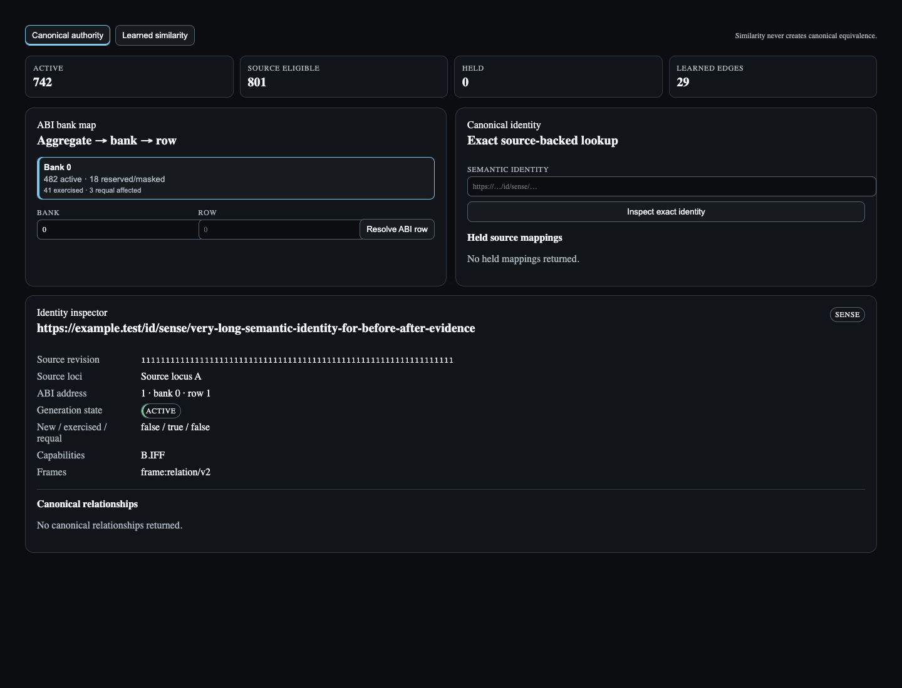
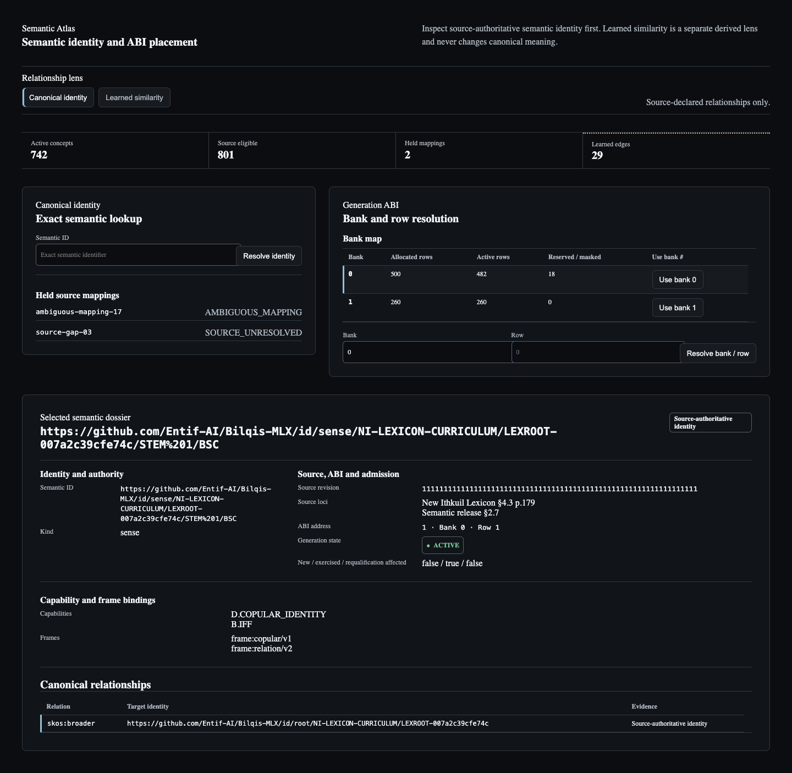
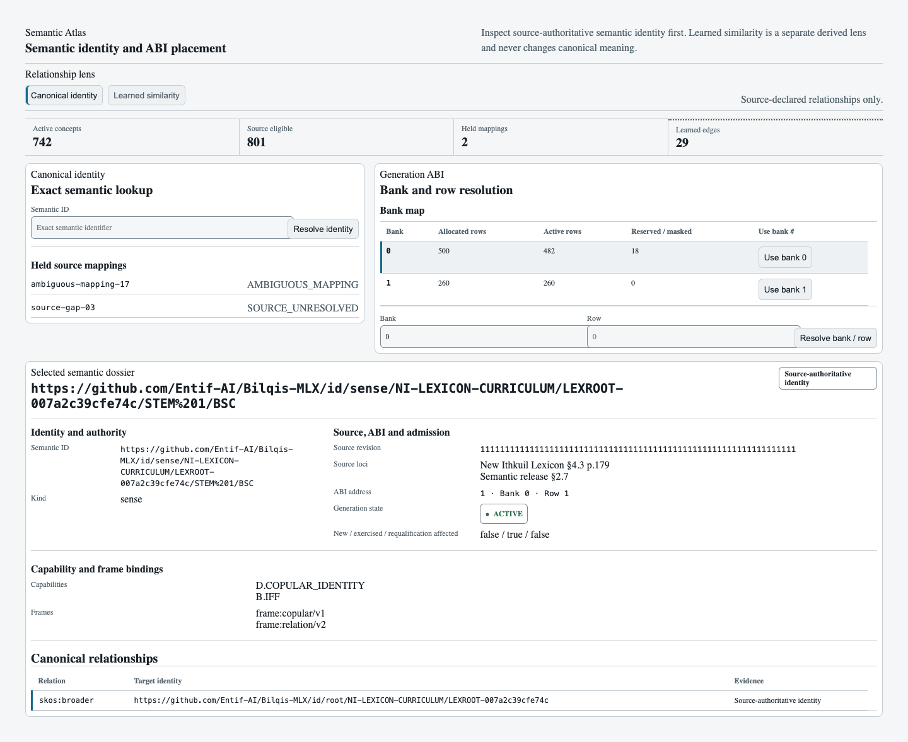

# Semantic Atlas workspace — #1133

As of 2026-11-14. Target: VIEW-D-005, COMP-D-501..505 and COMP-D-521,
including owned descendants. Initial unified source:
`dada27e8b1776e0fb7917c61bd8df141a210f93a`. Parent #1124 contains the
explicit human design-ratification receipt, and design PR #1145 is merged.
Before final qualification this branch consumed current unified
`27744c66227da7c93e866c054cab3fee898b2594` without conflict.

## Result and authority boundary

The workspace now leads with source-authoritative semantic identity and ABI
placement. Canonical relationships and learned similarity are separate lenses:
the canonical lens carries source authority; the learned lens is explicitly
derived and says that similarity does not create identity, equivalence,
prerequisite, or causal claims. Learned edges cannot enter the canonical lens.

Aggregate counts are a compact orientation strip rather than KPI cards. Exact
semantic lookup and bank/row resolution are compact work controls. The selected
semantic dossier is document-shaped and orders identity/authority, source/ABI,
generation state, capability/frame bindings, and relationship evidence. Long
semantic IDs, source loci and machine values wrap instead of truncating. Wide
ABI and relationship tables own local keyboard-focusable scrolling.

Request states replace prior content cleanly. Loading is a live status; failure
is an alert; a selected source identity without an exact generation projection
gets an explicit no-projection state rather than silently implying current ABI
truth. Historical ABI lookup remains generation-scoped. No learner, teacher,
optimizer, source authority, or control-plane mutation semantics changed.

## Copy and test hooks

All new static Atlas application copy is in `i18n-atlas.mjs` under stable
`atlas.*` tokens and is rendered through the existing translator. Semantic IDs,
machine states, reason codes, source loci, references, bank/row values and other
source-returned values remain data rather than translated application copy.

Interactive controls and meaningful state/detail regions expose stable unique
`atlas-*` hooks. The Atlas controller and owned tests locate interactive forms
through `data-test-id`, not text, CSS classes, or DOM IDs. Repeated held rows,
banks and relationship rows receive scoped unique hooks.

## Structural interruption required by AGENTS.md

While using Teacher as a landed redesign reference, the task encountered the
project-authored `teacher.css` at 536 lines, above the repository's structural
threshold. The #1133 task was preserved in BIOS Work Stack, then that file was
split before Atlas work continued:

- `teacher-core.css`: 200 lines;
- `teacher-detail.css`: 197 lines;
- `teacher-comparison.css`: 138 lines;
- `teacher.css`: 3 import lines.

The finite Electron renderer-asset allowlist and its exact test expectation were
updated for the split files. The split is presentation-only; Teacher behavior
and selectors are unchanged. The renderer-protocol test passed immediately after
the interruption, and `git diff --check` is clean after whitespace normalization.

## Focused verification and browser evidence

- Atlas/domain-context/accessibility/renderer-protocol focused seam: **32/32
  passed** after composing current unified.
- Chromium fixture uses the production renderer asset allowlist and the same
  synthetic semantic evidence for baseline and candidate renders.
- Candidate browser journey proves source-authority priority, derived-similarity
  separation, exact ABI/source fields, canonical/learned relation separation,
  and unique rendered hooks.
- Axe WCAG 2 A/AA, 2.1 AA and 2.2 AA reports **zero violations** for the owned
  Atlas micro-surface in dark/comfortable 1440px, light/compact 1440px,
  dark/comfortable 390px and light/compact 320px.
- All four variants report zero document horizontal overflow. RTL plus WCAG text
  spacing and `prefers-reduced-motion` also reflow without document overflow.
- The browser proof deliberately caught and repaired a narrow RTL overflow: the
  relationship table originally lacked the local scroll wrapper already used by
  the ABI table. The repaired table retains full exact values rather than
  truncating them.

Structured result:
`output/playwright/1133/browser-result.json`.

### Before — initial unified source

### After — dark, comfortable, 1440px

### After — light, compact, 1440px

[Narrow dark](../../../../output/playwright/1133/after-dark-comfortable-390.png) ·
[Narrow light](../../../../output/playwright/1133/after-light-compact-320.png) ·
[RTL/text spacing/reduced motion](../../../../output/playwright/1133/after-rtl-text-spacing-320.png).

This rendered evidence is synthetic and read-only. It proves the owned UI
contract and accessibility checks above; it does not prove neural competence or
semantic-source correctness. Real screen-reader and human usability testing were
not performed, so automated axe results are not a universal WCAG certification.

## Final qualification

Final composed-tree qualification against current unified
`27744c66227da7c93e866c054cab3fee898b2594`:

- `verify:leaf`: **PASS** with quality/structure/governance green, static
  adaptation-source authority green, flow-control green, differential gate
  correctly reused/skipped for the UI-only delta, **301/301 Mission Control UI
  tests**, **53/53 Electron security tests**, and **6/6 Python bridge tests**.
- Mission Control Python discovery: **80/80 passed**. Python 3.14 emitted
  `ResourceWarning` messages for unclosed SQLite connections during teardown;
  the suite still exited `0`. This leaf does not modify that backend lifecycle.
- The fresh worktree initially lacked the checked-in npm dependency tree, so the
  first security pass failed only on missing `ajv/dist/2020`. `npm ci
  --ignore-scripts` restored dependencies from the lockfile; the unchanged
  security suite then passed completely.
- The required Teacher stylesheet split initially exposed three tests that read
  only the former monolithic `teacher.css`. Those companion tests now inspect the
  runtime-composed split style surface and pass without weakening any assertion.
- `git diff --check`: **PASS**.

Hosted CI status belongs to the PR/issue turn-in receipt because it is produced
after the immutable review head is pushed. Human review and merge remain separate
from engineering completion; issue #1133 stays open until the accepted change
lands on unified.
