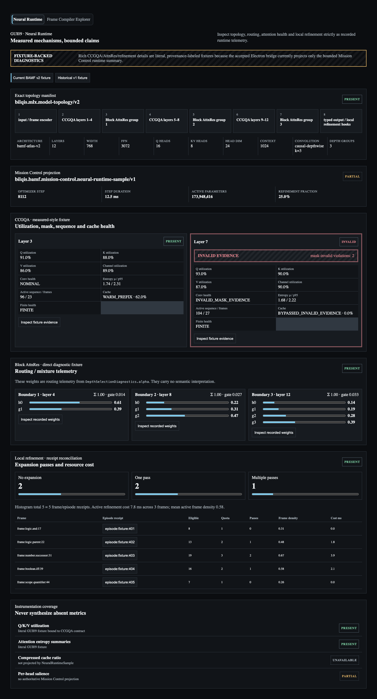
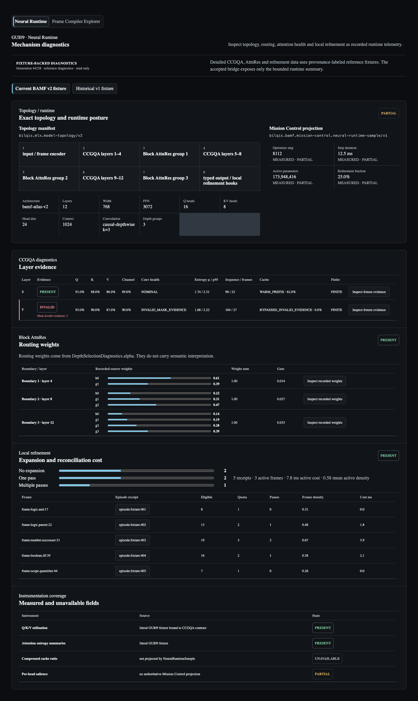
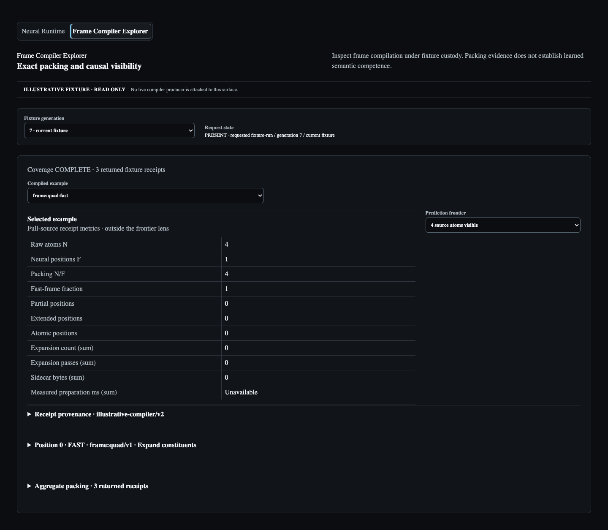

# Model runtime and Frame Compiler Explorer — #1134

As of 2026-11-14. Target: VIEW-D-006, COMP-D-601..606 and COMP-D-611,
including the former Frame descendants COMP-D-607..610 as internal sections of
the target Frame workspace. Initial unified source:
`490e86e1a284fd03c3824e0bce656d658df0052c`. Parent #1124 contains the
explicit human design-ratification receipt, and design authority PR #1145 is
merged.

## Result and authority boundary

Model remains one destination with two peer workspaces: Neural Runtime and Frame
Compiler Explorer. Neural Runtime now follows the governed mechanism hierarchy:
topology/runtime first, then CCGQA and Block AttnRes diagnostics, local
refinement, and instrumentation coverage. The redesign does not convert measured
runtime facts, fixture diagnostics, missing instrumentation, or routing weights
into claims about learned semantic competence.

The detailed CCGQA, AttnRes, refinement and Frame data remains explicitly
fixture-backed and read-only. Historical neural topology does not borrow current
CCGQA, AttnRes or refinement evidence. Unsupported dimensions render quiet
`UNAVAILABLE` states instead of synthetic zeros. Invalid CCGQA mask evidence
remains structurally distinct from an ordinary warning and retains its literal
violation count.

Frame Compiler Explorer is now a coherent peer workspace rather than a loose
stack of controls and receipts. Generation/request context leads, exact compiled
example selection follows, selected packing and prediction-frontier controls
share one work surface, and exact compiler/source/manifest/position receipts stay
available through progressive disclosure. The existing Frame query epoch,
historical context custody, stale-response rejection and shell-context restoration
semantics are unchanged.

## Copy, controls and test hooks

All static human-facing copy owned by the redesigned Model surfaces resolves
through `foundation/i18n-model.mjs`. This includes topology-path labels and
instrumentation descriptions that previously came from English fixture/model
strings. Exact machine states, source/provider identities, evidence IDs, frame
IDs, digests, semantic IDs and measured values remain literal data.

Owned interactive controls and meaningful state/detail regions expose stable
`model-*` `data-test-id` hooks. Frame-shell production selectors and companion
tests now use those hooks rather than incidental DOM IDs or `data-frame-*`
attributes. Repeated layer, boundary, receipt and position hooks are scoped by
their stable identity/index and are unique within a rendered workspace.

## Browser-discovered repairs

The comparative browser harness found two product defects and one evidence-harness
defect before turn-in:

- Runtime metrics initially placed source/coverage metadata beside `dt`/`dd`
  nodes inside a definition-list group. Axe reported the invalid structure. The
  metadata now lives inside the owning value cell.
- At 320px under RTL plus WCAG text spacing, a long AttnRes diagnostic identifier
  and a fixed refinement-histogram grid expanded the document. Diagnostic tables
  now keep their overflow coordinate system local, long doctrine text can wrap,
  and the narrow histogram recomposes without truncating values.
- The first synthetic Frame screenshot left Neural Runtime visually selected and
  captured Frame before exact-example selection. The harness now sets the correct
  peer state and captures the full selected-example workspace. No product code
  depended on that fixture-nav mistake.

The final topology path uses four balanced desktop columns for its eight stages,
with two and one-column recomposition at narrower widths. The prediction-frontier
control now aligns with the top of selected-example metrics rather than hanging at
the bottom of the block.

## Focused and rendered verification

- Model/Frames/domain-context/renderer-protocol focused seam: **43/43 passed**.
- `git diff --check`: **PASS**.
- Chromium comparative fixture uses the production renderer asset allowlist. The
  baseline Neural screenshot is rendered from the initial unified source by
  `git show`; candidate Neural and Frame workspaces use the feature-tree modules.
- The browser journey proves peer-workspace separation, mechanism-first Neural
  hierarchy, explicit fixture posture, historical unavailable semantics,
  progressive Frame receipts, exact historical Frame custody and unique hooks.
- Axe WCAG 2 A/AA, 2.1 AA and 2.2 AA reports **zero violations** for both owned
  workspaces in dark/comfortable 1440px, light/compact 1440px,
  dark/comfortable 390px and light/compact 320px.
- Every variant reports zero document horizontal overflow. RTL plus WCAG text
  spacing and `prefers-reduced-motion` also reflow without document overflow.

Structured result:
`output/playwright/1134/browser-result.json`.

### Before — initial Neural Runtime

### After — Neural Runtime, dark / comfortable / 1440px

### After — Frame Compiler Explorer, dark / comfortable / 1440px

[Neural narrow](../../../../output/playwright/1134/after-neural-light-compact-320.png) ·
[Frame narrow](../../../../output/playwright/1134/after-frame-light-compact-320.png) ·
[Neural RTL/text spacing](../../../../output/playwright/1134/after-neural-rtl-text-spacing-320.png) ·
[Frame RTL/text spacing](../../../../output/playwright/1134/after-frame-rtl-text-spacing-320.png).

The rendered evidence is synthetic and read-only. It proves the owned UI,
presentation, reflow and automated accessibility contracts. It does not prove
neural competence or semantic-source correctness. Automated axe output is not a
universal WCAG certification, and no real screen-reader or human usability study
was performed in this leaf.

## Structural interruption required by AGENTS.md

Before final qualification, #1134 consumed current unified
`7b79ef85b1b7fad87918066b8ca2e048ddc24936`. That merge was conflict-free, but
the newly landed Salience redesign introduced a 566-line project-authored
`salience.css`. Repository governance requires an immediate structural repair
when such a file is encountered during integration review, so the already
committed #1134 state was preserved and the dependent repair was completed before
Model verification resumed.

The Salience stylesheet is now presentation-only split into:

- `salience-core.css`: 220 lines;
- `salience-evidence.css`: 120 lines;
- `salience-analysis.css`: 226 lines;
- `salience.css`: 3 ordered imports.

The Electron renderer allowlist and the two tests that inspect the full Salience
style surface were updated for the split. No Salience selector, declaration,
view logic or product behavior was intentionally changed. The independent
structural-interruption seam passed **37/37** tests, and all authored stylesheet
modules are below the repository threshold.

## Final qualification

Final composed-tree qualification against unified
`7b79ef85b1b7fad87918066b8ca2e048ddc24936`:

- focused Model/Frames/domain-context/renderer-protocol seam: **43/43 PASS**;
- final comparative Playwright/axe matrix: **PASS** with zero document overflow
  and zero owned-surface WCAG 2/2.1/2.2 A/AA violations in every recorded
  theme/density/width variant;
- `verify:leaf`: **PASS**;
- Admin Main Frame renderer: **335/335 PASS**;
- Electron security: **53/53 PASS**;
- Python bridge: **6/6 PASS**;
- structure/governance: **PASS**;
- static adaptation-source authority: **PASS**, companion tests **7/7 PASS**;
- BAMF flow control: **PASS**, companion tests **15/15 PASS**;
- Admin Main Frame Python discovery: **80/80 PASS**;
- `git diff --check`: **PASS**.

The fresh worktree initially lacked the lockfile dependency tree. `npm ci
--ignore-scripts` restored the checked-in Node dependencies before the security
gate; no dependency versions were changed. Python 3.14 emitted `ResourceWarning`
messages for unclosed SQLite connections during Admin Main Frame test teardown;
the suite still exited `0`, and this UI leaf does not modify that backend
lifecycle.

No new design deficiency requiring an amendment to #1124 was discovered during
implementation. Hosted CI status and the exact immutable review head are recorded
on the issue/PR after push. Human review and merge remain a separate boundary.
