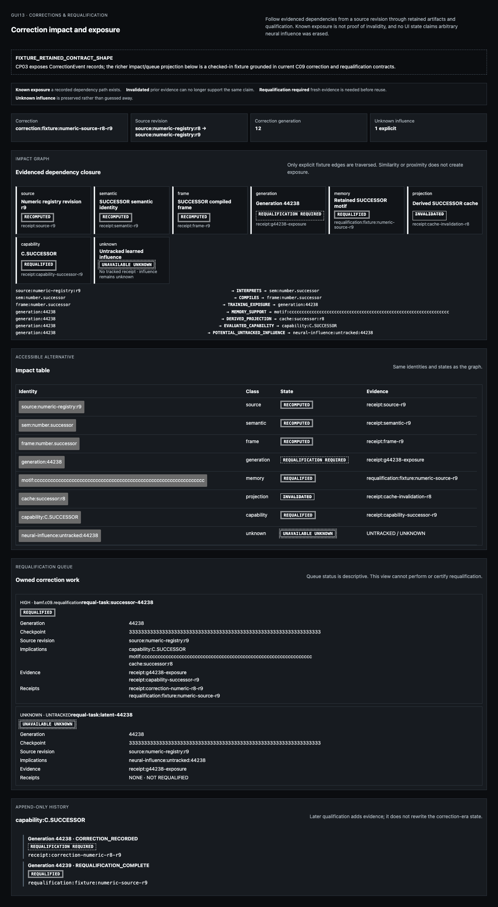
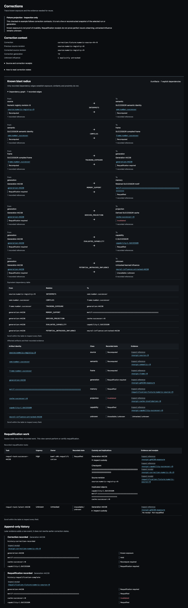

# Corrections workspace — #1138

As of 2026-11-14. VIEW-D-010 / COMP-D-1001..1005, all descendants; FLOW-D-011.
Parent design ratification: #1124 comment 6886007666. Initial unified source
`9add9b499d844f23b99067cab37e679761a31604`; engineering sync
`1f13ba2753f95f39857c31d04705eca8de34eb59`. Final turn-in consumes the current
unified branch at `dada27e8b1776e0fb7917c61bd8df141a210f93a`. The only
integration conflict was the obsolete glossary assertion list; both Teacher and
Corrections removals were preserved and the scoped suite rechecked.

## Result and source boundary

The workspace distinguishes compact correction context, a primary known-exposure
instrument, an analytical requalification queue, and chronological append-only
history. The artifact table leads. The adjacent native disclosure contains the
complete directed-edge diagram and equivalent dependency table. History shows
all recorded artifact transitions, not only the previous hardcoded capability.
Long IDs/refs wrap; wide tables own named, keyboard-accessible scroll regions.

The source model and fixture are unchanged. Their eight artifacts, seven edges,
two queue tasks and two history events remain synthetic. Workspace and inspector
explicitly say **fixture projection**, including under live/historical lenses
and when a Corrections route is reloaded. Known exposure, invalidated evidence,
unknown influence, untracked ownership, missing receipts and receipt-backed
requalification remain distinct. No perfect neural unlearning is claimed.

Exact artifacts and receipts remain locally inspectable. Native owner/Evidence
mapping for this richer fixture projection is unproven; those inspector actions
are disabled with a reason, and shell navigation functions preserve the boundary.
An operator can separately search Evidence using the exact reference. The leaf
does not invent a live C09/CP03 projection. Other source-backed selection routes
and global shell context are unchanged. No runtime/provider/training mutation.

## Inventory disposition

| Current inventory, including descendants | Target | Disposition |
| --- | --- | --- |
| CUR-COMP-1001 | COMP-D-1001 | Transform to compact definition-list context, exact revisions/generation, unknown count, authority note and receipt disclosure. Move glossary guidance to native disclosure. |
| CUR-COMP-1002 | COMP-D-1002 | Transform the card grid into an explicit directed-edge diagram; each endpoint has label, exact identity, kind, state and evidence count. Retain only recorded edges. |
| CUR-COMP-1003 | COMP-D-1003 | Retain complete artifact identity/class/state/evidence table and selection. Add the explicit From/Relation/To equivalent edge table. |
| CUR-COMP-1004 | COMP-D-1004 | Transform task cards to aligned Task/Urgency/Owner/State/Custody/Evidence table. Preserve checkpoint/revision/implication details and explicit missing receipts. |
| CUR-COMP-1005 | COMP-D-1005 | Transform single-capability history into full immutable event chronology, stable event IDs, all recorded transitions and exact receipt inspection. |

All new application copy uses `corrections.*` tokens and named parameters through
the existing translator. Four shared inspector tokens live in `i18n-shell.mjs`.
Literal fixture/source labels, IDs, refs and machine values remain data. Test IDs
are scoped `corrections-*` exact/prefix hooks; graph/table and repeated-reference
scopes remain unique. Buttons include stable focus keys. Existing native
expanded disclosures survive inspector-triggered repaint. All browser selection
uses exact/prefix test hooks; obsolete glossary/source-copy assertions changed
with the owned surface. No existing browser journey selected Corrections UI.

## Verification

- **39 focused tests pass**: Corrections, shell state, layout and renderer asset
  closure. Source model/fixture tests retain their original contracts.
- **`verify:leaf` passes**: quality/structure/governance, source-authority and
  flow-control checks; differential Python gate correctly skips non-Python
  changes; **294 UI tests, 53 Electron tests, 6 Python bridge tests** pass.
- `quality:check` and structural ABI verification are recorded in local logs.
  Independent fingerprint enforcement remains advisory: the separate repository
  variable is absent. No semantic source changed.
- Backend/semantic proof is reused under the repository's unchanged-surface
  policy. No backend, semantic, dependency-manifest or test-policy files changed.
  The consumed baseline's [portable workflow](https://github.com/Entif-AI/Bilqis-MLX/actions/runs/43665803810)
  and [ABI workflow](https://github.com/Entif-AI/Bilqis-MLX/actions/runs/43665803759)
  passed. A full backend runner is not repeated for this UI leaf.
- Chromium executes actual `renderCurrentView` and `renderInspector` for graph
  selection, keyboard disclosure, exact receipt/reference callback types, full
  history, custody access, unique hooks, and fixture truth/navigation guards
  across live/historical and rehydrated selections.
- Red/green evidence covers new composition, fixture navigation guards, graph
  endpoint identity/kind/state and typed reference callbacks. The prior inspector
  posture flaw was source-observed; no pre-fix Electron launch is claimed.
- Pinned EGM `b3a35956759bf7f024af2ff061b2e0b44b438e4c`: independent GPT-6.1
  Terra High implementation-readiness **PASS** before coding; scoped correctness
  and drift **PASS / NO_DRIFT** after endpoint/callback repairs.
- PM-2026-11-14-002 filed with canonical native Sheet readback. Parent #1124
  deficiency/coordination checkpoint: comment 6887822034.

### Browser reproduction

With installed verification dependencies (none added to runtime manifests):

```sh
BILQIS_PLAYWRIGHT_MODULE=/absolute/path/to/playwright \
BILQIS_AXE_MODULE=/absolute/path/to/axe-core/axe.min.js \
node apps/mission-control/tests/browser/corrections-check.cjs
```

The local preview enforces the production renderer asset resolver and regenerates
screenshots and [structured results](../../../../output/playwright/1138/browser-result.json).
Full logs are preserved under `.local/1138/` in the feature worktree.

## Accessibility and rendered evidence

This is a Corrections micro-surface review, not whole-app certification.
Native buttons/details/table semantics, visible focus and target geometry were
reviewed against keyboard/focus criteria (2.1.1, 2.4.3, 2.4.7, 2.4.11), names,
roles and descriptions (4.1.2), non-color state/structure/contrast (1.3.1, 1.4.1,
1.4.3, 1.4.11), reflow/text spacing (1.4.10, 1.4.12) and target size (2.5.8).
The graph and tables preserve exact labels; unknown and missing evidence have
explicit copy. No motion or hover-only essential guidance was introduced.

Axe WCAG 2 A/AA, 2.1 AA and 2.2 AA report zero violations in dark/comfortable
1440px, light/compact 1440px, dark/comfortable 390px and light/compact 320px,
both with the dependency graph closed and open. All variants have zero document
overflow. Expanded translation, RTL/text spacing and reduced-motion cases also
retain reflow. 320px covers the width equivalent of 400% zoom at 1280px. Real
screen-reader/operator usability testing was not performed. These are rendered,
read-only fixture tests, not proof of actual correction or learner requalification.

### Before — consumed unified fixture



### After — dark, comfortable



[Light/compact](../../../../output/playwright/1138/after-light-compact-1440.png) ·
[Dependency graph](../../../../output/playwright/1138/after-graph-dark-1440.png) ·
[Narrow dark](../../../../output/playwright/1138/after-dark-comfortable-390.png) ·
[Narrow light](../../../../output/playwright/1138/after-light-compact-320.png) ·
[Expanded text](../../../../output/playwright/1138/after-expanded-320.png) ·
[RTL/text spacing](../../../../output/playwright/1138/after-rtl-text-spacing-320.png).

IPR-0220 remains open. Curriculum/source/coverage/retained-learning risks are
unchanged and unmeasured by this leaf. No actual student, own AdamW, teacher or
human-run state changed. Issue #1138 closes only after accepted merge readback;
human review/integration remains separate from engineering proof.
