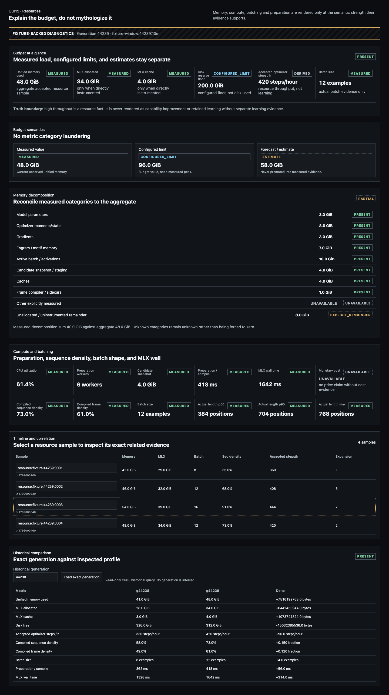
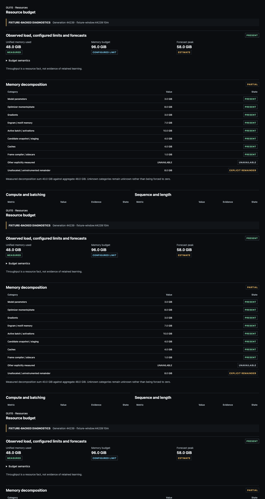

# Resources workspace — #1140

As of 2026-11-14. Target VIEW-D-012, COMP-D-1201..1206 and their descendants;
FLOW-D-012 and FLOW-D-018. Original unified baseline:
`dada27e8b1776e0fb7917c61bd8df141a210f93a`.
Human ratification: [#1124 receipt](https://github.com/Entif-AI/Bilqis-MLX/issues/1124#issuecomment-6886007666).

## Target and migration

| Current inventory, including descendants | Target | Disposition |
| --- | --- | --- |
| CUR-COMP-1201 headline | COMP-D-1201 | Transform into compact observed/budget/forecast readings; merge provenance/page state nearby. Move MLX, reserve, throughput and batch facts into aligned analytical tables. Retain the throughput/learning distinction. |
| CUR-COMP-1202 metric semantics | COMP-D-1202 | Transform static metric group into local native disclosure defining observations, settings and forecasts. Merge duplicated values into headline readings. |
| CUR-COMP-1203 decomposition/remainder | COMP-D-1203 | Transform into exact category/value/state table; retain unknown categories, measured sum and aggregate. Show signed unresolved remainder or overage with COMPLETE/PARTIAL/UNAVAILABLE reconciliation. |
| CUR-COMP-1204 compute/length | COMP-D-1204 | Transform metric tiles into compute and sequence/length tables, sharing desktop space and stacking on narrow screens. Retain every prior metric and add existing disk-free/disk-used fields to their proper analytical owner. |
| CUR-COMP-1205 timeline | COMP-D-1205 | Retain exact samples, timestamps, memory/MLX/batch/density/steps/expansion and inspection. Transform wide table into named keyboard-scrollable region. Preserve individual source/evidence/receipt refs and fixture episode/batch/checkpoint/preparation identities. No inferred causality or decorative chart. |
| CUR-COMP-1206 historical comparison | COMP-D-1206 | Retain exact read-only generation query; transform compact form/table and explicit requested-generation status. Empty results do not create a historical profile. |

All target constituents are represented by the mappings above. Prose, badges,
metric/category/unit labels, formatting templates, validation feedback and
inspector detail labels use `resource.*` catalog tokens. Record identities and
source-provided unknown machine states remain literal. The known CP03 page-window
label is localized at rendering. New modules join Electron's finite asset manifest.

## Conformance refinements

The original decomposition clamped category overage to zero and could mark unknown
categories COMPLETE. Signed remainder now remains visible; COMPLETE requires every
category to be finite/PRESENT and exactly reconcile with a finite aggregate.
One-byte values remain nonzero. Context, current-page and comparison request epochs
prevent late replies replacing newer intent. Repainting preserves comparison draft,
caret, focus and disclosure. Blank/unsafe generations cannot become implicit queries;
unsafe input exposes localized native validation and can be corrected.

Scope-drift audit: all changes inherit the issue's required target atoms, truthful
states, localization, test hooks, accessibility and recovery clauses.
`new_acceptance=false`; no new backend, trainer or authority requirement was added.

## Verification frontier

Pinned design readiness passed before implementation: [design receipt](design.md).
Independent drift findings were reproduced and repaired with focused regressions.
Final gate counts, rendered variants and independent re-review are recorded at turn-in.

The browser evidence uses synthetic read-only fixtures. No actual learner, optimizer,
teacher, source release or accepted checkpoint changed. Human review and merge remain
separate; #1140 stays open until its accepted implementation lands on unified.

## Turn-in evidence

Current unified `27744c66227da7c93e866c054cab3fee898b2594` was consumed by
merge `feb4d507`; the protocol allowlists merged cleanly. Its Corrections changes
were included in the subsequent leaf verification. Resource implementation source
was independently reviewed at `829d93df`; the final CSS-only refinement permits
expanded translated summary/state labels to wrap at word boundaries.

- Resources regressions: **30 passed**, including false completeness, signed
  overage, explicit zero, sub-MiB values, exact typed refs, empty comparison,
  unsafe generation recovery, late responses and historical event isolation.
- Final leaf: changed-file governance/structure, legacy-authority and flow-control
  checks passed; differential Python selector reported `skip/non-python-change`;
  **319 UI tests, 53 Electron tests and 6 Python bridge tests passed**.
- Full neural-inert `quality:check` passed before turn-in, including architecture,
  docs, error contracts, smells, legacy-authority and flow-control checks.
- Backend/semantic suites were not invalidated: no backend, semantic,
  dependency-manifest, workflow or test-policy surface changed from unified.
  Reuse follows AGENTS and the hosted UI-only impact policy. Baseline
  [portable run 43666514939](https://github.com/Entif-AI/Bilqis-MLX/actions/runs/43666514939)
  and [ABI run 43666514941](https://github.com/Entif-AI/Bilqis-MLX/actions/runs/43666514941)
  succeeded. The aggregate Python premerge runner was not repeated for this UI leaf.
- Pinned readiness: **PASS**; independent focused post-repair fidelity review:
  **NO_DRIFT** for all seven reported areas. See [review](drift.md).
- PM-2026-11-14-003 was filed and native-readback verified. Newly discovered
  deficiencies were appended to [#1124](https://github.com/Entif-AI/Bilqis-MLX/issues/1124#issuecomment-6888106258).

### Rendered and accessibility evidence

Chromium checks covered draft/caret/focus/disclosure preservation, exact sample and
typed-reference inspection, unique hooks, distinct current/comparison states,
measured zero versus unavailable, historical provenance, keyboard table scrolling,
expanded localization, RTL/text spacing, reduced motion and forced colors.

Dark/comfortable at 1440px and 390px, and light/compact at 1440px and 320px,
all have **zero document overflow and a 12px minimum visible text size**. Expanded
copy also fits 320px. Tables retain their own scrolling and sticky identities.
320px exercises the width equivalent of 400% zoom at a 1280px viewport.
Axe WCAG 2/2.1/2.2 A/AA checks report **zero violations** in all four primary
variants. Manual review covered readable contrast/non-color states, visible focus,
input names, table headers, target geometry and error recovery. These checks do not
claim full WCAG certification or real screen-reader/operator usability testing.

[Browser results](../../../../output/playwright/1140/browser-result.json) ·
[Additional checks](../../../../output/playwright/1140/extra-result.json) ·
[Axe results](../../../../output/playwright/1140/axe-result.json).

Before and after show the same isolated Resources fixture workspace, without shell
chrome. Whole-application integration and operator visual acceptance remain #1143.

[After light](../../../../output/playwright/1140/after-light-compact-1440.png) ·
[Narrow dark](../../../../output/playwright/1140/after-dark-comfortable-390.png) ·
[Narrow light](../../../../output/playwright/1140/after-light-compact-320.png) ·
[Expanded copy](../../../../output/playwright/1140/after-expanded-320.png) ·
[RTL/text spacing](../../../../output/playwright/1140/after-rtl-spacing-320.png) ·
[Historical/forced colors](../../../../output/playwright/1140/after-historical-forced-colors-320.png).

### Final synchronization

Before PR admission, unified advanced to `b621e1bb3195fe739a1916e32d46c7b605b5e510`
with the Home redesign. Merge `e735381c7b64c4ef622dc49211875527f775a13c` consumed it.
The affected Resources/translator imports, layout and Electron protocol closure
passed **41 scoped tests** afterward. Prior behavioral and visual evidence remains
valid: this intake changed no Resources runtime or style source. The earlier full
leaf and static evidence is reused for unaffected surfaces.

Scope-drift audit after integration commits: every changed Resources obligation
still maps to #1140's inherited acceptance; synchronization and review receipts
add no feature scope or new acceptance.

### Narrow-table correction and final intake

Final screenshot inspection found that sticky category labels could consume the
narrow scroller and conceal values. At widths through 640px, identity columns now
use 40vw with word wrapping; numeric columns remain visible and the rest retain
local scrolling. The browser regression requires five explicit identity hooks and
bounds each identity column to 35–55% of the viewport. Measured widths are 128px
at 320px and 156px at 390px. Updated screenshots, expanded-copy checks and axe
checks pass. Independent focused review found no additional design drift.

The final active repair consumed unified `9cc037d8d67d34fc548b76d7a2375c53ddfb23a7`
through merge `40e04c95fc9e3a0c0045bfd43eb3c75e0ea351c9`. The Resources,
layout and finite-asset dependency closure passed **42 tests** after the new
identity-hook regression (31 Resources cases). Unchanged backend/semantic and
unaffected UI evidence remains reused; hosted checks qualify the final PR head.

### Merge boundary and bounded follow-up

Human merge of PR #1155 landed the initial redesign at
`490e86e1a284fd03c3824e0bce656d658df0052c` while final narrow-screen review was
still in progress. That merge contains source head `f6a7b9e9`, not the subsequent
narrow-table correction. Issue #1140 was reopened for this same original
presentation requirement. The verified correction is isolated on
`codex/1140-resources-narrow-followup-20261114`, which consumed `490e86e1`.
It adds no new acceptance or runtime policy. Its PR and hosted checks are a separate
review boundary; the initial PR's passing checks do not qualify this later source.
