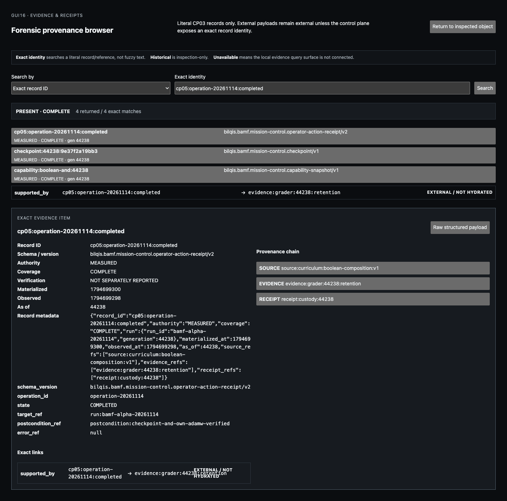
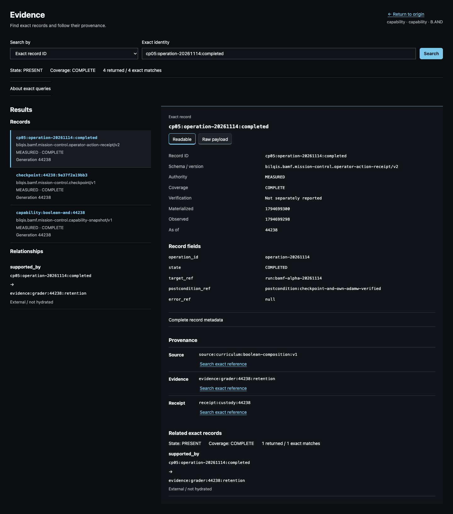
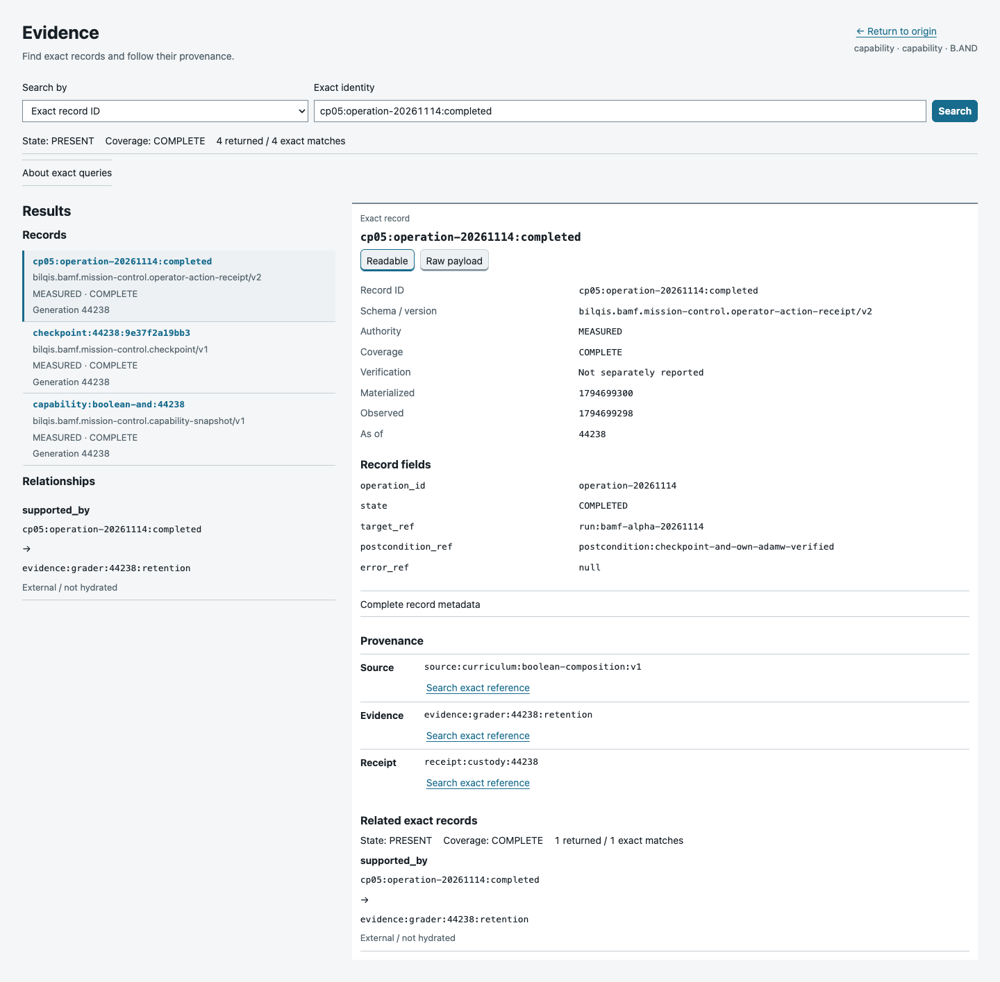

# Evidence workspace — #1141

As of 2026-11-14. Target: VIEW-D-013, COMP-D-1301..1306 and all descendants;
FLOW-D-003. Baseline: `dc9b881e20b8c825042e4697e60f396264d16156` on
`codex/bamf-unified-base-20261028`. Parent #1124 ratification receipt:
[6886007666](https://github.com/Entif-AI/Bilqis-MLX/issues/1124#issuecomment-6886007666).

## Result and migration

The query row and its live status lead into a record/relationship list and a
larger exact-record document. At narrow widths they stack in reading order.
Readable fields lead; raw JSON is an explicit mode. Exact values wrap or own
local scrolling. Source / Evidence / Receipt groups retain literal references
and exact search actions. The return action names the retained destination and
object. Missing evidence, truncation and traversal failure remain visible.

| Current inventory | Target | Disposition |
| --- | --- | --- |
| CUR-COMP-1301, all descendants | COMP-D-1301 | Transform controls; move essential query help to native disclosure; retain bounded requests and stale-response cancellation. |
| CUR-COMP-1305, all descendants | COMP-D-1305 | Retain query states, alert/status semantics and returned/total/coverage/truncation; improve placement and legibility. |
| CUR-COMP-1302, all descendants | COMP-D-1302 | Transform independent record/relationship lists with exact identity and explicit selected posture. |
| CUR-COMP-1303, all descendants | COMP-D-1303 | Transform readable/raw modes, literal fields, metadata disclosure, grouped references and selected-record links. |
| CUR-COMP-1306, all descendants | COMP-D-1306 | Retain degraded markers, unresolved external references and traversal failure; expose selected-link bounds and preserve errors during pagination. |
| CUR-COMP-1304, all descendants | COMP-D-1304 | Retain shell-owned return semantics; add explicit origin identity. |

Query family/scoping, 16-record page size and 32-link bound remain unchanged.
Query and selection hydration have separate epochs. New searches cancel pending
selection work; bootstrap selection applies only to the initial automatic query.
Async paint preserves unsent query drafts, caret, focus and native disclosures.
The finite Electron asset manifest includes the three new local modules.
No CSP, renderer privilege, provider, trainer or learner policy changed.

## Copy and hooks

All displayed Evidence application copy is in `evidence-messages.mjs` under
stable `evidence.*` tokens using the existing translator with named parameters.
Literal record fields/values, schemas, reasons and references remain data.
`foundation/current-view.mjs` uses the same token for the Evidence summary.

All interactive Evidence elements and meaningful state/detail regions expose
`evidence-*` hooks. Repeated records, links and references use reversible identity
suffixes plus per-identity occurrence counts, with separate scopes. No rows are
dropped to make IDs unique. Browser selection uses exact hooks or documented
prefix groups exclusively. Existing Evidence unit tests assert markup content,
not text-based DOM locators; no other existing browser journey selects Evidence
UI elements. The obsolete glossary/uppercase-source assertions were replaced.

## Verification

- Focused Evidence/layout/shell/security/protocol suite: **56 passed**.
- Mandatory leaf stages: quality checks and differential gate passed (Python
  selector correctly reports `skip/non-python-change`); **281 UI tests passed**.
- Initial security stage lacked the checkout's installed `ajv` dependency. After
  `npm ci --ignore-scripts`, **53 Electron tests and 6 Python bridge tests passed**.
- Pre-turn-in `quality:check`: governance, architecture, docs, error contracts,
  smells, legacy-authority and flow-control checks passed.
- ABI checker passed structural checks in advisory mode. The independently
  controlled `BILQIS_EXPECTED_ABI_SHA256` repository variable is absent; external
  fingerprint enforcement is not claimed. No semantic source changed.
- Backend/semantic expensive suites are reused under AGENTS passing-evidence and
  the hosted UI-only impact policy. Baseline portable workflow
  [43662084745](https://github.com/Entif-AI/Bilqis-MLX/actions/runs/43662084745)
  and ABI workflow
  [43662084819](https://github.com/Entif-AI/Bilqis-MLX/actions/runs/43662084819)
  succeeded. No backend, semantic, dependency-manifest, test-policy or workflow
  surface changed; the aggregate backend runner was not repeated for this leaf.
- Chromium browser journey passes concurrency, draft/caret/disclosure custody,
  stale bootstrap and fresh-query cancellation, exact traversal/reference
  requests, raw parity, explicit return callback, paging recovery/focus and
  loading/empty/partial/stale/missing/denied/unavailable/unknown/disconnected
  states. Traversal errors remain visible in raw mode.
- Red evidence: baseline controller fails the selection-during-pagination test.
  Candidate missing Electron assets, pagination error preservation and pending
  bootstrap reset each failed a regression before repair.
- Pinned EGM `b3a35956759bf7f024af2ff061b2e0b44b438e4c`: GPT-6.1 Terra,
  High reasoning, scoped implementation-readiness **PASS** before coding;
  independent correctness/drift review **PASS / NO_DRIFT** after repairs.
- Incident **PM-2026-11-14-001** filed/enriched and native Sheet readback verified.
  It distinguishes runtime reproductions, source predictions and protocol
  closure proof. It does not claim a pre-fix Electron launch occurred.

### Browser reproduction

Use installed Playwright and axe-core paths (verification tools only; no runtime
dependency is added):

```sh
BILQIS_PLAYWRIGHT_MODULE=/absolute/path/to/playwright \
BILQIS_AXE_MODULE=/absolute/path/to/axe-core/axe.min.js \
node apps/mission-control/tests/browser/evidence-check.cjs
```

The finite local preview enforces the production renderer asset resolver. It
runs `evidence-journey.mjs` and regenerates the screenshots/result below. Full
logs are retained in the task worktree at `.local/1141/`.

## Accessibility and rendered evidence

Scope: Evidence micro-surface, not whole-application conformance. Reviewed
keyboard and focus order/visibility/recovery (2.1.1, 2.4.3, 2.4.7, 2.4.11), native
names/roles/states and live errors (4.1.2, 4.1.3, 3.3.1–3.3.2), structure/non-color
cues/contrast (1.3.1, 1.4.1, 1.4.3, 1.4.11), 320px reflow/text spacing (1.4.10,
1.4.12), target size (2.5.8) and reduced-motion behavior. No animation or hover-only
guidance is introduced. Raw/structured scrollers are keyboard-focusable and named.

Automated axe WCAG 2 A/AA, 2.1 AA and 2.2 AA checks report **zero violations** in
dark/comfortable 1440px, light/compact 1440px, dark/comfortable 390px and
light/compact 320px. Each has zero document overflow. Expanded translation,
RTL/text spacing and reduced-motion cases also retain reflow. 320px exercises
the width equivalent of 400% zoom at a 1280px viewport. Real screen-reader use
and operator usability testing were not performed; automated checks are not a
universal WCAG certification. Fixtures are synthetic read-only browser evidence.

[Structured browser result](../../../../output/playwright/1141/browser-result.json).

### Before — same synthetic receipt, 1440px



### After — dark, comfortable, 1440px



### After — light, compact, 1440px



[Narrow dark](../../../../output/playwright/1141/after-dark-comfortable-390.png) ·
[Narrow light](../../../../output/playwright/1141/after-light-compact-320.png) ·
[Expanded translation](../../../../output/playwright/1141/after-expanded-320.png) ·
[RTL/text spacing](../../../../output/playwright/1141/after-rtl-text-spacing-320.png).

## Boundary

This leaf changes presentation and its local async lifecycle. IPR-0220 remains
open; semantic/source/retained-learning claims are unchanged and unmeasured by
this work. No actual student, matching AdamW, teacher or human-run state was
modified. Human review/integration remains separate from engineering completion;
issue #1141 stays open until its accepted change lands on unified.
