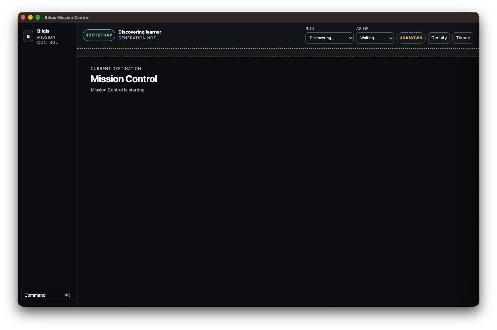
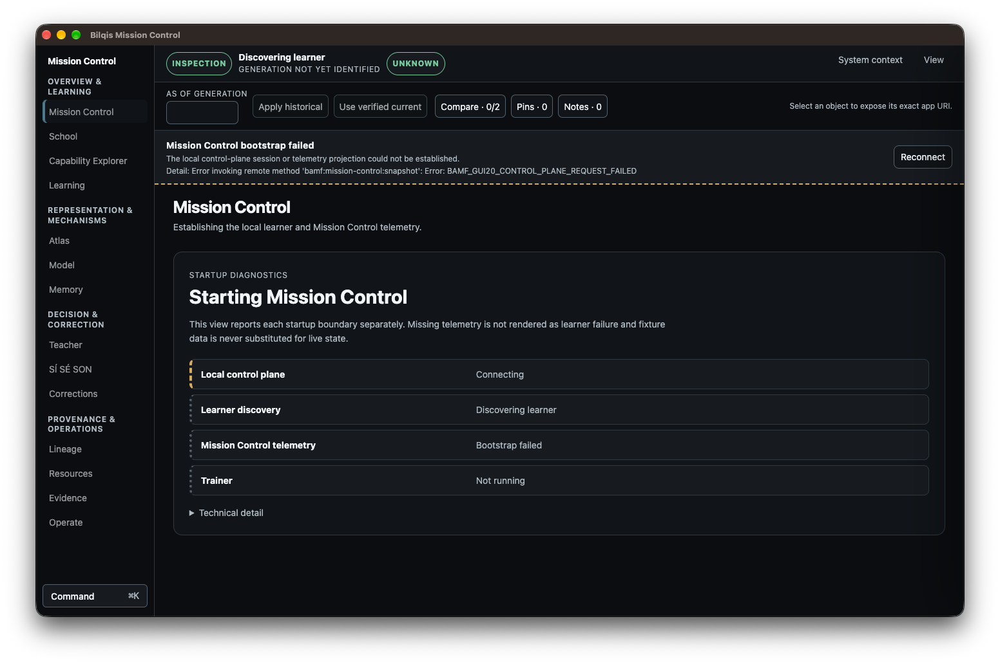

# Admin Main Frame shell #1127 visual QA

Issue: #1127. Baseline: `dc9b881e20b8c825042e4697e60f396264d16156`.

## Compared states

The native Electron application was inspected before and after the shell recomposition at the real 1440 x 920 desktop window. The candidate was also exercised at 760 px width, in dark/comfortable and light/compact modes.

Baseline screenshot:

Candidate screenshot:

## Observed shell changes

The candidate removes the standalone `B` mark and replaces the flat destination rail with the four atlas task families while preserving direct access to all 14 destinations. The context bar is one orientation band: run, generation, freshness, and mode stay visible, while topology, factory, semantic, resource, and related facts move behind System context disclosure.

The duplicate shell run/generation selectors are gone. The existing global time lens remains the generation authority. View settings move behind a separate disclosure. The destination header now contains only destination identity, purpose, and historical posture when applicable.

Defensive presentation uses borders, text, and status structure without striped or wallpaper backgrounds. The command palette uses the same task groups as persistent navigation and keeps theme/density commands subordinate to destination navigation.

## Responsive and theme evidence

At the default desktop window, dark/comfortable and light/compact both preserve canvas/surface separation and keep persistent shell chrome subordinate to destination work.

At a 760 px Electron window in light/compact mode, DevTools measurements were:

| Surface | Client width | Scroll width | Result |
| --- | ---: | ---: | --- |
| Document | 745 px | 745 px | no page overflow |
| Body | 745 px | 745 px | no page overflow |
| Context bar | 745 px | 745 px | contained |
| Navigation | 706 px | 1245 px | intentional local horizontal scroll |

Navigation labels remain complete at the supported narrow width. The responsive mode does not collapse destinations to initials. Task families remain visible and the navigation owns its horizontal overflow instead of widening the page.

## Accessibility and state review

The shell keeps skip navigation, roving navigation, focus transfer to destination headings, live-region announcements, reduced-motion handling, forced-colors handling, and explicit defensive roles. Long machine identities remain visually compact but expose the exact value through an accessible label.

All shell-owned labels, status copy, destination purpose text, bootstrap diagnostics, and view-setting labels route through stable i18n keys. Stable `data-test-id` hooks cover shell navigation, context chrome, destination header, command palette, settings controls, and School/Model peer navigation.

## Acceptance result

Visual acceptance passed for the issue-owned shell surface. The candidate preserves destination semantics and control-plane authority while reducing persistent chrome, retaining exact context identity, preserving full navigation labels, and containing responsive overflow.
